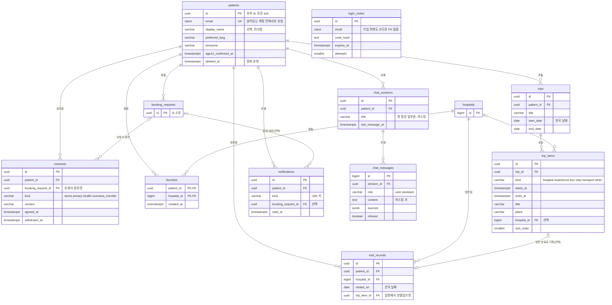
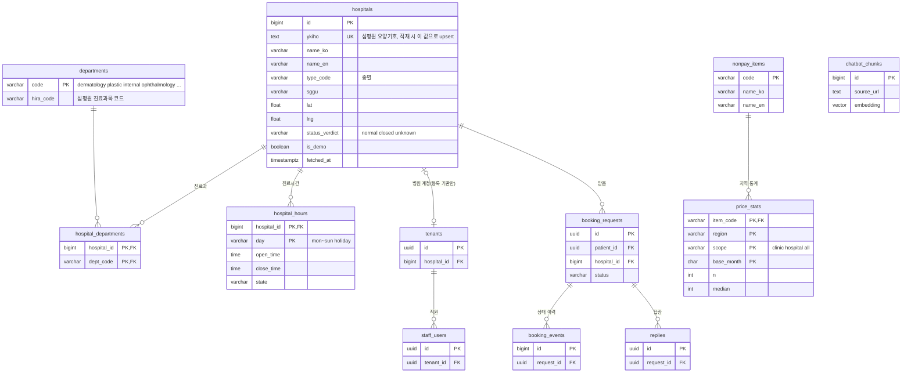

# backend-db-schema.md — DB 스키마 (전체, 초안 v3)

> 작성 2026-11-03 · v2·v3 같은 날 (v2 관계도·테이블 점검, v3 마이페이지 와이어프레임 반영: 방문 기록 저장, 조회 기록은 브라우저에만 → 맨 아래 변경 이력) · A (backend-A-auth)
> 상태: **제안** (B 검토 → 확정 후 B가 마이그레이션)
> 근거: [backend-plan.md](backend-plan.md) 4절, [backend-contracts.md](backend-contracts.md), 프론트 마이페이지 (`origin/frontend` `apps/web-platform/src/features/mypage/`, 커밋 f8da9c6)
> DB: PostgreSQL + pgvector (결정 2). 시간은 UTC `timestamptz` (결정 4)

## 0. 요약

| 묶음 | 테이블 | 주인 | 이번에 새로 |
|---|---|---|---|
| 공공 정보 (읽기 전용) | `hospitals`, `departments`, `hospital_departments`, `hospital_hours`, `nonpay_items`, `price_stats`, `chatbot_chunks` | A | `departments`, `price_stats.scope`, `hospitals.status_verdict` |
| 환자 계정 | `patients`, `login_codes`, `consents` | A | `patients.display_name` |
| 마이페이지 | `favorites`(찜), `visit_records`(방문 기록), `trips`(여행), `trip_items`(일정 항목), `notifications`(알림함) | A | **전부 새로** |
| 브라우저에만 (DB 아님) | 조회 기록, 방문 체크리스트 체크 상태 | 프론트 | 쿠키(사이트 데이터) 삭제하면 사라짐. 조회 기록은 30일 안 보면 삭제 |
| 챗봇 | `chat_sessions`, `chat_messages` | A | **새로** (로그인 사용자만 저장) |
| 병원 쪽 | `tenants`, `staff_users`, `booking_requests`, `booking_events`, `replies`, `availability`, `audit_logs`, `llm_usage` | B | 변경 없음 (관계도에만 표시) |

결정 반영 (2026-11-03, 사용자 답변)
- 찜 = **병원만**
- 여행 일정 = **한 계정에 여러 개**, 항목은 **직접 추가**만 (예약 요청 자동 연결 X)
- 챗봇 대화 = **로그인했을 때만 저장**, 비로그인은 저장 X
- 추가 기능 = **알림함, 최근 본 병원, 준비물 체크리스트**
- 마이페이지 와이어프레임 (2026-11-03): 요약 카드 = 저장한 병원 · **방문 기록(계정에 저장, 리뷰 X)** · **조회 기록(브라우저에만, 30일)**, 그 아래 나의 대구 일정 · 방문 체크리스트, 맨 아래 내 계정 · 개인정보 처리방침 · 쿠키 정책 · 이용 약관 · 의료 관련법. 머리말에 언어(EN) · 알림 · 프로필
- 개인정보 항목은 프론트 코드 기준(인사말 이름 + 언어 설정), 수집 항목 안내는 **별도 개인정보처리방침 페이지** (8절에 넘길 목록)

## 1. 관계도

### 1-1. 환자 쪽 (A) — 계정·마이페이지·챗봇



- `login_codes`는 가입 전 이메일에도 쓰므로 `patients`와 FK로 묶지 않음 (선이 없는 이유)
- 탈퇴 → `patients` 삭제 시 `consents`를 뺀 환자 쪽 테이블은 전부 같이 삭제(CASCADE). `consents`는 동의 증명이라 보관 규칙 따로 (10절)

### 1-2. 공공 정보 + 병원 쪽 (B) 연결



- `price_stats`는 **병원과 연결하지 않음** (병원별 가격 비교 X, [가격-표시-방식.md](../research/의료관광/가격-표시-방식.md))

## 2. 공공 정보 (적재 스크립트로 채움)

| 테이블 | 칸 | 비고 |
|---|---|---|
| `hospitals` | `id` bigint PK, `ykiho` text UNIQUE, `name_ko`, `name_en`, `type_code`, `sggu`, `addr_ko`, `addr_en`, `tel`, `lat`, `lng`, `homepage`, `is_registered_facility`, `status_verdict`(`normal/closed/unknown`), `is_demo`, `source`, `fetched_at`, `updated_at` | 4,242곳. **행을 지우지 않음** — 재적재는 `ykiho`로 upsert, 없어진 병원은 `status_verdict='closed'` → `id`가 바뀌지 않아 찜·일정이 깨지지 않음. 목록·지도엔 `normal`만 |
| `departments` | `code` PK(프론트 키와 같게: `dermatology/plastic/internal/ophthalmology/…`), `hira_code`(심평원 `dgsbjtCd`) | 프론트 `dept.*` i18n 키 = `code` |
| `hospital_departments` | `hospital_id` FK, `dept_code` FK · PK(둘) | 필터용 |
| `hospital_hours` | `hospital_id` FK, `day`, `open_time`, `close_time`, `lunch_start`, `lunch_end`, `memo_ko`, `state`, `source`, `checked_at` · **PK(`hospital_id`, `day`)** | |
| `nonpay_items` | `code` PK, `name_ko`, `name_en`, `name_zh_tw`, `name_vi`, `reviewed` | |
| `price_stats` | `item_code` FK, `region`, `scope`(`clinic/hospital/all`), `base_month`, `n`, `min`, `max`, `mean`, `median`, `q1`, `q3`, `source` · PK(`item_code`, `region`, `scope`, `base_month`) | `data/processed/daegu_nonpay_price_stats.csv`. 기관 5곳 미만 저장 X |
| `chatbot_chunks` | `id`, `doc_id`, `source_url`, `fetched_at`, `lang`, `body`, `embedding vector(n)` | 공공 문서만 |

## 3. 환자 계정

### `patients`

| 칸 | 타입 | 필수 | 설명 |
|---|---|---|---|
| `id` | uuid PK | O | **유저 id**. 토큰 `sub`. 순번이 아니라 추측 불가 |
| `email` | citext | O | 로그인. **`deleted_at IS NULL`인 계정끼리만 UNIQUE** (부분 인덱스) → 탈퇴 후 파기 전에도 같은 메일로 재가입 가능 |
| `display_name` | varchar(30) | X | 인사말. 실명 아니어도 됨, 비우면 이메일 앞부분 |
| `preferred_lang` | varchar(8) | O | `ko/en/zh-TW/zh-CN/vi` |
| `timezone` | varchar(64) | O | IANA |
| `age14_confirmed_at` | timestamptz | O | 만 14세 이상 체크 시각 |
| `created_at`, `updated_at` | timestamptz | O | `updated_at`은 SQLAlchemy `onupdate` |
| `deleted_at` | timestamptz | X | 탈퇴 요청. 이후 모든 조회에서 제외, 파기 스크립트가 매일 삭제 |

- 국적·연락처·건강정보는 계정에 두지 않음 → 요청서에서만

### `login_codes`, `consents`

| 테이블 | 칸 | 점검 |
|---|---|---|
| `login_codes` | `id`, `email`, `code_hash`, `expires_at`, `attempts`, `used_at`, `created_at` | 인덱스 (`email`, `created_at`) — 시도 제한 조회용. 만료된 줄은 매일 삭제 |
| `consents` | `id`, `patient_id` FK, `booking_request_id` FK(선택), `kind` CHECK, `version`, `lang`, `agreed_at`, `withdrawn_at` | 탈퇴해도 **CASCADE로 지우지 않음** (동의 증명). `patient_id`는 `ON DELETE SET NULL` + 보관 기간 후 삭제 (팀 확인) |

## 4. 마이페이지

### `favorites` — 찜한 병원

| 칸 | 타입 | 설명 |
|---|---|---|
| `patient_id` | uuid FK CASCADE | |
| `hospital_id` | bigint FK | |
| `created_at` | timestamptz | 목록은 최근 찜한 순 |
| PK | (`patient_id`, `hospital_id`) | |

- 병원별 찜 수 집계·노출·정렬 X (추천·유인). 본인 목록만
- 찜한 병원이 나중에 `closed`가 되면 목록에 "폐업 확인됨" 표시 (지우지 않음, 사용자가 삭제)

### `visit_records` — 방문 기록 (계정에 저장, 리뷰 X)

| 칸 | 타입 | 필수 | 설명 |
|---|---|---|---|
| `id` | uuid PK | O | |
| `patient_id` | uuid FK CASCADE | O | |
| `hospital_id` | bigint FK | O | |
| `visited_on` | date | O | 한국 날짜, 오늘 이후 X (service) |
| `trip_item_id` | uuid FK → trip_items SET NULL | X | 지난 병원 일정에서 "방문 완료"를 눌러 만든 경우 |
| `created_at` | timestamptz | O | |
| 제약 | UNIQUE(`patient_id`, `hospital_id`, `visited_on`) | | 같은 날 같은 병원 두 번 X |

- 만드는 방법: 사용자가 직접 — 지난 병원 일정의 "방문 완료" 또는 병원 상세의 "방문함". 예약 요청이 확정돼도 자동으로 만들지 않음 (실제로 갔는지 모름)
- **리뷰 X**: 별점·후기·메모 칸을 두지 않음 (후기 기능 금지, AGENTS.md 6절 / 메모에 증상이 쌓이는 것 방지)
- 본인만 조회. 병원별 방문 수를 집계·노출·정렬에 쓰지 않음
- 마이페이지 "방문 기록" 수 = 이 표의 줄 수

### 조회 기록 — DB에 저장하지 않음 (브라우저에만)

| 항목 | 설계 |
|---|---|
| 저장 위치 | 브라우저 `localStorage` (프론트). 서버로 보내지 않음 → 서버엔 조회 기록이 없음 |
| 키·값 | `recentViews:<patient id>` → `[{"hospitalId": 123, "viewedAt": "2026-11-03T01:00:00Z"}, …]` 최근 50곳. 계정마다 키를 나눠 같은 PC의 다른 계정과 섞이지 않게 |
| 사라지는 때 | (1) 브라우저에서 쿠키·사이트 데이터 삭제 (2) **마지막으로 본 지 30일 지난 항목**은 페이지를 열 때 프론트가 지움 (3) 마이페이지 "조회 기록 지우기" |
| 한계 | 다른 기기·브라우저와 연결 안 됨, 시크릿 창은 창을 닫으면 사라짐 |
| 쿠키 대신 localStorage인 이유 | 쿠키는 요청마다 서버로 같이 전송됨 → 서버에 안 보내려면 localStorage. 브라우저의 "쿠키 및 사이트 데이터 삭제"로 같이 지워짐 |
| 쿠키 정책 페이지 | "조회 기록을 이 기기 브라우저 저장소에 30일 보관, 서버 전송 없음" 문구 필요. 동의 배너가 필요한지는 **미확인** (처리방침·쿠키 정책 담당 확인) |

- 서버 쪽에 남기고 싶어지면(기기 간 연결) 대안: 로그인 시 `recent_views` 테이블(v2 안, 30일 슬라이딩 삭제). 지금은 쓰지 않음

### `trips` — 여행 (여러 개)

| 칸 | 타입 | 필수 | 설명 |
|---|---|---|---|
| `id` | uuid PK | O | |
| `patient_id` | uuid FK CASCADE | O | |
| `title` | varchar(60) | X | 비우면 기간으로 표시 |
| `start_date`, `end_date` | date | O | 한국 날짜. `end_date >= start_date`, 최대 90일 (service) |
| `created_at`, `updated_at` | timestamptz | O | |

- 마이페이지 카드 = 진행 중이거나 가장 가까운 다음 여행 1개 (계산)
- 계정당 여행 최대 20개 (남용 방지, 제안)

### `trip_items` — 일정 항목

| 칸 | 타입 | 필수 | 설명 |
|---|---|---|---|
| `id` | uuid PK | O | |
| `trip_id` | uuid FK CASCADE | O | 권한 확인은 `trips.patient_id`로 (항목 API는 항상 trip을 거쳐 조회) |
| `kind` | varchar(16) CHECK | O | `hospital/experience/tour/stay/transport/other` |
| `starts_at` | timestamptz | O | UTC 저장, 화면 KST. 여행 기간 안 (service) |
| `ends_at` | timestamptz | X | `>= starts_at` |
| `title` | varchar(100) | O | 사용자가 쓴 글 1개 |
| `place` | varchar(200) | X | |
| `map_query` | varchar(200) | X | |
| `hospital_id` | bigint FK SET NULL | X | `kind=hospital`일 때만 (CHECK) |
| `memo` | varchar(500) | X | |
| `sort_order` | smallint | O | 같은 시각 항목 순서 |
| `created_at`, `updated_at` | timestamptz | O | |

- 증상·진료 내용 칸 없음. 지난 병원 일정에는 "방문 완료" 버튼 → `visit_records` 한 줄

### 방문 체크리스트 — DB에 저장하지 않음 (브라우저에만)

| 항목 | 설계 |
|---|---|
| 항목 목록 | 프론트에 고정 5개 (`saveAddress/setLanguage/checkHours/checkInterpreter/checkNotice`, i18n `mypage.checklist.items.*`) → 모든 사람이 같음. 직접 추가 X |
| 체크 상태 | 브라우저 `localStorage` `checklist:<patient id>:<trip id>` → `{"saveAddress": true, …}`. 서버로 보내지 않음 |
| 사라지는 때 | 쿠키·사이트 데이터 삭제, 여행 삭제 시 프론트가 같은 키 삭제 |
| 한계 | 기기·브라우저마다 따로 (폰에서 체크한 게 PC엔 안 보임) |
| 프론트 할 일 | `ChecklistCard.tsx`의 `useState` 초기값을 저장값에서 읽고, 체크할 때 저장 (읽기·쓰기는 try/catch — 시크릿 창 등에서 실패할 수 있음) |

### `notifications` — 알림함

| 칸 | 타입 | 필수 | 설명 |
|---|---|---|---|
| `id` | uuid PK | O | |
| `patient_id` | uuid FK CASCADE | O | |
| `kind` | varchar(32) CHECK | O | `booking.confirmed/booking.rejected/booking.proposed/booking.expired/reply.arrived` |
| `booking_request_id` | uuid FK SET NULL | X | |
| `payload` | jsonb | X | 병원 id·제안 시각 등 최소 값. 본문·연락처 X |
| `read_at` | timestamptz | X | |
| `created_at` | timestamptz | O | 90일 후 삭제 (제안) |

- B가 상태 변경 후 `notification.service.notify()` 호출 (contracts 5절) → 메일(데모는 콘솔) + 한 줄
- `booking_requests`를 FK로 물므로 **마이그레이션 순서: booking(B) 먼저 → notifications**

## 5. 챗봇 (로그인 사용자만 저장)

| 테이블 | 칸 | 설명 |
|---|---|---|
| `chat_sessions` | `id` uuid PK, `patient_id` FK CASCADE NOT NULL, `lang`, `title` varchar(60)(첫 질문 앞부분, 마스킹), `created_at`, `last_message_at` | 마이페이지 "지난 대화" 목록용 `title` |
| `chat_messages` | `id` bigint identity PK, `session_id` FK CASCADE, `role`(`user/assistant`), `content`(마스킹 후), `sources` jsonb `[{url,title,fetched_at}]`, `refused` bool, `created_at` | 출처는 당시 값 그대로 보관 (문서 재적재돼도 남게 jsonb) |

- 토큰 사용량은 `llm_usage`(B) — 비로그인도 기록, 대화 내용은 X
- 30일 후 삭제 + 대화 삭제 버튼, 계정당 세션 수 제한 (제안)
- ⚠️ 증상을 쓰면 건강정보가 계정에 저장됨 → "환자 계정에 건강정보 저장 X"(AGENTS.md 6절)와 충돌. 대책: 입력창 안내 + 마스킹 + 짧은 보관, 안 되면 저장 안 함 → **팀 확인 필요**

## 6. 병원 쪽 (B 주인, 변경 없음)

`tenants`, `staff_users`, `booking_requests`(`id` uuid 제안), `booking_events`, `replies`, `availability`, `audit_logs`, `llm_usage` → [backend-plan.md](backend-plan.md) 4-2절

## 7. 공통 규칙

| 규칙 | 내용 |
|---|---|
| id | 사람·사용자 데이터는 **uuid** (추측 방지), 공공·로그성 대량 데이터는 bigint |
| 코드 값 | PostgreSQL `ENUM` 대신 `varchar + CHECK` → 값 추가가 마이그레이션 한 줄 |
| 남의 데이터 | 모든 `/me/...` 조회는 `patient_id = 토큰 sub` 조건, 없으면 **404** |
| 정기 삭제 | 매일 1회: 만료 인증코드, 알림 90일, 챗봇 30일, 탈퇴 계정 파기 → `backend/scripts/purge.py` (A). 조회 기록 30일은 프론트가 브라우저에서 |
| 인덱스 | FK로 자주 거는 쪽 + 정기 삭제 기준 시각 칸 (8절 SQL) |

## 8. 개인정보처리방침 페이지에 넘길 목록

| 수집 항목 | 언제 | 목적 | 보관 (제안) |
|---|---|---|---|
| 이메일 | 가입 | 로그인·알림 | 탈퇴 시 파기 |
| 표시 이름(선택) | 마이페이지 | 인사말 | 탈퇴 시 |
| 사용 언어·시간대 | 가입·설정 | 화면 언어·시간 | 탈퇴 시 |
| 만 14세 이상 확인 시각 | 가입 | 법정대리인 동의 대상 확인 | 탈퇴 시 |
| 찜한 병원 | 이용 중 | 마이페이지 | 탈퇴 시 |
| 방문 기록 (병원·날짜, 리뷰 없음) | 사용자가 "방문 완료" | 마이페이지 | 탈퇴 시 |
| 조회 기록 | 병원 상세를 볼 때 | 마이페이지 | **서버 수집 X**, 이 기기 브라우저에 30일 (쿠키 정책에 안내) |
| 여행 일정 | 입력 시 | 일정 관리 | 탈퇴 시 |
| 방문 체크리스트 체크 상태 | 체크할 때 | 준비 확인 | **서버 수집 X**, 이 기기 브라우저에만 (쿠키 정책에 안내) |
| 알림 | 요청 상태 변경 | 결과 안내 | 90일 |
| 챗봇 대화 (로그인 시) | 이용 중 | 다시 보기 | 30일 |
| 동의 기록 | 가입·요청 | 동의 증명 | 팀 확인 |
| 요청서 (국적·연락처·희망 일정·선택 건강정보) | 제출 | 병원 전달 | 질의 회신 후 (B) |

## 9. 생성 SQL (참고 — 실제 마이그레이션은 B가 Alembic으로)

```sql
CREATE EXTENSION IF NOT EXISTS citext;

CREATE TABLE patients (
  id                 uuid PRIMARY KEY DEFAULT gen_random_uuid(),
  email              citext NOT NULL,
  display_name       varchar(30),
  preferred_lang     varchar(8)  NOT NULL DEFAULT 'en',
  timezone           varchar(64) NOT NULL DEFAULT 'Asia/Seoul',
  age14_confirmed_at timestamptz NOT NULL,
  created_at         timestamptz NOT NULL DEFAULT now(),
  updated_at         timestamptz NOT NULL DEFAULT now(),
  deleted_at         timestamptz
);
CREATE UNIQUE INDEX patients_email_live ON patients (email) WHERE deleted_at IS NULL;

CREATE TABLE login_codes (
  id         uuid PRIMARY KEY DEFAULT gen_random_uuid(),
  email      citext NOT NULL,
  code_hash  text NOT NULL,
  expires_at timestamptz NOT NULL,
  attempts   smallint NOT NULL DEFAULT 0,
  used_at    timestamptz,
  created_at timestamptz NOT NULL DEFAULT now()
);
CREATE INDEX ON login_codes (email, created_at DESC);

CREATE TABLE consents (
  id                 uuid PRIMARY KEY DEFAULT gen_random_uuid(),
  patient_id         uuid REFERENCES patients(id) ON DELETE SET NULL,
  booking_request_id uuid REFERENCES booking_requests(id),
  kind               varchar(24) NOT NULL
                     CHECK (kind IN ('terms','privacy','health','overseas_transfer')),
  version            varchar(16) NOT NULL,
  lang               varchar(8)  NOT NULL,
  agreed_at          timestamptz NOT NULL DEFAULT now(),
  withdrawn_at       timestamptz
);
CREATE INDEX ON consents (patient_id, kind);

CREATE TABLE favorites (
  patient_id  uuid   NOT NULL REFERENCES patients(id) ON DELETE CASCADE,
  hospital_id bigint NOT NULL REFERENCES hospitals(id),
  created_at  timestamptz NOT NULL DEFAULT now(),
  PRIMARY KEY (patient_id, hospital_id)
);
CREATE INDEX ON favorites (patient_id, created_at DESC);


CREATE TABLE trips (
  id         uuid PRIMARY KEY DEFAULT gen_random_uuid(),
  patient_id uuid NOT NULL REFERENCES patients(id) ON DELETE CASCADE,
  title      varchar(60),
  start_date date NOT NULL,
  end_date   date NOT NULL CHECK (end_date >= start_date),
  created_at timestamptz NOT NULL DEFAULT now(),
  updated_at timestamptz NOT NULL DEFAULT now()
);
CREATE INDEX ON trips (patient_id, end_date);

CREATE TABLE trip_items (
  id          uuid PRIMARY KEY DEFAULT gen_random_uuid(),
  trip_id     uuid NOT NULL REFERENCES trips(id) ON DELETE CASCADE,
  kind        varchar(16) NOT NULL
              CHECK (kind IN ('hospital','experience','tour','stay','transport','other')),
  starts_at   timestamptz NOT NULL,
  ends_at     timestamptz CHECK (ends_at IS NULL OR ends_at >= starts_at),
  title       varchar(100) NOT NULL,
  place       varchar(200),
  map_query   varchar(200),
  hospital_id bigint REFERENCES hospitals(id) ON DELETE SET NULL,
  memo        varchar(500),
  sort_order  smallint NOT NULL DEFAULT 0,
  created_at  timestamptz NOT NULL DEFAULT now(),
  updated_at  timestamptz NOT NULL DEFAULT now(),
  CHECK (hospital_id IS NULL OR kind = 'hospital')  -- 두 칸을 보므로 표 제약으로
);
CREATE INDEX ON trip_items (trip_id, starts_at, sort_order);

CREATE TABLE visit_records (
  id           uuid PRIMARY KEY DEFAULT gen_random_uuid(),
  patient_id   uuid   NOT NULL REFERENCES patients(id) ON DELETE CASCADE,
  hospital_id  bigint NOT NULL REFERENCES hospitals(id),
  visited_on   date   NOT NULL,
  trip_item_id uuid REFERENCES trip_items(id) ON DELETE SET NULL,
  created_at   timestamptz NOT NULL DEFAULT now(),
  UNIQUE (patient_id, hospital_id, visited_on)
);
CREATE INDEX ON visit_records (patient_id, visited_on DESC);

CREATE TABLE notifications (
  id                 uuid PRIMARY KEY DEFAULT gen_random_uuid(),
  patient_id         uuid NOT NULL REFERENCES patients(id) ON DELETE CASCADE,
  kind               varchar(32) NOT NULL CHECK (kind IN
                     ('booking.confirmed','booking.rejected','booking.proposed','booking.expired','reply.arrived')),
  booking_request_id uuid REFERENCES booking_requests(id) ON DELETE SET NULL,
  payload            jsonb,
  read_at            timestamptz,
  created_at         timestamptz NOT NULL DEFAULT now()
);
CREATE INDEX ON notifications (patient_id, created_at DESC);
CREATE INDEX ON notifications (created_at);  -- 90일 정기 삭제

CREATE TABLE chat_sessions (
  id              uuid PRIMARY KEY DEFAULT gen_random_uuid(),
  patient_id      uuid NOT NULL REFERENCES patients(id) ON DELETE CASCADE,
  lang            varchar(8) NOT NULL,
  title           varchar(60),
  created_at      timestamptz NOT NULL DEFAULT now(),
  last_message_at timestamptz NOT NULL DEFAULT now()
);
CREATE INDEX ON chat_sessions (patient_id, last_message_at DESC);

CREATE TABLE chat_messages (
  id         bigint GENERATED ALWAYS AS IDENTITY PRIMARY KEY,
  session_id uuid NOT NULL REFERENCES chat_sessions(id) ON DELETE CASCADE,
  role       varchar(16) NOT NULL CHECK (role IN ('user','assistant')),
  content    text NOT NULL,
  sources    jsonb,
  refused    boolean NOT NULL DEFAULT false,
  created_at timestamptz NOT NULL DEFAULT now()
);
CREATE INDEX ON chat_messages (session_id, id);
```

- 30일·90일 정기 삭제는 `chat_sessions.last_message_at` 기준 (세션째 삭제)

## 10. API 추가 (환자, 로그인 필요, `/api/v1`)

| 메서드·경로 | 하는 일 |
|---|---|
| `GET /me/summary` | 마이페이지 첫 화면: 표시 이름, 찜·방문 기록 수, 안 읽은 알림 수(머리말 "알림"), 다음 여행 + 항목. 조회 기록 수·체크리스트는 프론트가 브라우저에서 |
| `GET /me/favorites`, `PUT·DELETE /me/favorites/{hospital_id}` | 찜 목록·추가·삭제 (PUT은 이미 있으면 그대로) |
| `GET·POST /me/visits`, `DELETE /me/visits/{id}` | 방문 기록 목록·추가(`hospital_id`, `visited_on`, `trip_item_id` 선택)·삭제 |
| `GET /hospitals?ids=1,2,3` | 조회 기록 화면용: 브라우저에 있는 병원 id로 기본 정보만 (로그인 X, 서버는 기록 안 함) |
| `GET·POST /me/trips`, `GET·PATCH·DELETE /me/trips/{id}` | 여행 |
| `POST /me/trips/{id}/items`, `PATCH·DELETE /me/trips/{id}/items/{item_id}` | 일정 항목 |
| `GET /me/notifications`, `POST /me/notifications/read` | 알림 목록·읽음 (`ids` 또는 전체) |
| `GET /me/chat-sessions`, `GET·DELETE /me/chat-sessions/{id}` | 지난 대화 보기·삭제 |

## 11. 팀이 정할 것

| 항목 | 제안 | 누구 |
|---|---|---|
| 챗봇 대화 저장 vs 건강정보 규칙 (5절 ⚠️) | 안내 + 마스킹 + 30일 | 팀 |
| 보관 기간 (알림 90일, 챗봇 30일, 동의 기록 ?) | 위 값 | 팀 |
| 조회 기록 localStorage에 쿠키 동의 배너가 필요한지 | 쿠키 정책 페이지에 안내 | 쿠키 정책 담당 |
| "챗봇(자주하는 질문)" 메뉴의 FAQ를 DB에 둘지 | 처음엔 프론트 i18n 고정 글 (DB X) | 프론트·챗봇 |
| 일정 종류 3개 추가 (`stay/transport/other`), 제목 문자열 1개 | 추가, 1개 | 프론트 |
| `booking_requests.id` uuid, 마이그레이션 순서(booking → notifications·consents) | uuid | B |
| 개인정보처리방침 페이지에 8절 목록 반영 | — | 처리방침 담당 |

## v1 → v2 (2026-11-03)

| 바뀐 것 | 이유 |
|---|---|
| 관계도: 칸(PK·FK)·관계 이름 추가, 환자 쪽 / 공공+병원 쪽 2장으로 | v1은 테이블 이름과 선만 있어 읽기 어려움 |
| `consents`를 관계도에 연결, 탈퇴 시 CASCADE 대신 `SET NULL` | 동의 증명이 탈퇴와 함께 사라지면 안 됨 |
| `departments` 표 추가 | 진료과 코드를 프론트 키·심평원 코드와 맞추는 곳이 없었음 |
| `hospitals` 행 삭제 금지 + `ykiho` upsert | 재적재 때 `id`가 바뀌면 찜·일정 FK가 깨짐 |
| `hospital_hours` PK(`hospital_id`, `day`) | v1엔 PK 없음 |
| `patients.email` 부분 UNIQUE | 탈퇴 후 파기 전 재가입이 막힘 |
| `trip_items.sort_order`, `hospital_id`는 `kind=hospital`일 때만 | 같은 시각 순서, 잘못된 연결 방지 |
| `trip_checklist_items` UNIQUE(`trip_id`, `preset_key`) | 기본 항목 중복 생성 방지 |
| `notifications.kind` CHECK, 마이그레이션 순서 명시 | 코드 값 고정, FK 의존 |
| `chat_sessions.title` | "지난 대화" 목록에 보여줄 이름 |
| 정기 삭제용 인덱스, 남용 제한(여행 20개·기간 90일), 공통 규칙 7절 | v1엔 보관 기간만 있고 실행 방법 없음 |

## v2 → v3 (2026-11-03, 마이페이지 와이어프레임)

| 바뀐 것 | 이유 |
|---|---|
| `recent_views` 테이블 삭제 → 조회 기록은 브라우저 `localStorage`, 30일 | 사용자 결정: 쿠키 삭제·30일 미조회 시 사라지게. 서버 수집 항목 하나 줄어듦 |
| `visit_records` 테이블 추가 (리뷰·메모 칸 없음) | 사용자 결정: 방문 기록은 계정에 저장, 리뷰 X. v2의 "지난 병원 일정 수로 계산" 대체 |
| `GET /me/summary`에 안 읽은 알림 수 | 와이어프레임 머리말 "알림" |
| 처리방침 목록에 방문 기록·조회 기록(서버 수집 X) | 처리방침·쿠키 정책 페이지가 따로 있음 |
| `trip_checklist_items` 테이블·체크리스트 API 삭제 → 고정 5개 항목, 체크 상태는 브라우저 `localStorage` | 사용자 결정: 모두 같은 항목, 자기 컴퓨터에서만 체크 유지 |

## 출처
- 프론트 마이페이지 코드 (`origin/frontend` f8da9c6 `apps/web-platform/src/features/mypage/`, `i18n/locales/ko.json` `mypage.*`·`dept.*`) — 2026-11-03 확인
- 백엔드 결정·설계: [backend-decisions.md](backend-decisions.md) 2·3·4, [backend-plan.md](backend-plan.md) 4·6절, [backend-contracts.md](backend-contracts.md) 3·4·5절
- PostgreSQL `gen_random_uuid()`, `citext`, 부분 인덱스, UNIQUE의 NULL 처리: https://www.postgresql.org/docs/current/ — 공식 문서, 이번에 원문은 다시 열어보지 않음 (미확인)
