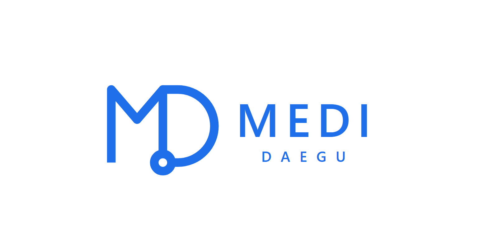
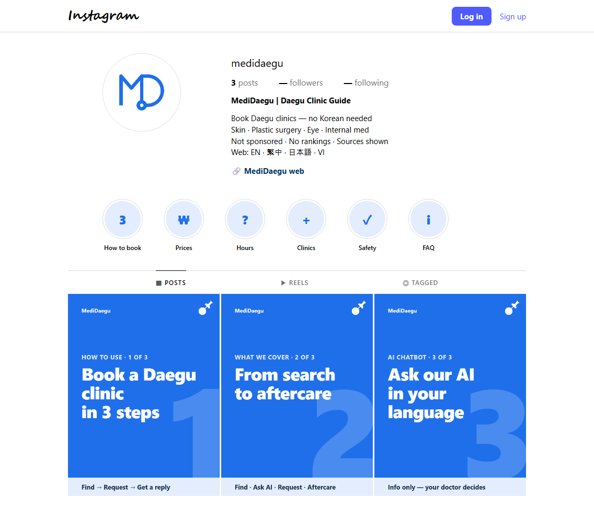
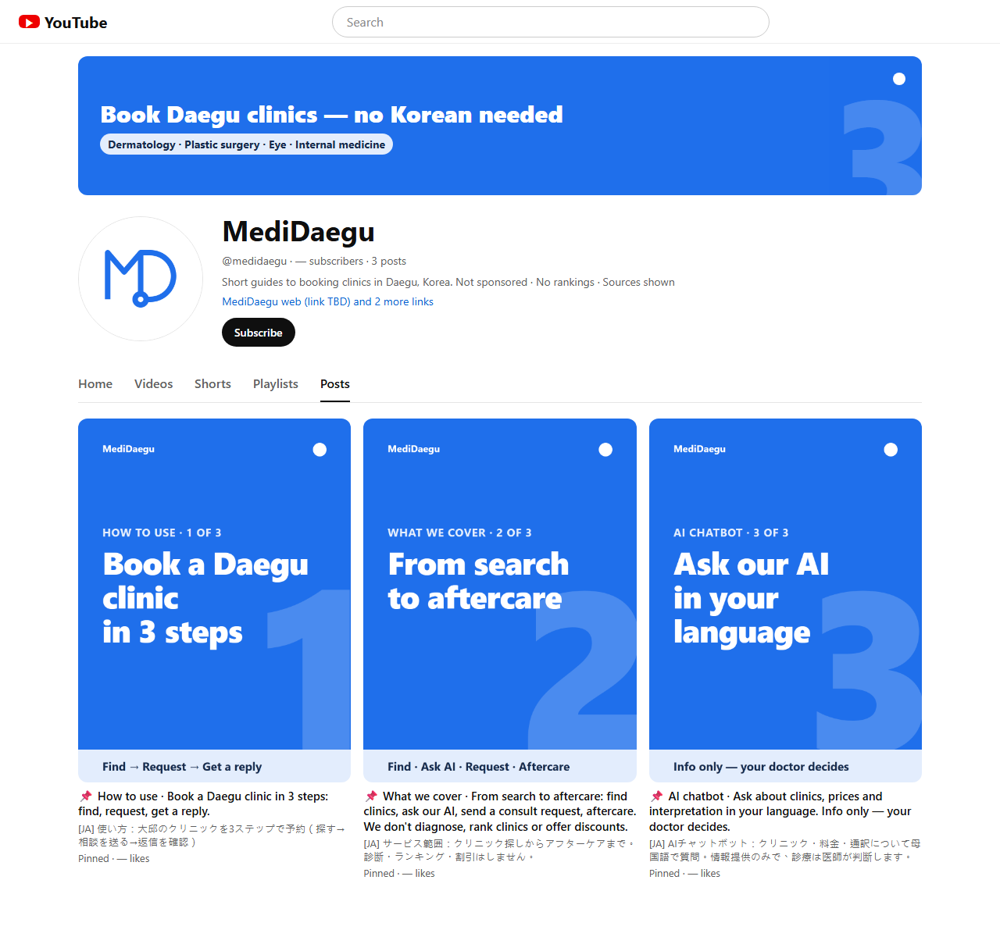
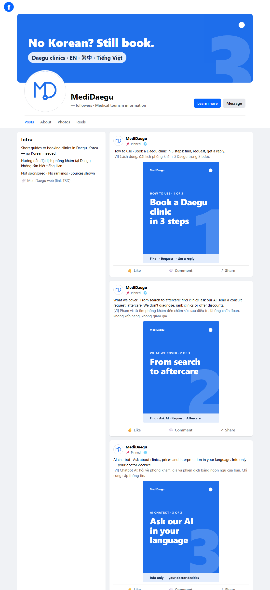
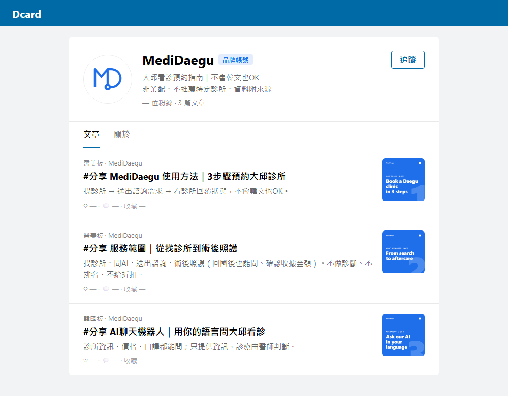
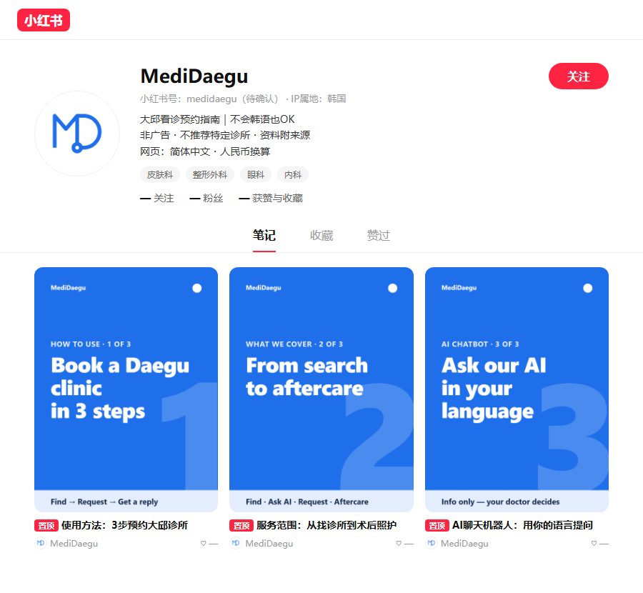

# 마케팅 유입방법 고안 — 인스타그램 · 유튜브 · 페이스북 · Dcard · 샤오훙수

> 작성 2026-11-20 · 상태: **Claude 예시, 팀 논의 전** (게시 전 규제 확인은 팀원 2)
> 공통: 계정 이름 **MediDaegu** · 로고 **v8 확정: MD 모노그램 + 청진판 고리 · 흰 배경** · 메디대구 웹 테마 색 (파랑 `#1f6feb` · 연하늘 `#e3edfd` · 남색 `#172b4d`) [S1]
> 전체 전략은 [마케팅-최신본.md](마케팅-최신본.md)

**모든 채널에 고정 게시물 3개("이용 방법 · 서비스 범위 · AI 챗봇")만** 두고 다른 게시물은 없앴어요 (2026-11-20 팀 결정, 처음의 "3가지 약속"에서 바꿈).

목업은 각 서비스의 실제 화면을 그대로 베낀 것이 아니라, **프로필 · 소개 · 게시물 목록** 구조만 비슷하게 그린 예시예요. 구독자·팔로워·조회 수는 새 계정이라 "—"로 두었어요.

## 한눈에

| 채널 | 언어 | 누구에게 | 화면에서 먼저 보이는 것 |
|---|---|---|---|
| 인스타그램 | **영어 + 일본어** | **영어권 · 일본** (대만·베트남도 볼 수 있음) | 고정 게시물 3개 (이용 방법 · 서비스 범위 · AI 챗봇) |
| 유튜브 | **영어 + 일본어** | **영어권 · 일본** | 게시물 탭의 고정 3개 (긴 영상 없음) |
| 페이스북 | 영어 + 베트남어 한 줄 | **베트남(주)** · 대만 · 영어권 | 고정 게시물 3개 (영어 + 베트남어 캡션) |
| Dcard | **번체 중국어** | **대만만** | 브랜드 계정 · 정보 글 3개 (使用方法 · 服務範圍 · AI聊天機器人) |
| 샤오훙수 | **간체 중국어** | **중국(본토)만** (대만에선 차단) | 노트 3개 고정 (使用方法 · 服务范围 · AI聊天机器人) |

## 브랜드 로고 (확정)

**MD 모노그램 + 청진판 고리 · 흰 배경** (v8, 2026-11-20 팀 결정) — 모든 채널의 프로필 사진에 같은 로고를 써요

| 가로형 (1600×800) | 아이콘 · 프로필 사진 (1080×1080) |
|---|---|
|  |  |

| 요소 | 내용 |
|---|---|
| 모양 | MediDaegu의 약자 **MD**. M의 오른쪽 기둥(= D의 기둥)이 아래로 내려와 **작은 고리**로 끝나고, D의 둥근 선이 그 고리로 들어감 → MD는 그대로 읽히면서 **청진기(관 + 청진판)**가 살짝 보임 |
| 선 | 모든 선의 굵기가 같음 (고리도 같은 굵기, 가운데 구멍이 보이게). 아이콘(로고만)도 가로형과 같은 굵기 비율 — 따로 굵게 하지 않음 |
| 글자 | 큰 **MEDI** + 그 가운데에 맞춘 작은 **DAEGU** 두 줄 (v6 그대로) |
| 색 | 흰 배경 + 메디대구 파랑 `#1f6feb` (웹 테마 색) [S1] |
| 쓰는 곳 | 인스타그램·유튜브·페이스북·Dcard·샤오훙수 프로필 사진, 웹 머리글, 문서 |
| 보관 버전 | 파랑 배경 버전([가로형](instagram/logo_v8_lockup_blue.png) · [아이콘](instagram/logo_v8_icon_blue.png)), 이전 시안(v3~v7)은 [인스타그램-계정-구성.md](인스타그램-계정-구성.md) 2-1절 |

**채널별 타깃·언어 (2026-11-20 팀 결정)**

| 채널 | 타깃 | 언어·콘텐츠 |
|---|---|---|
| 인스타그램 | 영어권 · **일본** | **영어 + 일본어** (이미지는 영어, 캡션에 일본어 한 줄) |
| 유튜브 | 영어권 · **일본** | **영어 + 일본어** (제목·설명은 영어 + 일본어 한 줄, 자막은 영어·일본어 두 트랙) |
| 페이스북 | 베트남(주) · 영어권 | 영어 + 베트남어 한 줄 |
| Dcard | **대만만** | 번체 중국어 |
| 샤오훙수 | **중국(본토)만** | 간체 중국어 |

- 일본어 웹 화면은 PR #52(frontend-ja) 병합·배포 뒤 링크 — 그전엔 영어 화면으로 연결

## 0. 근거 — 왜 이 나라, 왜 이 채널인가

상세 계산·표: [유입마케팅-국가별-진료과별.md](유입마케팅-국가별-진료과별.md) 1~3장

### 0-1. 타깃 나라 (외국인환자 · 대구 거주 외국인)

| 타깃 | 전국 환자 (2025) | 대구 환자 | 대구 점유율 | 많이 받는 진료 (전국) | 대구 등록외국인 (2026-09) | 고른 이유 |
|---|---|---|---|---|---|---|
| **영어권** (미국 기준) | 173,363 | **6,101 (대구 1위)** | 3.52% | 피부 49.3% · 성형 10.4% | 1,678 (남구 630) | 대구 환자 1위 국적. 입원 비율 12.9%로 거주자 비중이 클 가능성 `[추정]` |
| **대만** | 185,715 | 1,495 | 0.81% | **피부 80.3%** · 성형 8.9% · 질환 1위 '눈' | 503 | 대구가 대만 환자가 3번째로 많이 가는 지역, 전국 +122.5% 성장 |
| **일본** | 600,009 | 938 | **0.16%** | 피부 66.7% · **성형 16.3%** (최고) | 768 | 시장은 가장 크지만 대구가 거의 못 받는 곳 → 늘릴 여지 |
| **베트남** | 23,133 | 2,225 | **9.62%** | 진료과 비중 미확인 | **13,321 (1위, 31.4%)** | 대구 점유율이 기준선(1.0%)의 10배, 대구 거주 외국인 1위 |
| **중국** | 618,973 | 3,422 | 0.55% | **피부 73.4%** · 성형 9.1% | 4,334 (+한국계 1,216) | 전국 최대 시장(+137.5%)인데 대구 점유율이 낮음 → 늘릴 여지. 인스타·유튜브·페이스북이 본토에서 차단돼 **샤오훙수로** |

- 출처: 진흥원 「2025년 외국인환자 유치실적 통계분석 보고서」 표 2.11·2.12·3.x [S6][S7] · 법무부 등록외국인 [S2]. 대구 점유율·비중은 계산값
- 대만·일본·영어권은 의료관광 비자(C-3-3) 체류자가 거의 없어 **짧게 다녀가는 여행객**, 베트남·중국은 거주·치료 목적이 섞여 있음 `[추정]` [S8]

### 0-2. 채널 (나라별 SNS 이용)

| 타깃 | 유튜브 | 인스타그램 | 페이스북 | 그 밖에 | → 고른 채널 |
|---|---|---|---|---|---|
| **영어권 (미국)** | **84%** | 50% (18~29세 80%) | 68~71% | 틱톡 33% | **유튜브(주)** + 인스타 · 페이스북 |
| **대만** | 광고 도달 78.4% | "가장 많이 쓰는 SNS" 21.07% (2위) · 광고 도달 52.6% | **"가장 많이 쓰는 SNS" 51.38% (1위)** | 틱톡 25.16% · Dcard 이용자 약 80%가 18~35세 | **인스타 · Dcard(주)** + 페이스북 · 유튜브 |
| **일본** | **80.8%** (20대 97.2%) | **52.6%** (20대 78.0%) | 26.8% | LINE 91.1%(메신저) · X 43.3% · 틱톡 33.2% | **인스타 · 유튜브** (일본어 웹 배포 후) |
| **베트남** | 광고 도달 61.5% | 광고 도달 **10.4%** (약함) | **광고 도달 75.2% (최대)** | 틱톡 성인 55.6% | **페이스북(주)** + 유튜브 |
| **중국 (본토)** | 차단 | 차단 | 차단 | 짧은 영상 이용자 10.68억 (인터넷 이용자의 95.1%) · **샤오훙수 월간 이용자 3.5억 이상** (회사 발표) | **샤오훙수** |

- 숫자 기준이 다름: 미국·일본·대만(TWNIC)은 **설문 이용률**, 대만(DataReportal)·베트남은 **광고 도달(계정 수)** → 나라끼리 비교하지 말고 **나라 안 순위**로 읽기
- 출처: 미국 Pew [S9] · 대만 TWNIC [S10] · DataReportal 대만 [S11] · Dcard [S12] · 일본 총무성 [S13] · 베트남 DataReportal [S14] · 중국 CNNIC [S15] · 중국 차단 [S16] · 샤오훙수 이용자 [S18]

### 0-3. 정한 것과 뺀 것

| 항목 | 결정 | 이유 |
|---|---|---|
| Dcard | **대만 전용으로 넣음** | 대만 18~35세가 시술 정보를 찾는 커뮤니티 [S12], "광고 아닌 정보 글" 방향과 맞음 |
| 페이스북 | **넣음** (베트남은 주 채널) | 베트남 광고 도달 75.2%로 최대, 대만 "가장 많이 쓰는 SNS" 1위 [S14][S10] |
| 유튜브 | **쇼츠·게시물만, 긴 영상 없음** | 팀 결정 (제작 부담) · 짧은 영상은 대만 78.46%, 중국 95.1%가 볼 만큼 보편적 [S10][S15] |
| 틱톡 | 주 채널에서 뺌 | 대만 최근 3개월 25.16%, "가장 많이 쓰는 SNS" 4.19%로 소수 [S10] |
| 샤오훙수 | **넣음 — 중국 본토 전용** (2026-11-20 팀 결정) | 중국 본토에서 인스타·유튜브·페이스북이 차단 [S16] → 중국 사람에게 닿는 채널. 월간 이용자 3.5억 이상 [S18]. **대만에서는 2025-12-04부터 1년 차단** [S17]이라 대만에는 쓰지 않음 |
| 인스타·유튜브 언어 | **영어 + 일본어** | 영어권이 주 타깃이고, 일본은 인스타(52.6%)·유튜브(80.8%)가 강한 나라라 일본어까지 넣음 (2026-11-20 팀 결정) [S13]. 다른 언어 사용자는 웹에서 언어를 고름. 번체·간체 콘텐츠는 Dcard·샤오훙수에서만. 일본어 웹 화면은 PR #52(frontend-ja) 병합·배포 뒤 링크 — 그전엔 영어 화면으로 연결 |
| 채널별 타깃 | **Dcard = 대만만, 샤오훙수 = 중국만** | 각 나라 안에서만 쓰이는 커뮤니티라 그 나라 사람에게만 맞춰 씀 (팀 결정) |
| 일본 게시 | **보류** | 메디대구 웹 일본어 화면은 `frontend-ja`(PR #52)에 있고, 백엔드가 일본어·엔화를 받기 전 |

## 1. 인스타그램

자세히: [인스타그램-계정-구성.md](인스타그램-계정-구성.md)

- 이름 `MediDaegu | Daegu Clinic Guide` · 소개 4줄(149자) · 하이라이트 6개
- 게시물은 고정 3개(이용 방법 · 서비스 범위 · AI 챗봇)만

### 서비스 범위 — 어디까지 해 주나 (고정 게시물 2번의 내용, 2026-11-20)

| 해 주는 것 | 내용 | 근거 |
|---|---|---|
| **병원 찾기** | 대구 등록 외국인환자 유치의료기관 정보 — 위치(지도)·진료시간·진료과·외국어 상담 여부, 가격 범위(공공데이터 출처·기준일), 통화 환산 | 웹 기능 · 진흥원 공공데이터 |
| **AI 챗봇** | 병원 정보·가격·통역을 내 언어로 질문 | 웹 챗봇 ("Find Daegu medical and travel information together") |
| **상담 요청·예약** | 원하는 날짜·진료를 적은 상담 요청서를 병원에 보내고, 병원 답(확인·시간 제안 등) 상태를 확인 | 웹 상담/예약 · 병원 대시보드 |
| **사후관리** | 진료 뒤 병원과 대화(귀국 뒤 질문), 진료 후 영수증·결제 금액 확인 | 서비스 핵심 기능 (CLAUDE.md) |
| **다국어 화면** | 영어 · 번체 · 간체 · 베트남어 (일본어는 배포 예정) | 웹 언어 |

| 하지 않는 것 | 이유 |
|---|---|
| 진단·치료 권유 (의료 상담) | 진료 판단은 병원·의사 몫 |
| 병원 추천·순위, 할인가·이벤트가 | 의료법 제56조 · 팀 원칙 |
| 결제 대행 | 결제는 병원에서 — 메디대구는 결제 금액 **확인**만 |
| 항공·숙박·비자 대행 | 서비스 범위 밖 (지금 기능에 없음) |

## 2. 유튜브 채널

| 칸 | 내용 (영어) | 한국어 뜻 |
|---|---|---|
| 채널 배너 | `Book Daegu clinics — no Korean needed` + `Dermatology · Plastic surgery · Eye · Internal medicine` | 한국어 몰라도 대구 병원 예약 / 4개 진료과 |
| 이름 · 핸들 | `MediDaegu` · `@medidaegu` (사용 가능 여부 확인 필요) | — |
| 설명 | `Short guides to booking clinics in Daegu, Korea. Not sponsored · No rankings · Sources shown` | 대구 병원 예약 짧은 안내 · 협찬 없음 · 순위 없음 · 출처 표시 |
| 링크 | 메디대구 웹 (주소 정해지면) | — |
| 첫 화면 탭 | **Posts** (고정 3개) | 긴 영상은 만들지 않기로 함 (팀 결정) |

**고정 게시물 3개** (게시물 탭) — 인스타와 같은 이미지

| # | 제목 (영어) | 일본어 한 줄 |
|---|---|---|
| 1 📌 | How to use · Book a Daegu clinic in 3 steps | 使い方：大邱のクリニックを3ステップで予約（探す→相談を送る→返信を確認） |
| 2 📌 | What we cover · From search to aftercare | サービス範囲：クリニック探しからアフターケアまで。診断・ランキング・割引はしません。 |
| 3 📌 | AI chatbot · Ask our AI in your language | AIチャットボット：クリニック・料金・通訳について母国語で質問。情報提供のみで、診療は医師が判断します。 |

- 게시물·쇼츠 설명란 끝에도 인스타와 같은 문구: `MediDaegu does not recommend specific clinics. Treatment and fees are decided by each clinic.`

## 3. 페이스북 페이지

| 칸 | 내용 | 한국어 뜻 |
|---|---|---|
| 커버 | `No Korean? Still book.` + `Daegu clinics · EN · 繁中 · Tiếng Việt` | 한국어 몰라도 예약 / 웹 언어 |
| 이름 · 분류 | `MediDaegu` · Medical tourism information (실제 분류 이름은 개설할 때 고르기) | 의료관광 정보 |
| 버튼 | **Learn more** (→ 메디대구 웹) · Message | 웹으로 연결, 메시지 |
| 소개 | `Short guides to booking clinics in Daegu, Korea — no Korean needed.` `Hướng dẫn đặt lịch phòng khám tại Daegu, không cần biết tiếng Hàn.` `Not sponsored · No rankings · Sources shown` | 영어 + 베트남어 같은 뜻 / 협찬·순위 없음, 출처 표시 |

**고정 게시물 3개** (영어 + 베트남어 한 줄)

| # | 영어 | 베트남어 | 한국어 뜻 |
|---|---|---|---|
| 1 📌 | How to use · Book a Daegu clinic in 3 steps: find, request, get a reply. | Cách dùng: đặt lịch phòng khám ở Daegu trong 3 bước. | 이용 방법: 찾기 → 요청 → 답 받기 3단계 |
| 2 📌 | What we cover · From search to aftercare: find clinics, ask our AI, send a consult request, aftercare. We don't diagnose, rank clinics or offer discounts. | Phạm vi: từ tìm phòng khám đến chăm sóc sau điều trị. Không chẩn đoán, không xếp hạng, không giảm giá. | 서비스 범위: 병원 찾기부터 사후관리까지 / 진단·순위·할인은 안 함 |
| 3 📌 | AI chatbot · Ask about clinics, prices and interpretation in your language. Info only — your doctor decides. | Chatbot AI: hỏi về phòng khám, giá và phiên dịch bằng ngôn ngữ của bạn. Chỉ cung cấp thông tin. | AI 챗봇: 병원·가격·통역을 내 언어로 질문, 정보만 제공하고 진료는 의사가 판단 |

- 베트남은 대구 등록외국인 1위(13,321명)라 **거주자가 많아요** [S2]. 거주자는 서비스 원칙상 정보 열람만이라, 페이스북은 예약 유도가 아니라 정보 안내로 써요
- 국내에서도 보이는 페이스북 게시물이 "외국인환자 유치 국내광고" 금지(의료법 제56조 제2항 제12호)에 걸리는지 확인 필요 [S3]

## 4. Dcard (대만)

자세히: [유입마케팅-인스타-Dcard.md](유입마케팅-인스타-Dcard.md)

| 칸 | 내용 (번체 중국어) | 한국어 뜻 |
|---|---|---|
| 이름 | `MediDaegu` + **品牌帳號**(브랜드 계정) 표시 | — |
| 소개 | `大邱看診預約指南｜不會韓文也OK` / `非業配・不推薦特定診所・資料附來源` | 대구 진료 예약 안내 · 한국어 몰라도 OK / 협찬 아님 · 특정 병원 추천 안 함 · 출처 표시 |

**글 3개 — 이용 방법 · 서비스 범위 · AI 챗봇**

| 게시판 | 제목 | 본문 요약 | 한국어 뜻 |
|---|---|---|---|
| 醫美板 | #分享 MediDaegu 使用方法｜3步驟預約大邱診所 | 找診所 → 送出諮詢需求 → 看診所回覆狀態，不會韓文也OK。 | 이용 방법: 병원 찾기 → 상담 요청 → 병원 답 확인, 한국어 몰라도 OK |
| 醫美板 | #分享 服務範圍｜從找診所到術後照護 | 找診所・問AI・送出諮詢・術後照護（回國後也能問、確認收據金額）。不做診斷、不排名、不給折扣。 | 서비스 범위: 병원 찾기·AI 질문·상담 요청·사후관리(귀국 뒤 질문, 영수증 금액 확인) / 진단·순위·할인은 안 함 |
| 韓國板 | #分享 AI聊天機器人｜用你的語言問大邱看診 | 診所資訊・價格・口譯都能問；只提供資訊，診療由醫師判斷。 | AI 챗봇: 병원 정보·가격·통역을 물어볼 수 있음, 정보만 제공하고 진료는 의사가 판단 |

- 브랜드 계정도 게시판 규칙·광고 규칙을 지켜야 해요. "官方合作(공식 협업)" 태그는 쓰지 않아요 [S4]
- 韓國板·旅遊板의 게시판 규칙 원문은 게시 전에 팀이 확인

## 5. 샤오훙수 (중국 본토, 간체 중국어)

| 칸 | 내용 (간체 중국어) | 한국어 뜻 |
|---|---|---|
| 이름 · 아이디 | `MediDaegu` · 小红书号 `medidaegu` (사용 가능 여부 확인 필요) | — |
| 소개 | `大邱看诊预约指南｜不会韩语也OK` / `非广告・不推荐特定诊所・资料附来源` / `网页：简体中文・人民币换算` | 대구 진료 예약 안내 · 한국어 몰라도 OK / 광고 아님 · 특정 병원 추천 안 함 · 출처 표시 / 웹: 간체 화면 · 위안화 환산 |
| 태그 | 皮肤科 · 整形外科 · 眼科 · 内科 | 피부과 · 성형외과 · 안과 · 내과 |

**고정 노트 3개 — 이용 방법 · 서비스 범위 · AI 챗봇** (다른 채널과 같은 이미지)

| # | 제목 | 한 줄 | 한국어 뜻 |
|---|---|---|---|
| 1 📌 | 使用方法：3步预约大邱诊所 | 找诊所 → 提交咨询 → 查看回复 | 이용 방법: 3단계로 대구 병원 예약 |
| 2 📌 | 服务范围：从找诊所到术后照护 | 找诊所・问AI・咨询・术后照护 | 서비스 범위: 병원 찾기부터 사후관리까지 |
| 3 📌 | AI聊天机器人：用你的语言提问 | 只提供信息，诊疗由医生判断 | AI 챗봇: 내 언어로 질문, 정보만 제공하고 진료는 의사가 판단 |

- 메디대구 웹은 간체 중국어 화면과 위안화(CNY) 환산이 이미 있어요 (frontend `i18n/locales/zh-CN.json`, 백엔드 환율 API CNY) [S1]
- **확인 필요 (팀원 2)**: ① 해외(한국) 법인·개인이 샤오훙수 브랜드 계정(企业号)을 만들 수 있는지, 인증에 무엇이 필요한지 ② 중국 쪽 의료 관련 광고 규정에 정보 글도 해당하는지 — 둘 다 **미확인**
- 대만 사용자는 샤오훙수가 차단돼 있어 Dcard·인스타로만 다가가요

## 6. 모든 채널에 넣지 않는 것

| 하지 않음 | 이유 |
|---|---|
| 특정 병원·의사 추천, 순위, "best" | 의료법 제56조 제2항, 의료인이 아니라 의료광고 불가 (제56조 제1항) [S5] |
| 전후 사진, 환자 후기·경험담 | 제56조 제2항 제2호 [S5] |
| 할인가·이벤트가 | 제56조 제2항 제13호 유형 + 팀 원칙 [S5] |
| 병원 이름·로고가 보이는 화면 | 특정 병원 광고로 보일 수 있음 |

## 7. 파일

| 파일 | 내용 |
|---|---|
| [instagram/logo_v8_lockup_white.png](instagram/logo_v8_lockup_white.png) · [instagram/logo_v8_icon_white.png](instagram/logo_v8_icon_white.png) | 확정 로고 v8 (가로형 · 아이콘), 생성기 [instagram/src/make_logo_v8.py](instagram/src/make_logo_v8.py) |
| [instagram/account_mockup.png](instagram/account_mockup.png) | 인스타그램 계정 목업 |
| [channels/youtube_mockup.png](channels/youtube_mockup.png) | 유튜브 채널 목업 (1280×1150) |
| [channels/facebook_mockup.png](channels/facebook_mockup.png) | 페이스북 페이지 목업 (1100×2370) |
| [channels/dcard_mockup.png](channels/dcard_mockup.png) | Dcard 브랜드 계정 목업 (1000×760) |
| [channels/xiaohongshu_mockup.png](channels/xiaohongshu_mockup.png) | 샤오훙수 계정 목업 (900×830) |
| [channels/src/make_channels.py](channels/src/make_channels.py) | 유튜브·페이스북·Dcard·샤오훙수 목업 생성기 (로고·썸네일 이미지를 다시 씀) |

다시 만들기: `python -I -X utf8 channels/src/make_channels.py` 후 `chrome --headless=new --window-size=1280,1150 --screenshot=youtube_mockup.png channels/src/youtube.html` (페이스북 `1100,2370` · Dcard `1000,760` · 샤오훙수 `900,830`)

## 출처

| 번호 | 자료 | 위치·URL | 등급 | 기준 시점 | 확인일 |
|---|---|---|---|---|---|
| S1 | 메디대구 웹 테마 색 | frontend 브랜치 `apps/web-platform/src/styles.css` | 팀 내부 | 2026-11-19 | 2026-11-20 |
| S2 | 법무부 등록외국인 시군구별·국적별 (대구 베트남 13,321명) | `data/raw/비자데이터/법무부_등록외국인_시군구별_국적별_20260930.xlsx` (브랜치) | 공식 | 2026-09-30 | 2026-11-20 |
| S3 | 의료법 제56조 제2항 제12호 · 의료해외진출법 제15조 정리 | [../research/의료관광/규제-병원연결-유인알선.md](../research/의료관광/규제-병원연결-유인알선.md) | 공식 (팀 노트 경유) | 2026-10-29 확인분 | 2026-11-20 |
| S4 | Dcard 광고·상업 콘텐츠 규칙 공지 | https://www.dcard.tw/f/announcement/p/234243656 | 공식 (자동 접속 차단, 검색 요약만 확인 — 원문 미확인) | 미확인 | 2026-11-19 |
| S5 | 의료법 제56조 정리 (원문 https://www.law.go.kr/법령/의료법) | [../research/의료관광/규제-가격노출-의료광고.md](../research/의료관광/규제-가격노출-의료광고.md) | 공식 (팀 노트 경유) | 시행 2026-10-02 | 2026-11-20 |
| S6 | 한국보건산업진흥원 「2025년 외국인환자 유치실적 통계분석 보고서」 원문 | `data/raw/다국어/■ 2025년 외국인환자 유치실적 통계분석 보고서.pdf` (브랜치) | 통계 | 2025 | 2026-11-20 |
| S7 | 같은 보고서 팀 정리 (국가별 환자·대구 점유율·진료과 비중) | [../data/raw/다국어/타깃_국가_분야_분석.md](../data/raw/다국어/타깃_국가_분야_분석.md) | 통계 (팀 정리) | 2025 | 2026-11-20 |
| S8 | 법무부 의료관광(C-3-3) 체류자격 등록외국인 | `data/raw/비자데이터/법무부_의료관광(C_3_3) 체류자격 등록외국인 현황_20251231.csv` (브랜치) | 공식 | 2025-12-31 | 2026-11-20 |
| S9 | Pew Research Center, Americans' Social Media Use 2025 (성인 5,022명) | https://www.pewresearch.org/internet/2025/11/20/americans-social-media-use-2025/ | 통계 (설문) | 2025 | 2026-11-19 |
| S10 | TWNIC, 2025 台灣網路報告 (2,142명) | https://report.twnic.tw/2025/en/assets/download/TWNIC_TaiwanInternetReport_2025_CH_summary.pdf | 공식 (설문) | 2025-07 ~ 09 | 2026-11-19 |
| S11 | DataReportal, Digital 2026: Taiwan | https://datareportal.com/reports/digital-2026-taiwan | 통계 (광고 도달) | 2025년 말 | 2026-11-19 |
| S12 | 數位時代, Dcard 이용자 약 80%가 18~35세 (Dcard 측 발표) | https://www.bnext.com.tw/article/83303/dcard-premium-2025 | 언론 (원문 미확인) | 2025 | 2026-11-19 |
| S13 | 総務省 「令和6年度 情報通信メディアの利用時間と情報行動に関する調査報告書」 표 5-1-1 (1,800명) | https://www.soumu.go.jp/main_content/001017160.pdf | 공식 (설문) | 2024-12 | 2026-11-19 |
| S14 | DataReportal, Digital 2025: Vietnam | https://datareportal.com/reports/digital-2025-vietnam | 통계 (광고 도달) | 2025-01 | 2026-11-19 |
| S15 | CNNIC 제56차 中国互联网络发展状况统计报告 | https://www.cnnic.cn/NMediaFile/2025/0730/MAIN1753846666507QEK67ZS9DH.pdf | 공식 | 2025-06 | 2026-11-19 |
| S16 | Internet Society Pulse 중국 서비스 차단 (OONI) · Freedom House, Freedom on the Net 2025 | https://pulse.internetsociety.org/shutdowns/multiple-internet-services-blocked-in-china · https://freedomhouse.org/sites/default/files/2025-11/Freedom_on_the_Net_2025_Digital.pdf | 기관 (2개 교차) | 2025 | 2026-11-19 |
| S17 | 대만 내정부 샤오훙수 1년 차단 — udn · 公視 | https://udn.com/news/story/6656/9183137 · https://news.pts.org.tw/article/784654 | 언론 (2개 교차) | 2025-12-04 | 2026-11-19 |
| S18 | 샤오훙수 월간 이용자 3.5억 이상 (「小红书2025年度兴趣报告」 회사 발표, 언론 보도) | https://news.sina.cn/sx/2025-12-31/detail-inhesten3732753.d.html | 언론 (회사 발표 원문 미확인) | 2025-12-31 | 2026-11-19 |
