# 메디대구 유입 마케팅 — 최신본

> 기준 2026-11-20 (3장 서비스 · 8장 국내광고 규제 갱신) · 이 문서 하나에 지금까지 정한 것을 모았어요. 세부 근거는 각 장의 링크 문서에 있어요
> 상태: **Claude 초안 + 팀 결정 반영, 팀 논의 전** (게시 전 규제 확인은 팀원 2)

## 0. 정한 것 한눈에

| 항목 | 결정 |
|---|---|
| 방향 | 병원·시술 광고가 아니라 **"대구에서 외국인이 병원을 예약하는 법"** 정보. 우리는 의료인이 아니라 의료광고를 할 수 없음 (의료법 제56조 제1항) [S10] |
| 타깃 | **영어권 · 대만 · 중국 · 일본 · 베트남** |
| 진료과 | **피부과 · 성형외과 · 안과 · 내과** |
| 채널 | **인스타그램 · 유튜브 쇼츠 · 페이스북** + **Dcard**(대만 전용) + **샤오훙수**(중국 본토 전용) |
| 영상 | 짧은 세로 영상(9:16)만, **유튜브 긴 영상 없음** |
| 계정 이름 | **MediDaegu** (모든 채널) |
| 채널 언어 | **인스타그램·유튜브 = 영어 + 일본어** · 페이스북 = 영어 + 베트남어 한 줄 · **Dcard = 번체(대만만)** · **샤오훙수 = 간체(중국만)** (2026-11-20) |
| 로고 | **v8 확정: MD 모노그램 + 청진판 고리, 흰 배경** — M의 오른쪽 기둥이 내려와 작은 고리로 끝나고 D 선이 그 고리로 이어져 청진기를 살짝 떠올리게 + MEDI / DAEGU 두 줄(가운데 정렬) (2026-11-20) |
| 상담 연결 | 메디대구 웹의 **상담 요청**으로만 (LINE 상담 연결 없음) |
| Dcard | **브랜드 계정**으로 정보 글 |
| 중국 | **샤오훙수로** (인스타·유튜브·페이스북은 본토 차단) · 웹은 간체 화면·위안화 환산 (2026-11-20 결정 변경) |
| 일본 | **웹에 일본어 화면 추가** → `frontend-ja` 브랜치로 원격에 올라감, `frontend`로 PR 전. 백엔드가 일본어·엔화를 받기 전까지 일본 게시 보류 |
| 게시물 | **모든 채널(인스타·유튜브·페이스북·Dcard·샤오훙수) 고정 3개(이용 방법 · 서비스 범위 · AI 챗봇)만** (2026-11-20) |
| 썸네일·게시물 색 | 메디대구 웹 테마: 파랑 `#1f6feb` · 연하늘 `#e3edfd` · 남색 `#172b4d` · 흰색 [S17] |

## 1. 누구에게 — 타깃별 근거 (브랜치 자료)

자세히: [유입마케팅-국가별-진료과별.md](유입마케팅-국가별-진료과별.md) 1장

| 타깃 | 대구 환자 (2025) | 대구 점유율 | 많이 받는 진료 (전국) | 대구 등록외국인 (2026-09) | 성격 |
|---|---|---|---|---|---|
| 영어권 (미국 기준) | **6,101** (대구 1위) | 3.52% | 피부 49.3% · 일반 진료 섞임 | 1,678 (남구 630) | 거주자 비중 클 가능성 `[추정]` |
| 대만 | 1,495 | 0.81% | **피부 80.3%** · 질환 1위 '눈' | 503 | 짧게 다녀가는 여행객 |
| 중국 | 3,422 | 0.55% | **피부 73.4%** | 4,334 | 시장 최대, 대구 점유율 낮음 → 샤오훙수 |
| 일본 | 938 | **0.16%** | 피부 66.7% · **성형 16.3%** | 768 | 여행객, 대구 점유율 매우 낮음 |
| 베트남 | 2,225 | **9.62%** | 진료과 비중 미확인 | **13,321 (1위, 31.4%)** | 거주자 비중 클 가능성 `[추정]` |

- 출처: 진흥원 「2025년 외국인환자 유치실적 통계분석 보고서」 [S1][S2][S3] · 법무부 등록외국인 [S4] · 의료관광 비자 [S5]
- 국내 거주 외국인은 서비스 원칙상 **정보 열람만** → 영어권·베트남 내과 콘텐츠는 예약 유도가 아니라 정보 안내

## 2. 어디에 — 타깃별 채널

| 타깃 | 주 채널 | 보조 | 근거 (나라 안 순위) |
|---|---|---|---|
| 영어권 | **유튜브 쇼츠** | 인스타 · 페이스북 | 미국 성인 유튜브 84% · 페이스북 68~71% · 인스타 50% [S6] |
| 대만 | **인스타** · **Dcard** | 페이스북 · 유튜브 쇼츠 | "가장 많이 쓰는 SNS" 페이스북 51.38% · 인스타 21.07% [S7] · Dcard 이용자 약 80%가 18~35세 [S9] |
| 일본 | **인스타** · **유튜브 쇼츠** | (페이스북 약함) | 유튜브 80.8% · 인스타 52.6% · 페이스북 26.8% [S14] |
| 베트남 | **페이스북** | 유튜브 쇼츠 | 광고 도달 페이스북 75.2% · 유튜브 61.5% · 인스타 10.4% [S15] |
| 중국 | **샤오훙수** | — | 인스타·유튜브·페이스북 본토 차단 [S12] · 샤오훙수 월간 이용자 3.5억 이상 (회사 발표) |

미국·일본·대만(TWNIC)은 설문 이용률, 대만(DataReportal)·베트남은 광고 도달 기준이라 나라끼리 비교하지 말고 **나라 안 순위**로 읽어 주세요.

## 3. 무엇을 — 메디대구가 제공하는 서비스

마케팅은 병원이나 시술이 아니라 **이 서비스를** 알려요. 진료과·나라와 상관없이 모든 환자에게 같은 서비스예요. 모든 채널의 고정 게시물·영상은 아래 내용 안에서만 말해요.

### 3-1. 이용 흐름 (환자 입장)

```
① 찾기 → ② 묻기 → ③ 상담·예약 요청 → ④ 병원 답 확인·방문 → ⑤ 사후관리
병원 정보·가격   AI 챗봇      요청서 보내기        확정·시간 제안·알림     진료 뒤 그 병원 의료진과 대화
```

### 3-2. 기능별로 자세히

| # | 기능 | 환자가 할 수 있는 것 | 웹 화면 | 게시물에서 말하는 법 (영어 예) |
|---|---|---|---|---|
| 1 | **병원 찾기** | 대구 **등록 외국인환자 유치의료기관**만 목록·지도로 보기 · 진료과(피부과·성형외과·안과·내과) 고르기 · 병원 이름 검색 · 상세에서 주소·진료시간·전화·외국어 상담 여부 확인 · 병원 저장 | 메인(지도) · 병원 정보 · 저장한 병원 | "Find registered clinics in Daegu" |
| 2 | **가격 가이드** | 공공 비급여 가격의 **범위**를 출처·기준일과 함께 보기 · 내 통화로 환산 (USD · TWD · CNY · VND, JPY는 일본어 화면과 함께 배포 예정) · 항상 "내국인 기준 공개 금액이라 외국인 실제 진료비와 다를 수 있음, 병원에 확인" 고지 | 가격 가이드 | "See public price ranges — confirm with the clinic" |
| 3 | **AI 챗봇** | 내 언어로 병원·진료시간·가격·외국어 상담 여부를 묻기 · 대구 의료·여행 정보를 함께 · 진단·치료 권유는 하지 않고, 필요하면 상담 요청으로 이어 줌 | 챗봇 | "Ask our AI in your language — info only" |
| 4 | **상담·예약 요청** | 환자 회원가입·동의 뒤 병원에 상담 요청서 보내기 (원하는 진료·날짜·시간) · 병원이 대시보드에서 **확정 / 다른 시간 제안 / 불가**로 답함 · 병원별 상담 대화 · 예약 상태·방문 예정일 확인 · 알림 | 상담/예약 · 예약 관리 | "Send a consult request, get the clinic's reply" |
| 5 | **사후관리** | 방문 완료로 기록된 진료만, 그 병원 의료진과 대화 (귀국 뒤에도) · 증상이 심하면 바로 병원·119 안내 | 사후관리 | "Ask your clinic after treatment, even back home" |
| 6 | **마이페이지** | 내 상담·예약·방문 기록, 저장한 병원, 개인정보 관리 | 마이페이지 | — |
| 7 | **다국어** | 영어 · 번체 · 간체 · 베트남어 화면 (일본어는 PR #52 배포 뒤) | 오른쪽 위 언어 선택 | "EN · 繁中 · 简中 · VI (日本語 soon)" |

- 사후관리는 **프리미엄 회원** 병원만 열려요 (요금 v4: 기본 회원 무료 + 13% / 프리미엄 연 ₩1,800,000 + 8%, `docs/subscription-plans.md`)
- 지금 웹에는 **영수증·결제 금액 확인 기능이 없어요** → 게시물에서 말하지 않아요 (기능이 생기면 추가)

### 3-3. 하지 않는 것 (게시물에서도 약속하지 않음)

| 하지 않음 | 이유 |
|---|---|
| 진단·치료 권유, 증상 상담 | 진료 판단은 병원·의사 몫 (의료법 제27조) |
| 병원 추천·순위·"best", 할인가·이벤트가 | 의료법 제56조 [S10] · 팀 원칙 (회원 등급이 노출 순서에 영향 없음) |
| 결제 대행 | 진료비는 병원에 직접 냄 |
| 항공·숙박·비자 대행 | 서비스 범위 밖 |
| 미등록 병원 소개 | 등록 유치의료기관만 노출 (compliance 결정 21) |

### 3-4. 콘텐츠 공통 규칙

- 효과·결과를 말하지 않고 **서비스 사용법 · 가격 보는 법 · 일정 · 준비**만
- 전후 사진·후기·병원 이름·로고·순위·할인가 없음 [S10]
- 진료과는 "4 specialties: skin, plastic surgery, eye, internal medicine"처럼 **서비스 범위로만** 언급
- 모든 캡션 끝: `MediDaegu does not recommend specific clinics. Treatment and fees are decided by each clinic.`
- 타깃별 통계·진료과 근거는 [유입마케팅-국가별-진료과별.md](유입마케팅-국가별-진료과별.md)에 그대로 있어요

## 4. 인스타그램 계정 (영어)

자세히: [인스타그램-계정-구성.md](인스타그램-계정-구성.md)

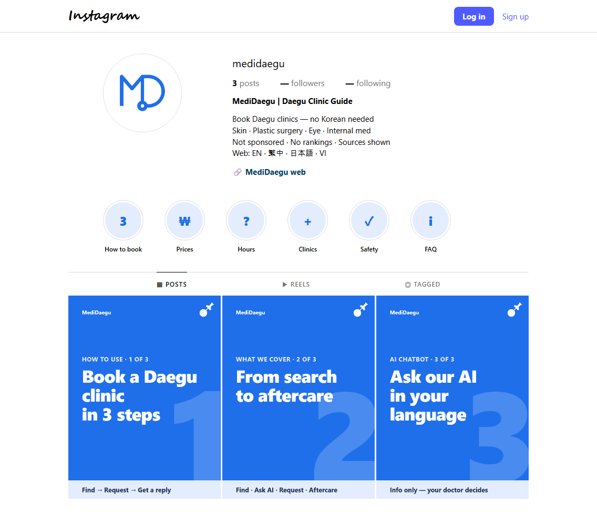

| 칸 | 내용 |
|---|---|
| 로고 | 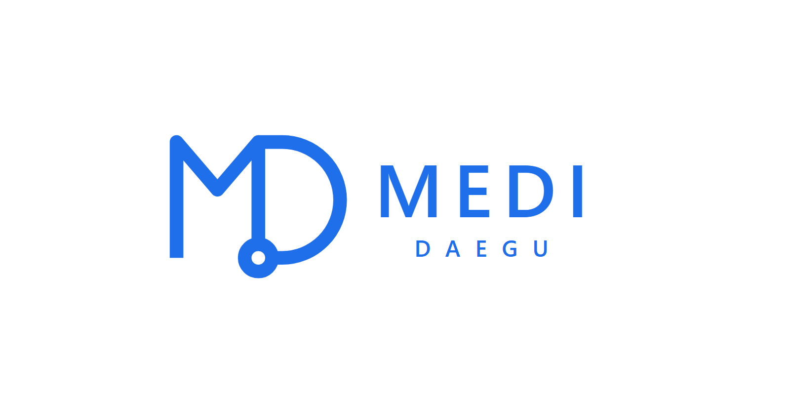 v8 확정: MD 모노그램 + 청진판 고리 (흰 배경) |
| 이름 | `MediDaegu \| Daegu Clinic Guide` (30자) |
| 소개 (149자) | `Book Daegu clinics — no Korean needed` / `Skin · Plastic surgery · Eye · Internal med` / `Not sponsored · No rankings · Sources shown` / `Web: EN · 繁中 · 日本語 · VI` |
| 하이라이트 | How to book · Prices · Hours · Clinics · Safety · FAQ |
| 게시물 | **고정 3개만** — How to use · What we cover(병원 찾기부터 사후관리까지, 진단·순위·할인은 안 함) · AI chatbot (파랑 썸네일, 캡션에 일본어 한 줄). 다른 정보는 하이라이트·릴스로 |
| 캡션 끝 고정 문구 | `MediDaegu does not recommend specific clinics. Treatment and fees are decided by each clinic.` |

- 소개의 日本語는 웹 일본어 화면이 배포된 뒤 넣어요
- 인스타·유튜브를 영어로 하면 대만·일본·베트남 사용자에게 덜 닿을 수 있어요 (미확인) → 대만은 Dcard, 중국은 샤오훙수, 베트남은 페이스북으로 보완. 게시 2주 뒤 반응 보고 다시 판단

## 5. Dcard (대만, 번체 중국어)

자세히: [유입마케팅-인스타-Dcard.md](유입마케팅-인스타-Dcard.md)

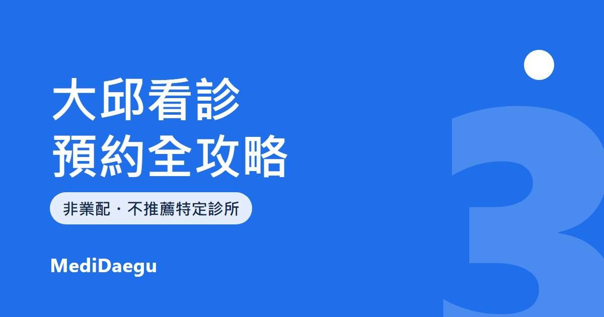

| 항목 | 내용 |
|---|---|
| 계정 | **MediDaegu 브랜드 계정**, 첫 줄에 "메디대구 팀이 쓴 글" |
| 게시판 | 醫美板(의료미용) · 韓國板 · 旅遊板 (韓國板·旅遊板 규칙은 게시 전 확인) |
| 글 예시 | `#分享 大邱看診預約全攻略｜不會韓文也OK（非業配）` — 예약 · 가격 보는 법 · 일정 |
| 지킬 것 | 브랜드 계정도 게시판·광고 규칙 적용 · "官方合作" 태그 안 씀 · 댓글 조작 금지 [S9-2] |

## 6. 짧은 영상 (인스타 릴스 · 유튜브 쇼츠 · 페이스북 릴스)

같은 9:16 영상 1개를 세 곳에 올려요. **인스타·유튜브 쇼츠는 영어**, 페이스북은 영어(베트남어 한 줄 캡션). 아래 번체·베트남어 표지는 참고용으로 남겨 둔 것이에요.

| 영어 | 번체 (대만) | 일본어 (보류) | 베트남어 | 질문 답변 (번체) |
|---|---|---|---|---|
| 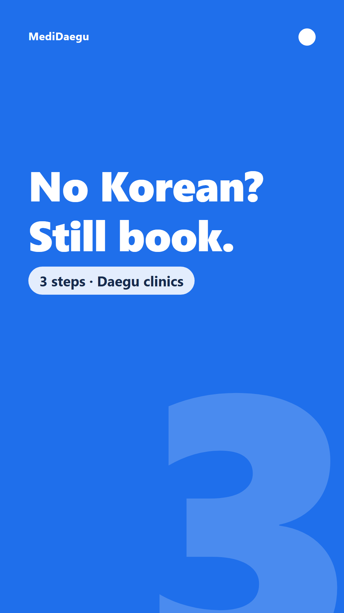 | 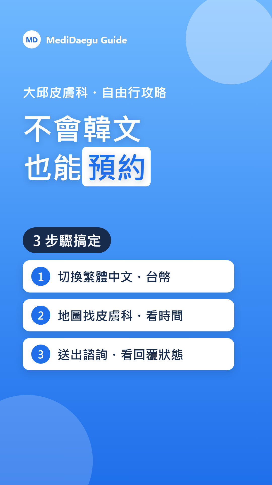 | 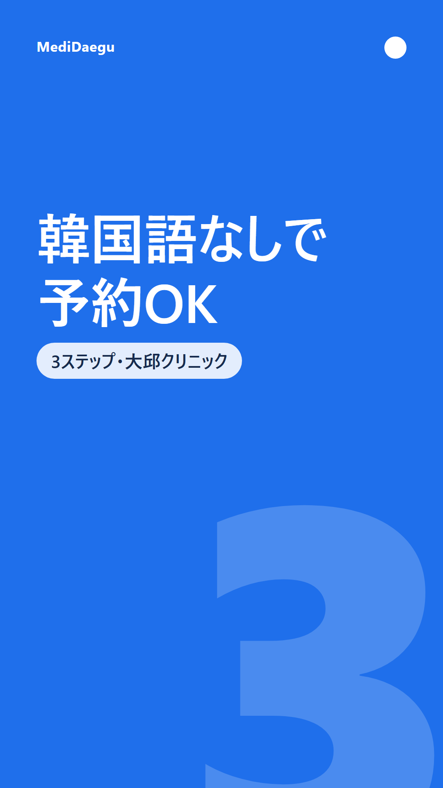 | 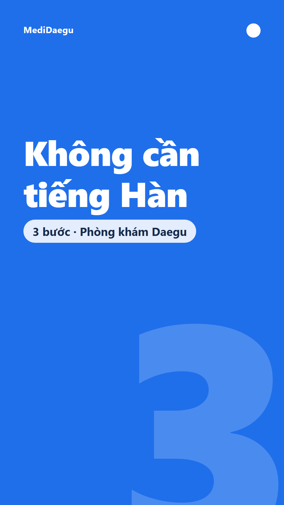 | 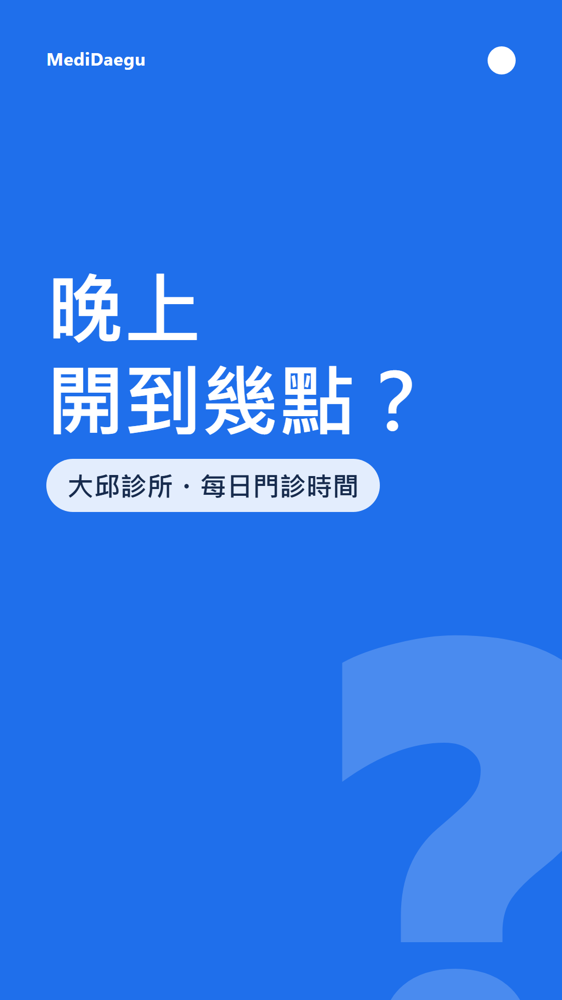 |

썸네일 v2 규칙: 파랑 한 색 · 큰 글자 2줄 · 태그 1개 · 오른쪽 아래 큰 연하늘 숫자/기호 + 오른쪽 위 흰 점

## 6-1. 채널별 계정 화면 (예시)

인스타그램 · 유튜브 · 페이스북 · Dcard · 샤오훙수 목업과 소개 문구: [마케팅-유입방법-고안.md](마케팅-유입방법-고안.md)

| 유튜브 | 페이스북 | Dcard |
|---|---|---|
| 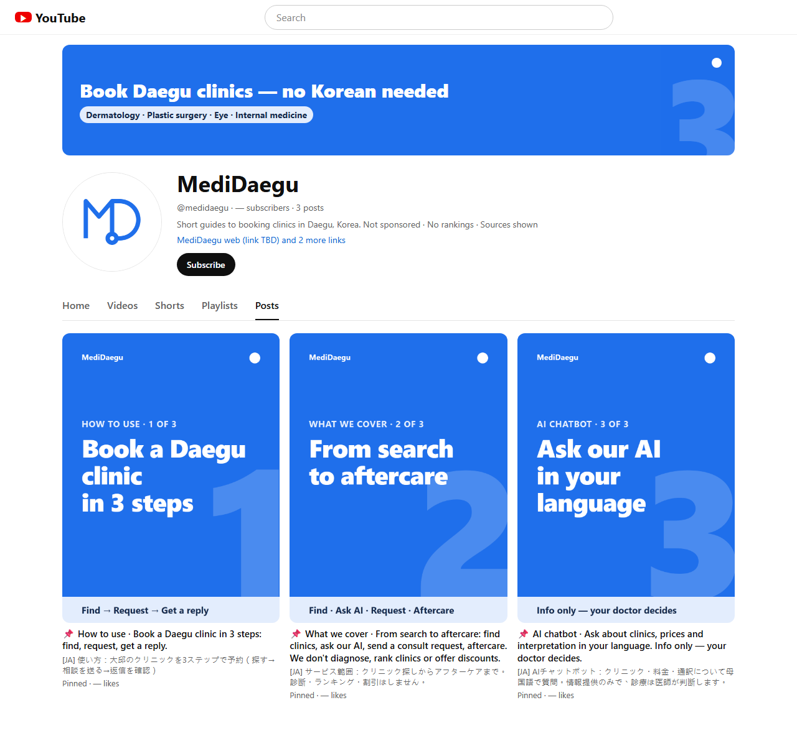 | 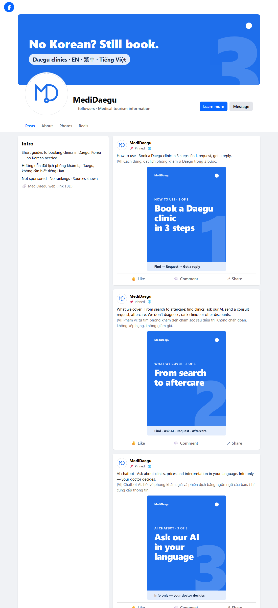 | 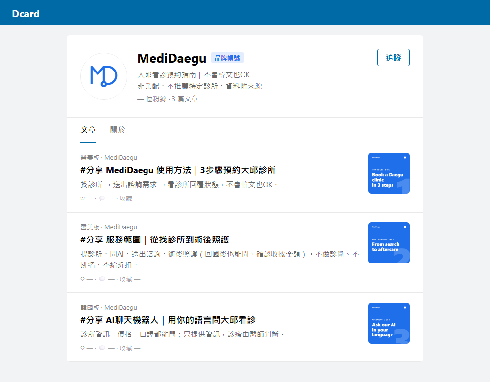 |

샤오훙수 (중국 본토): 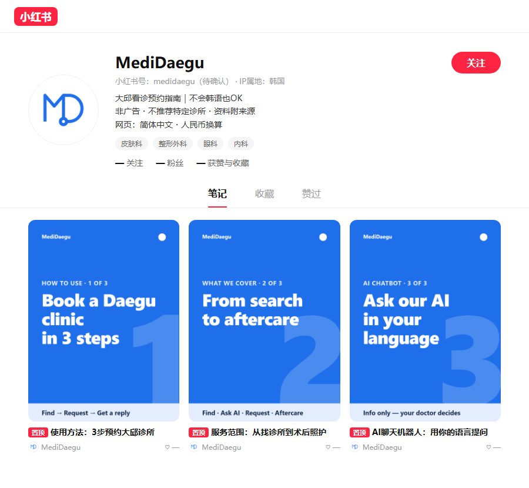

## 7. 운영

| 항목 | 방법 |
|---|---|
| 빈도 | 주 3회 (짧은 영상 2 · 캐러셀/게시물 1) + Dcard 주 1회 |
| 순서 | 채널마다 고정 3개(이용 방법 · 서비스 범위 · AI 챗봇)를 올리고 고정 → 이후엔 게시물을 늘리지 않고 짧은 영상·스토리로 |
| 링크 | 메디대구 웹 (주소 정해지면 넣기) |
| 보는 숫자 | 인스타 저장·링크 클릭 / 유튜브 쇼츠 조회 / 페이스북 공유·링크 클릭 / Dcard 댓글 질문 |

## 8. 넣지 않는 것 · 외국인환자 유치 국내광고 규제

### 8-1. 법이 정한 것

| 법 | 내용 | 메디대구에게 |
|---|---|---|
| 의료법 제56조 제1항 | 의료기관 개설자·의료인 등이 아니면 **의료광고 금지**. 위반 시 1년 이하 징역 또는 1천만원 이하 벌금 (제89조 제1호) [S10] | 우리는 의료기관이 아님 → 특정 병원·진료를 홍보하지 않고 **서비스(플랫폼)만** 소개 |
| 의료법 제56조 제2항 제12호 | 의료인등은 **외국인환자를 유치하기 위한 국내광고**를 하지 못함 [S19][S20] | 입점 병원이 메디대구 채널로 국내에서 외국인을 모으는 것처럼 보이면 안 됨 |
| 의료해외진출법 제15조 (의료광고 특례) | **등록 유치의료기관만** 정해진 장소(외국인전용판매장 · 보세판매장 · 지정면세점 · 국제공항 · 무역항, 현행법은 지정 관광특구 포함)에서 **외국어** 의료광고 가능. 보건복지부 **사전 심의** 필요 · 치료 전후 비교 사진·영상 금지 · 공항·무역항에서는 성형외과·피부과 등 특정 과에 치우친 광고 금지 · 의료법 제56·57조 준용 [S19][S22] | 유치**업자**인 메디대구는 특례 대상이 아님 → **공항·면세점 광고 안 함** |
| 의료해외진출법 제15조 위반 | 1년 이하 징역 또는 1천만원 이하 벌금 (제29조) · 등록 취소 가능 (제24조 제1항 제7호) [S19][S22] | 병원과 공동 광고를 할 때도 같은 규칙 |
| 의료해외진출법 제2조 제2·3호 | 외국인환자 = **건강보험 가입자·피부양자가 아닌** 외국인 · "유치"에 진료예약 대리·**진료정보 제공**까지 포함 [S19] | 국내 거주(건강보험 가입) 외국인은 법상 외국인환자가 아님 → 거주자에게는 **정보만**, 예약 유도 안 함 |
| 복지부·진흥원 회신 (2026-11-17) | 정보 웹도 유치 거래와 결부되면 유치행위로 볼 수 있고, 대가가 없어도 마찬가지 [S23] | **유치업자 등록 전에는 계정 공개 운영·게시를 하지 않음** (발표용 목업만) |

### 8-2. "국내광고"로 보일 수 있는 경우

- **복지부 공식 해석은 찾지 못함 (미확인).** 언론에 실린 법률 전문가 해석: 해외 사이트를 거치거나 외국어 홈페이지로 광고해도 **국내 일반 대중에게 쉽게 노출되면 국내광고로 볼 여지**가 있음 [S20]. 국내 매체로 외국인을 모으는 광고는 원칙적으로 금지 [S21]
- 그래서 채널마다 **"한국 안에서 일반 대중에게 보이게 하지 않는다"**를 기준으로 정해요

| 상황 | 위험 | 하는 방법 |
|---|---|---|
| 외국어 SNS 일반 게시물 (인스타·유튜브·페이스북) | 낮음~중간 `[미확인]` | 외국어만 · **한국어 캡션·해시태그(#대구피부과 등) 안 씀** · 국내 병원 위치 태그 안 씀 |
| 유료 광고·부스트 | 한국이 타깃에 들어가면 국내광고로 볼 수 있음 | 타깃 국가 = 대만·일본·베트남·미국 등, **대한민국 제외** 설정 |
| 페이스북 베트남어 | 대구 등록외국인 1위가 베트남(13,321명) [S4] → 국내 거주자에게 많이 닿음 | 광고는 **베트남 현지만** 타깃 · 거주자용 글은 정보만, 예약 유도 문구 없음 |
| Dcard (대만) · 샤오훙수 (중국) | 국내 노출 적음 | 번체·간체만 |
| 국내 오프라인 (지하철·관광안내소 전단·호텔 비치) | 국내광고 · 특례 대상 아님 | **하지 않음** |
| 국내 인플루언서·국내 커뮤니티·한국어 블로그 | 국내 일반 대중에게 노출 | **하지 않음** |
| 병원이 "우리 병원 홍보해 달라" 요청 | 병원의 국내광고·의료광고 대행 | 거절 · 병원 이름·로고를 게시물에 넣지 않음 |

### 8-3. 게시물에 넣지 않는 것

| 하지 않음 | 이유 |
|---|---|
| 특정 병원·의사 추천, 순위, "best" | 의료법 제56조 제2항, 의료광고 주체 아님 (제56조 제1항) [S10] |
| 전후 사진, 환자 후기·경험담 | 제56조 제2항 제2호 · 해외진출법 제15조 [S10][S22] |
| 할인가·이벤트가 | 제56조 제2항 제13호 유형 + 팀 원칙 [S10] |
| 병원 이름·로고가 보이는 화면 | 특정 병원 광고로 보일 수 있음 |
| 한국어 문구·해시태그 | 국내 대중 노출 → 국내광고 소지 [S20] |

**확인 필요 (팀원 2, 복지부 질의)**: ① 등록 유치업자가 해외 대상 외국어 SNS로 **플랫폼**을 소개하는 것이 제56조 제2항 제12호 "국내광고"에 해당하는지 ② 유료 광고에서 한국을 빼는 설정이면 충분한지 ③ 국내 거주 외국인이 게시물을 보는 경우 · 페이스북 광고 정책 · 일본 의료광고 가이드라인 (미확인)

## 9. 남은 할 일

| 할 일 | 담당 |
|---|---|
| `frontend-ja` → `frontend` PR 만들기 | 프론트 (GitHub CLI 로그인 후 가능) |
| 백엔드가 `ja` 언어·JPY 환율 받게 하기 | 백엔드 (worklog 요청 참고) |
| Dcard 韓國板·旅遊板 규칙 원문 확인 | 팀 |
| 국내광고 해당 여부 복지부 질의 (8-2 ①②③) | 팀원 2 |

## 이전 문서 (참고용)

| 문서 | 상태 |
|---|---|
| [유입마케팅-국가별-진료과별.md](유입마케팅-국가별-진료과별.md) | 근거 상세 (1~3장 통계, 출처 S1~S19) — 이 최신본의 근거 |
| [인스타그램-계정-구성.md](인스타그램-계정-구성.md) | 인스타 상세 (고정 게시물 3개, 캡션 틀) |
| [유입마케팅-인스타-Dcard.md](유입마케팅-인스타-Dcard.md) | 대만 세부 (Dcard 글 전문, 릴스 대본) |
| [대만-SNS-이용-현황.md](대만-SNS-이용-현황.md) | 대만 플랫폼 근거 |
| [유입마케팅-틱톡-인스타.md](유입마케팅-틱톡-인스타.md) | 첫 초안 (틱톡 중심, 지금은 바뀜) |
| [유입마케팅-예시.html](유입마케팅-예시.html) | 첫 예시 페이지 (지금은 바뀜) |

## 출처

번호는 [유입마케팅-국가별-진료과별.md](유입마케팅-국가별-진료과별.md) 출처 표와 같아요. 여기에는 이 문서에서 쓴 것만 적어요.

| 번호 | 자료 | 위치·URL | 등급 | 기준 시점 | 확인일 |
|---|---|---|---|---|---|
| S1 | 진흥원 「2025년 외국인환자 유치실적 통계분석 보고서」 원문 | `data/raw/다국어/■ 2025년 외국인환자 유치실적 통계분석 보고서.pdf` (브랜치) | 통계 | 2025 | 2026-11-19 |
| S2 | 같은 보고서 팀 정리 (국가별 환자·점유율·진료과 비중) | [../data/raw/다국어/타깃_국가_분야_분석.md](../data/raw/다국어/타깃_국가_분야_분석.md) | 통계 (팀 정리) | 2025 | 2026-11-19 |
| S3 | 같은 보고서 표 3.75 · 카드 보고서 표 3.32 — 팀 검증표 | [../market/verify.md](../market/verify.md) | 통계 (팀 검증) | 2024~2025 | 2026-11-19 |
| S4 | 법무부 등록외국인 시군구별·국적별 | `data/raw/비자데이터/법무부_등록외국인_시군구별_국적별_20260930.xlsx` (브랜치) | 공식 | 2026-09-30 | 2026-11-19 |
| S5 | 법무부 의료관광(C-3-3) 체류 등록외국인 | `data/raw/비자데이터/법무부_의료관광(C_3_3) 체류자격 등록외국인 현황_20251231.csv` (브랜치) | 공식 | 2025-12-31 | 2026-11-19 |
| S6 | Pew Research Center, Americans' Social Media Use 2025 | https://www.pewresearch.org/internet/2025/11/20/americans-social-media-use-2025/ | 통계 | 2025 | 2026-11-19 |
| S7 | TWNIC, 2025 台灣網路報告 | https://report.twnic.tw/2025/en/assets/download/TWNIC_TaiwanInternetReport_2025_CH_summary.pdf | 공식 | 2025 | 2026-11-19 |
| S9 | 數位時代, Dcard 이용자 약 80%가 18~35세 (Dcard 측 발표) | https://www.bnext.com.tw/article/83303/dcard-premium-2025 | 언론 (원문 미확인) | 2025 | 2026-11-19 |
| S9-2 | Dcard 광고·상업 콘텐츠 규칙 공지 | https://www.dcard.tw/f/announcement/p/234243656 | 공식 (자동 접속 차단, 검색 요약만 확인 — 원문 미확인) | 미확인 | 2026-11-19 |
| S10 | 의료법 제56조·제57조 정리 (원문 https://www.law.go.kr/법령/의료법) | [../research/의료관광/규제-가격노출-의료광고.md](../research/의료관광/규제-가격노출-의료광고.md) | 공식 (팀 노트 경유) | 시행 2026-10-02 | 2026-11-19 |
| S12 | Internet Society Pulse 중국 차단 · Freedom House 2025 | https://pulse.internetsociety.org/shutdowns/multiple-internet-services-blocked-in-china · https://freedomhouse.org/sites/default/files/2025-11/Freedom_on_the_Net_2025_Digital.pdf | 기관 (2개 교차) | 2025 | 2026-11-19 |
| S14 | 総務省 「令和6年度 情報通信メディアの利用時間と情報行動に関する調査報告書」 표 5-1-1 | https://www.soumu.go.jp/main_content/001017160.pdf | 공식 | 2024-12 | 2026-11-19 |
| S15 | DataReportal, Digital 2025: Vietnam | https://datareportal.com/reports/digital-2025-vietnam | 통계 (광고 도달) | 2025-01 | 2026-11-19 |
| S17 | 메디대구 웹 테마 색·언어·환율 | frontend 브랜치 `apps/web-platform/src/styles.css`, `i18n/locales/` · 백엔드 `/api/v1/exchange-rates` | 팀 내부 | 2026-11-19 | 2026-11-19 |
| S18 | 틱톡 3차 VOC 138건 | [../painpoint/voc_tiktok.md](../painpoint/voc_tiktok.md) | 팀 내부 | 2023-08 ~ 2026-11 | 2026-11-19 |
| S19 | 의료법 제56조 제2항 제12호 · 의료해외진출법 제15조 정리 | [../research/의료관광/규제-병원연결-유인알선.md](../research/의료관광/규제-병원연결-유인알선.md) | 공식 (팀 노트 경유) | 2026-10-29 확인분 | 2026-11-19 |
| S20 | 치의신보, 「외국인 환자 직접 유치 시 의료법 위반 주의」 (법률 전문가 인용 — 국내광고 금지·특례·외국어 홈페이지 노출) | https://dailydental.co.kr/news/article.html?no=134483 | 언론 (복지부 공식 해석 아님) | 2025-07-30 | 2026-11-20 |
| S21 | 메디칼타임즈, 「'해외환자유치' 되는 것과 안되는 것」 (변호사 칼럼) | https://medicaltimes.com/Main/News/NewsView.html?ID=1164056 | 언론 (해설) | 2025-06-23 | 2026-11-20 |
| S22 | 의료해외진출법 제15조 원문 (제정본, 당시 의료법 "제56조제2항제10호" 인용 → 현행 제12호) · 제24조 제1항 제7호 | https://elaw.klri.re.kr/kor_service/lawViewMultiContent.do?hseq=38861 (현행: https://www.law.go.kr/법령/의료해외진출및외국인환자유치지원에관한법률) | 공식 (제정본 — 현행 장소·호 번호는 S19 팀 노트 기준) | 2015-12-22 제정 | 2026-11-20 |
| S23 | 보건복지부·한국보건산업진흥원 국민신문고 회신 (정보제공 서비스의 유치행위 해당성) | 비공개 (팀 보관), 요약 `docs/compliance.md` v2.3 (main) | 공식 | 2026-11-17 | 2026-11-20 |
