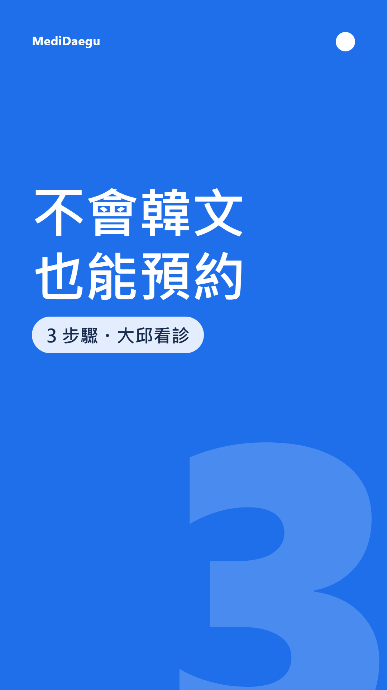
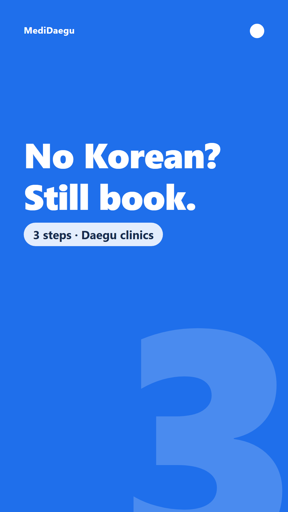
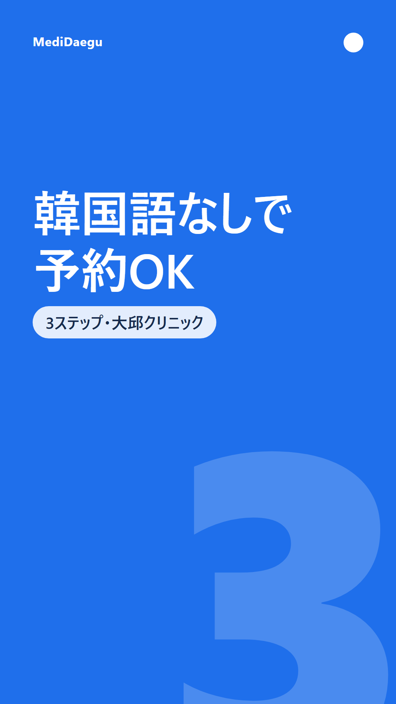
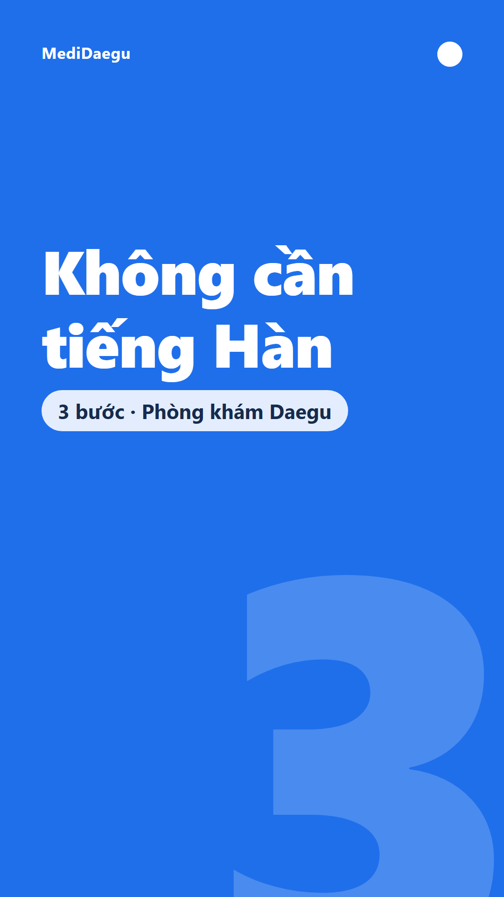
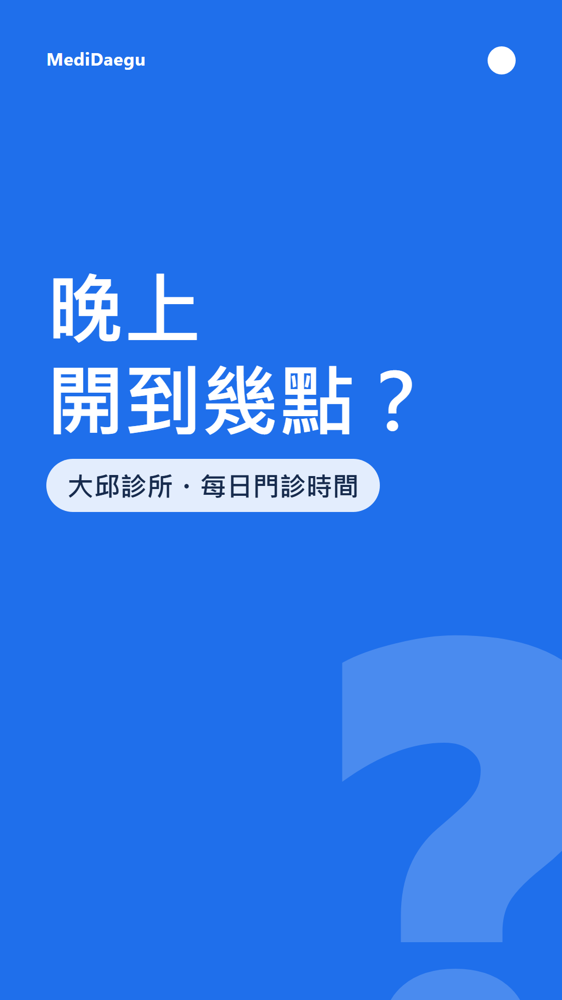
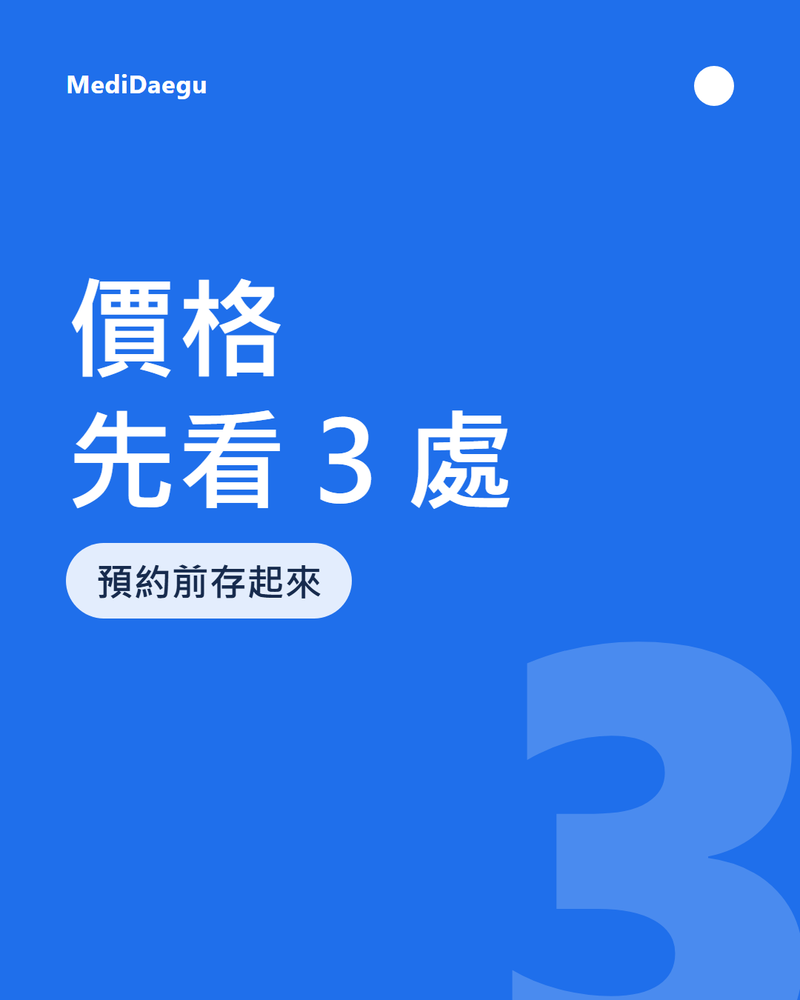
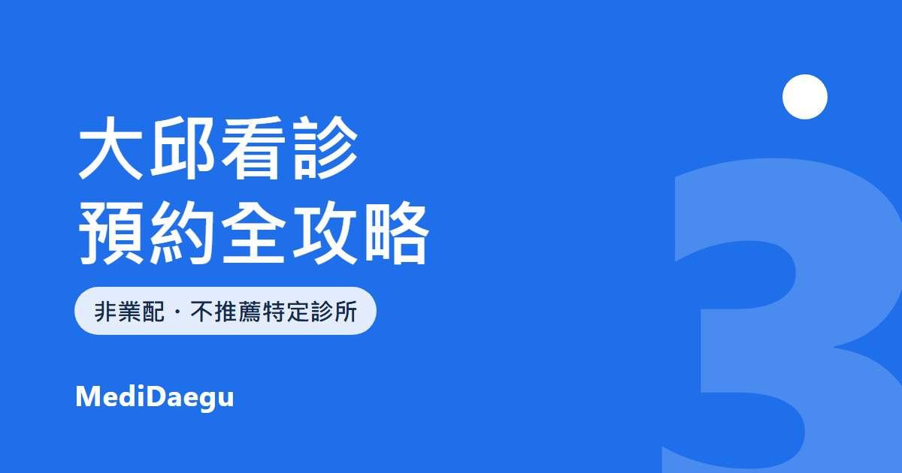

# 유입 마케팅 — 5개 타깃 · 4개 진료과 · 인스타그램 · 유튜브 쇼츠 · 페이스북

> 작성 2026-11-19 (같은 날 수정: 1장 브랜치 자료로 · 유튜브 긴 영상 뺌 · 페이스북 넣음 · 샤오훙수 안 씀 · 일본어 화면 추가 결정 · 썸네일 v2) · 상태: **Claude 초안, 팀 논의 전** (게시 전 규제 확인은 팀원 2)
> 타깃: **영어권 · 대만 · 중국 · 일본 · 베트남** / 진료과: **피부과 · 성형외과 · 안과 · 내과**
> 채널: **인스타그램 · 유튜브(쇼츠만) · 페이스북** + **Dcard**(대만 전용) — 대만 세부안은 [유입마케팅-인스타-Dcard.md](유입마케팅-인스타-Dcard.md)

## 0. 정한 것과 방향

| 항목 | 내용 |
|---|---|
| 계정 이름 | **MediDaegu** (모든 채널 같은 이름, 핸들 예: `@medidaegu`) — 팀 결정 |
| 상담 연결 | 메디대구 웹의 **상담 요청**으로만 (LINE 상담 연결 없음) — 팀 결정 |
| Dcard | **브랜드 계정**으로 정보 글 — 팀 결정 |
| 영상 | **짧은 세로 영상(9:16)만**. 유튜브 긴 영상은 만들지 않음 — 팀 결정 |
| 페이스북 | **넣음** — 팀 결정 (베트남은 주 채널, 2장) |
| 샤오훙수 | **쓰지 않음** — 팀 결정. 중국 본토는 SNS 마케팅을 하지 않고 웹(zh-CN 화면)만 둠 |
| 일본어 | **메디대구 웹에 일본어 화면 추가** — 팀 결정 (프론트 할 일, 엔화 환산도 함께 필요) |
| 방향 | 병원·시술 광고가 아니라 **"대구에서 외국인이 병원을 예약하는 법"** 정보. 의료인이 아니라 의료광고를 할 수 없음 (의료법 제56조 제1항) [S10] |
| 썸네일 | **v2 (심플)**: 파랑 한 색 바탕 · 큰 글자 2줄 · 태그 1개 · 시그니처(오른쪽 아래 큰 연하늘 숫자 + 오른쪽 위 흰 점) |

**한 줄 구조**: 짧은 영상 1개를 만들어 → 자막만 5개 언어로 바꿔 → **인스타 릴스 · 유튜브 쇼츠 · 페이스북 릴스**에 같이 올리고 → 인스타 캐러셀(페이스북에도 같은 이미지)로 저장하게 하고 → 프로필 링크로 메디대구 웹(그 나라 언어 화면)에 연결.

## 1. 타깃별 근거 — 누가, 어떤 진료로 오나 (브랜치 자료)

모두 research-data 브랜치에 있는 자료예요. 원문 PDF·CSV는 `data/raw/`, 계산·검증은 팀 노트.

**1-1. 외국인환자 (2025, 한국보건산업진흥원 보고서 — [S1] 원문 `data/raw/다국어/■ 2025년 외국인환자 유치실적 통계분석 보고서.pdf`, 팀 정리 [S2])**

| 타깃 | 전국 환자 | 대구 환자 | 대구 점유율 | 진료과 비중 (전국) |
|---|---|---|---|---|
| **영어권** (미국 기준) | 173,363 | **6,101** (대구 1위) | 3.52% | 피부 49.3% · 성형 10.4% · 일반 진료 섞임 |
| **대만** | 185,715 | 1,495 | 0.81% | **피부 80.3%** · 성형 8.9% · 질환 분류 1위 '눈' |
| **중국** | 618,973 | 3,422 | 0.55% | **피부 73.4%** · 성형 9.1% |
| **일본** | 600,009 | 938 | **0.16%** | 피부 66.7% · **성형 16.3%** (5개 중 최고) |
| **베트남** | 23,133 | 2,225 | **9.62%** | 진료과 비중 **미확인** (보고서에 베트남 진료과 표 없음) |

- 대구 진료과별 (2025): 성형 5,786 · 내과 3,370 · 피부 3,333 · 안과는 '기타'에 섞여 따로 없음 (대구 안과 약 931명은 카드 자료 비율로 낸 **추정**) [S3]
- 대구 카드 1인 진료비 (2024): 성형 117.6만 · 피부 61.6만 · 안과 32.3만 · 내과 19.3만 원 (계산) [S3]
- 대구 미국 환자는 입원 비율 12.9%로 높고, 전국 주한미군 환자 진료 1위가 내과(5,341명) [S2][S3]

**1-2. 대구에 사는 외국인 (등록외국인, 2026-09-30 — [S4] `data/raw/비자데이터/법무부_등록외국인_시군구별_국적별_20260930.xlsx`)**

| 국적 | 대구 등록외국인 | 비중 (대구 42,370명 중) | 많이 사는 곳 |
|---|---|---|---|
| **베트남** | **13,321** | **31.4%** (1위) | 달서구 6,035 · 북구 2,491 · 달성군 1,570 |
| 중국 (+한국계중국인) | 4,334 (+1,216) | 10.2% (+2.9%) | 달서구 1,490 · 북구 1,192 |
| 미국 | 1,678 | 4.0% | **남구 630** · 수성구 342 · 중구 207 |
| 일본 | 768 | 1.8% | 북구 181 · 달서구 166 |
| 대만 | 503 | 1.2% | 중구 120 · 수성구 88 |
| 영어권 기타 (영국·캐나다·호주) | 138 · 127 · 38 | 0.7% | 수성구 |

비중은 계산값. **읽는 법**: 베트남 환자의 대구 점유율(9.62%)이 높은 건 **대구에 사는 베트남인이 많기 때문**일 가능성이 커요 `[추정]`. 미국도 남구(미군 기지 주변)에 몰려 있어 거주자 비중이 클 가능성 `[추정]`. → 서비스 원칙상 **국내 거주 외국인은 정보 열람만**이라, 베트남·영어권 내과 콘텐츠는 예약 유도가 아니라 정보 안내로 (CLAUDE.md 원칙)

**1-3. 의료관광 비자(C-3-3) 등록외국인 (전국, 2025 — [S5] `data/raw/비자데이터/법무부_의료관광(C_3_3) 체류자격 등록외국인 현황_20251231.csv`)**

중국 996 · 몽골 526 · **베트남 137** · 우즈베키스탄 98 · 태국 28 (2025년 말). 치료 목적으로 오래 머무는 사람은 중국·몽골·중앙아시아 중심이고, 대만·일본·영어권은 거의 없음 → 대만·일본·영어권은 **짧게 다녀가는 여행객**, 베트남·중국은 거주·치료 목적이 섞여 있음 `[추정]`

## 2. 타깃별 플랫폼 — 인스타·유튜브·페이스북이 닿나

| 타깃 | 유튜브 | 인스타그램 | 페이스북 | 참고 | 출처 |
|---|---|---|---|---|---|
| **영어권 (미국)** | **84%** | 50% (18~29세 80%) | **68~71%** | 틱톡 33% | [S6] 통계 (설문) |
| **대만** | 광고 도달 **78.4%** | 광고 도달 52.6% · "가장 많이 쓰는 SNS" 21.07% | 광고 도달 74.9% · **"가장 많이 쓰는 SNS" 51.38%** | 틱톡 25.16% · Dcard 이용자 약 80%가 18~35세 | [S7] 공식, [S8] 통계, [S9] 언론 |
| **중국 (본토)** | 접속 차단 | 접속 차단 | 접속 차단 | 짧은 영상 이용자 10.68억 (95.1%) · 샤오훙수 월간 이용자 3.5억 이상 (회사 발표) | [S11] 공식, [S12] 기관, [S13] 언론 |
| **일본** | **80.8%** (20대 97.2%) | **52.6%** (20대 78.0%) | 26.8% (약함) | LINE 91.1%(메신저) · X 43.3% · 틱톡 33.2% | [S14] 공식 (설문) |
| **베트남** | 광고 도달 61.5% | 광고 도달 **10.4%** (약함) | 광고 도달 **75.2%** (최대) | 틱톡 성인 55.6% | [S15] 통계 |

- 숫자 기준이 나라마다 달라요: 미국·일본·대만(TWNIC)은 **설문 이용률**, 대만(DataReportal)·베트남은 **광고 도달(계정 수)** → 나라끼리 비교하지 말고 **나라 안에서 순위**로 읽어 주세요
- 미국 페이스북은 Pew 페이지에 따라 68%·71%로 다르게 적혀 있어 범위로 둠 [S6]
- 샤오훙수는 대만에서 2025-12-04부터 1년 차단이라 중국 본토 전용 [S16]

## 3. 결론 — 타깃별 채널

| 타깃 | 주 채널 | 보조 채널 | 언어 | 메디대구 웹 화면 |
|---|---|---|---|---|
| 영어권 | **유튜브 쇼츠** | 인스타 · 페이스북 | 영어 | ✅ en (USD 환산) |
| 대만 | **인스타** · **Dcard** | 페이스북 · 유튜브 쇼츠 | 번체 중국어 | ✅ zh-TW (TWD 환산) |
| 일본 | **인스타** · **유튜브 쇼츠** | (페이스북은 약함 → 재업로드만) | 일본어 | ⏳ **일본어 화면 추가 예정** (팀 결정) · 엔화 환산도 필요 |
| 베트남 | **페이스북** | 유튜브 쇼츠 | 베트남어 | ✅ vi (VND 환산) |
| 중국 | **SNS 하지 않음** (세 채널 모두 본토 차단, 샤오훙수 안 씀) | — | 간체 중국어 | ✅ zh-CN (CNY 환산) — 웹만 |

- 웹 화면 언어·환율은 frontend 브랜치 `apps/web-platform/src/i18n/locales/`(ko·en·zh-TW·zh-CN·vi)와 백엔드 환율 API(USD·CNY·TWD·VND) 기준 [S17]

## 4. 진료과별 콘텐츠 (짧은 영상 + 캐러셀)

공통 규칙: 효과·결과를 말하지 않고 **예약·가격·일정·준비**만 다룸. 전후 사진·후기·병원 이름·순위·할인가 없음 [S10]

| 진료과 | 주 타깃 | 왜 (근거) | 짧은 영상·캐러셀 주제 (예시) | VOC 근거 | 특히 조심 |
|---|---|---|---|---|---|
| **피부과** | 대만 · 중국 · 일본 | 세 나라 모두 피부 비중 66~80% [S2] | 릴스·쇼츠 "외국인이 대구 피부과 예약하는 3단계" · 캐러셀 "피부과 가격, 이 3곳부터" · 릴스 "시술 전 회복 기간 확인하는 법" | 예약 방법·채널 10건(최다), 가격 정보 없음 16건, 효과·회복 좋아요 714 [S18] | 체험가·이벤트가 언급 금지 |
| **성형외과** | 일본 · 영어권 · 중국 | 일본 성형 비중 16.3%(최고), 대구 진료과 1위 5,786명, 1인 진료비 최고 117.6만 [S2][S3] | 캐러셀 "상담 전에 꼭 물어볼 5가지" · 릴스 "귀국 일정에 맞춰 회복 기간 묻는 법" · 캐러셀 "등록된 유치기관인지 확인하는 법" | 묶음 권유·업셀 불만(강도 3), 공장식 불만 [S18] | **전후 사진·결과 영상 절대 금지**, 수술 권유 금지 |
| **안과** | 대만 · (영어권) | 대만 질환 분류 1위 '눈' `[추정: 시력교정 관심]` [S2] | 릴스 "시력교정 상담, 검사부터 결과까지 하루 일정" · 캐러셀 "안과 가격 범위 읽는 법" (공공데이터 범위 + 출처) | 직접 VOC 없음 (**미확인**) | 수술 적합 여부는 검사 뒤 의사 판단이라고 꼭 표기 |
| **내과** | 베트남 · 영어권 | 대구 등록외국인 1위 베트남 13,321명, 대구 내과 3,370명, 주한미군 진료 1위 내과 [S3][S4] | 페이스북 릴스·게시물 "외국어로 건강검진 예약하는 법" · "검진 전날 준비할 것 확인하는 법" · "결과지를 받은 뒤: 메디대구 사후관리" | 직접 VOC 없음 (**미확인**) | **거주자는 정보 열람만** (예약 유도 X), 증상 상담처럼 보이지 않게 |

## 5. 타깃 × 진료과 × 채널 한 장

| | 피부과 | 성형외과 | 안과 | 내과 |
|---|---|---|---|---|
| **영어권** | 유튜브 쇼츠 · 인스타 | **유튜브 쇼츠 · 인스타** | 유튜브 쇼츠 | **페이스북 · 유튜브 쇼츠** (거주자는 정보만) |
| **대만** | **인스타 릴스·캐러셀 · Dcard 醫美板** | 인스타 · Dcard | **인스타 · Dcard** (눈 관심) | — |
| **일본** | **인스타 릴스** | **인스타 · 유튜브 쇼츠** | 인스타 | — |
| **베트남** | 페이스북 릴스 | — | — | **페이스북 게시물·릴스** (거주자는 정보만) |
| **중국** | — (SNS 안 함, 웹만) | — | — | — |

굵게 = 먼저 만들 것. "—" = 근거가 약해 처음엔 만들지 않음.

## 6. 운영 방식

| 항목 | 방법 |
|---|---|
| 계정 | 인스타 1 · 유튜브 1 · 페이스북 페이지 1 (모두 `MediDaegu`), 처음엔 언어별로 나누지 않음 |
| 형식 | 짧은 세로 영상(9:16) 1개 → 인스타 릴스 · 유튜브 쇼츠 · 페이스북 릴스에 **같은 파일** / 캐러셀(4:5) → 인스타와 페이스북에 **같은 이미지** |
| 언어 | **인스타그램은 영어로 통일** (2026-11-19 팀 결정, [인스타그램-계정-구성.md](인스타그램-계정-구성.md)). 유튜브 쇼츠·페이스북은 같은 영상의 자막만 바꾼 언어 버전 (예: 베트남어는 페이스북) |
| 빈도 | 주 3회 (짧은 영상 2 · 캐러셀 1), 언어 버전은 타깃 채널에만 (예: 베트남어는 페이스북 중심) |
| 프로필 링크 | 메디대구 웹. 언어 화면으로 바로 여는 주소를 캡션에 적음 |
| 보는 숫자 | 인스타: 저장·링크 클릭 / 유튜브 쇼츠: 조회·구독 / 페이스북: 공유·링크 클릭 / Dcard: 댓글 질문 |

## 7. 썸네일 v2 (심플 · 기억에 남게)

**규칙 (모든 썸네일 공통)** — 색은 메디대구 웹 테마 그대로 [S17]

| 요소 | 규칙 |
|---|---|
| 바탕 | 메디대구 파랑 `#1f6feb` 한 색 (그라데이션·그림 없음) |
| 글자 | 흰색 큰 제목 **2줄만**. 단계 카드·설명 문장 없음 |
| 태그 | 1개, 연하늘 `#e3edfd` 바탕 + 남색 `#172b4d` 글자 |
| **시그니처** | 오른쪽 아래에 화면 밖으로 잘리는 **아주 큰 연하늘 숫자·기호** (`3` = 3단계·3곳, `?` = 질문 답변) + 오른쪽 위 **흰 점** → 피드에서 "파란 바탕 + 큰 3"으로 기억되게 |
| 브랜드 | 작은 `MediDaegu` 글자 (세로형은 왼쪽 위, 가로형은 왼쪽 아래) |
| 안전 영역 | 세로형은 릴스·쇼츠 버튼이 가리는 아래·오른쪽을 피해 글자를 위·가운데에 |

**짧은 영상 표지 (1080×1920)** — 인스타 릴스 · 유튜브 쇼츠 · 페이스북 릴스 공용

| 대만 (번체) | 영어권 | 일본 | 베트남 | 대만 · 질문 답변 |
|---|---|---|---|---|
|  |  |  |  |  |
| 不會韓文 也能預約 (한국어 몰라도 예약) | No Korean? Still book. | 韓国語なしで 予約OK | Không cần tiếng Hàn (한국어 필요 없음) | 晚上開到幾點？ (밤 몇 시까지?) |

**캐러셀·페이스북 게시물 (1080×1350)** · **Dcard 표지 (1200×630)**

| 캐러셀 표지 | Dcard 표지 |
|---|---|
|  |  |
| 價格 先看3處 (가격, 3곳부터) | 大邱看診 預約全攻略 (대구 진료 예약 총정리) |

- 중국(간체) 표지는 SNS를 하지 않기로 해서 만들지 않았어요
- 일본어 표지는 웹에 일본어 화면이 생긴 뒤에 올려요

다시 만들기: `python -I -X utf8 thumbnails/src/make_thumbs.py` → Chrome 헤드리스로 찍기 (명령은 [README.md](README.md))

## 8. 넣지 않는 것 (모든 타깃·채널 공통)

| 하지 않음 | 이유 |
|---|---|
| 특정 병원·의사 추천, 순위, "최고" | 의료법 제56조 제2항, 의료인이 아니라 의료광고 불가 (제56조 제1항) [S10] |
| 치료 전후 사진, 환자 후기·경험담 (특히 성형·안과) | 제56조 제2항 제2호 [S10] |
| 할인가·이벤트가·"특가" | 제56조 제2항 제13호 유형 + 팀 원칙 [S10] |
| 시술·수술 권유, 증상 상담처럼 보이는 말 | 진료 판단은 병원 몫 |
| 병원 이름·로고가 보이는 화면 | 특정 병원 광고로 보일 수 있음 |

**확인 필요 (팀원 2)**
- 해외 대상 게시물이 국내에서도 보일 때(특히 **국내 거주자가 많은 베트남·영어권 페이스북**) 의료법 제56조 제2항 제12호 "외국인환자 유치 **국내광고**" 금지와 부딪히는지 [S19]
- 각 나라 플랫폼·법의 의료 관련 광고 규정 (페이스북 광고 정책, 일본 의료광고 가이드라인 등) — **미확인**

## 9. 정한 것 (이전 남은 결정)

1. **중국**: 샤오훙수 쓰지 않음 → 중국 본토 SNS 마케팅 없음, 웹(zh-CN)만 — 팀 결정 2026-11-19
2. **일본**: 메디대구 웹에 **일본어 화면 추가** — 팀 결정 2026-11-19. 할 일: 프론트 `ja` 화면 + 엔화(JPY) 환산(백엔드 환율 API에 JPY 추가). 끝나기 전까지 일본 게시는 보류

## 출처

브랜치 자료는 research-data 브랜치 기준 경로예요.

| 번호 | 자료 | 위치·URL | 등급 | 기준 시점 | 확인일 |
|---|---|---|---|---|---|
| S1 | 한국보건산업진흥원 「2025년 외국인환자 유치실적 통계분석 보고서」 원문 | `data/raw/다국어/■ 2025년 외국인환자 유치실적 통계분석 보고서.pdf` (브랜치) | 통계 | 2025 | 2026-11-19 |
| S2 | 같은 보고서 표 2.11·2.12·3.2~3.74 팀 정리 (국가별 환자·대구 점유율·진료과 비중) | [../data/raw/다국어/타깃_국가_분야_분석.md](../data/raw/다국어/타깃_국가_분야_분석.md) (브랜치) | 통계 (팀 정리) | 2025 | 2026-11-19 |
| S3 | 같은 보고서 표 3.75 · 「2024 신용카드 데이터로 본 외국인환자 소비패턴 분석 보고서」 표 3.32 — 팀 검증표 (D10~D26, 계산값) | [../market/verify.md](../market/verify.md) (브랜치) | 통계 (팀 검증) | 2024~2025 | 2026-11-19 |
| S4 | 법무부 등록외국인 시군구별·국적별 현황 | `data/raw/비자데이터/법무부_등록외국인_시군구별_국적별_20260930.xlsx` (브랜치) | 공식 | 2026-09-30 | 2026-11-19 |
| S5 | 법무부 의료관광(C-3-3) 체류자격 등록외국인 현황 | `data/raw/비자데이터/법무부_의료관광(C_3_3) 체류자격 등록외국인 현황_20251231.csv` (브랜치) | 공식 | 2025-12-31 | 2026-11-19 |
| S6 | Pew Research Center, Americans' Social Media Use 2025 (성인 5,022명, 2025-02-05 ~ 06-18) | https://www.pewresearch.org/internet/2025/11/20/americans-social-media-use-2025/ | 통계 | 2025 | 2026-11-19 |
| S7 | TWNIC, 2025 台灣網路報告 (2,142명, 2025-07-28 ~ 09-01) | https://report.twnic.tw/2025/en/assets/download/TWNIC_TaiwanInternetReport_2025_CH_summary.pdf · 정리 [대만-SNS-이용-현황.md](대만-SNS-이용-현황.md) | 공식 | 2025 | 2026-11-19 |
| S8 | DataReportal, Digital 2026: Taiwan (Meta·Google 광고 도구 기준, 2025년 말) | https://datareportal.com/reports/digital-2026-taiwan | 통계 (광고 도달) | 2025년 말 | 2026-11-19 |
| S9 | 數位時代, Dcard 이용자 약 80%가 18~35세 (Dcard 측 발표) | https://www.bnext.com.tw/article/83303/dcard-premium-2025 | 언론 (원문 미확인) | 2025 | 2026-11-19 |
| S10 | 의료법 제56조·제57조 정리 (원문 https://www.law.go.kr/법령/의료법) | [../research/의료관광/규제-가격노출-의료광고.md](../research/의료관광/규제-가격노출-의료광고.md) (브랜치) | 공식 (팀 노트 경유) | 시행 2026-10-02 | 2026-11-19 |
| S11 | CNNIC 제56차 中国互联网络发展状况统计报告 (2025년 6월: 짧은 영상 이용자 10.68억, 95.1%) | https://www.cnnic.cn/NMediaFile/2025/0730/MAIN1753846666507QEK67ZS9DH.pdf | 공식 | 2025-06 | 2026-11-19 |
| S12 | Internet Society Pulse, 중국 서비스 차단 (Facebook·Instagram·YouTube 등, OONI 측정) · Freedom House, Freedom on the Net 2025 | https://pulse.internetsociety.org/shutdowns/multiple-internet-services-blocked-in-china · https://freedomhouse.org/sites/default/files/2025-11/Freedom_on_the_Net_2025_Digital.pdf | 기관 (2개 교차) | 2025 | 2026-11-19 |
| S13 | 샤오훙수 월간 이용자 3.5억 이상 (「小红书2025年度兴趣报告」 회사 발표, 언론 보도) | https://news.sina.cn/sx/2025-12-31/detail-inhesten3732753.d.html | 언론 (회사 발표 원문 미확인) | 2025-12-31 | 2026-11-19 |
| S14 | 総務省 情報通信政策研究所 「令和6年度 情報通信メディアの利用時間と情報行動に関する調査報告書」 표 5-1-1 (1,800명, 2024-12) | https://www.soumu.go.jp/main_content/001017160.pdf | 공식 | 2024-12 | 2026-11-19 |
| S15 | DataReportal, Digital 2025: Vietnam (광고 도달, 2025년 초) | https://datareportal.com/reports/digital-2025-vietnam | 통계 (광고 도달) | 2025-01 | 2026-11-19 |
| S16 | 대만 내정부 샤오훙수 1년 차단 — udn · 公視 | https://udn.com/news/story/6656/9183137 · https://news.pts.org.tw/article/784654 | 언론 (2개 교차) | 2025-12-04 | 2026-11-19 |
| S17 | 메디대구 웹 언어·테마 색·환율 통화 | frontend 브랜치 `apps/web-platform/src/i18n/locales/`, `styles.css` · 백엔드 `/api/v1/exchange-rates` | 팀 내부 | 2026-11-19 | 2026-11-19 |
| S18 | 틱톡 3차 VOC 138건 (검수 14차 채택) | [../painpoint/voc_tiktok.md](../painpoint/voc_tiktok.md) (브랜치) | 팀 내부 | 2023-08 ~ 2026-11 | 2026-11-19 |
| S19 | 의료법 제56조 제2항 제12호 · 의료해외진출법 제15조 정리 | [../research/의료관광/규제-병원연결-유인알선.md](../research/의료관광/규제-병원연결-유인알선.md) (브랜치) | 공식 (팀 노트 경유) | 2026-10-29 확인분 | 2026-11-19 |
