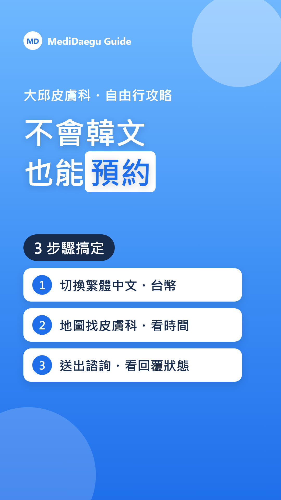
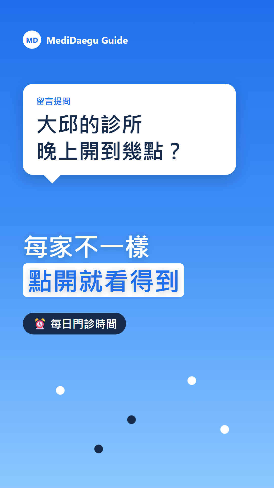
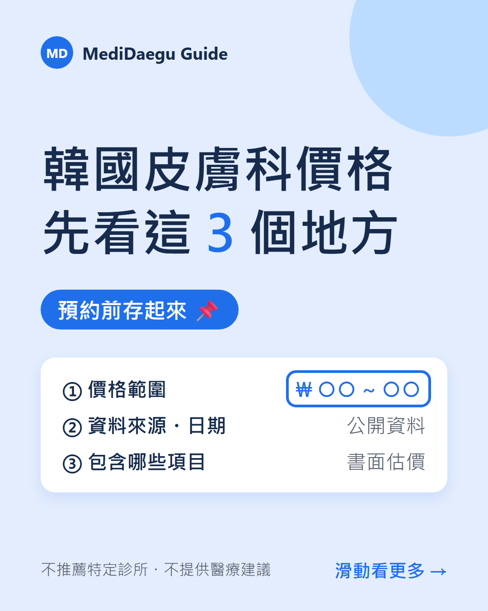
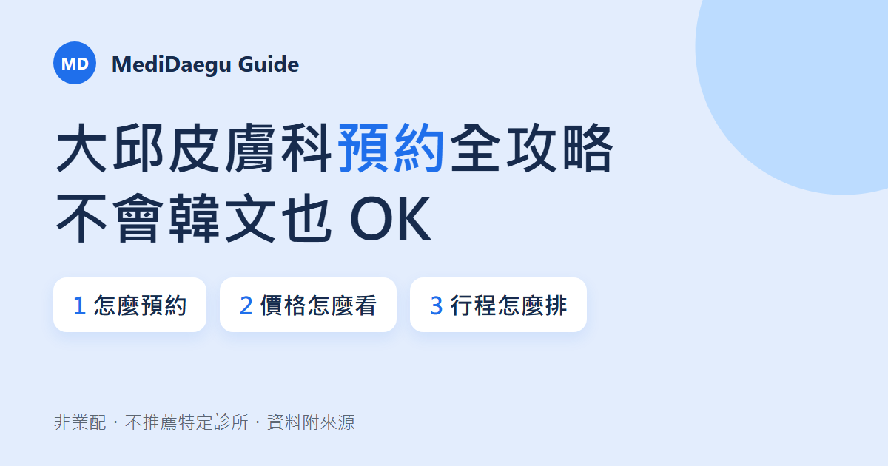

# 대만 유입 마케팅 — 인스타그램 · Dcard

> 작성 2026-11-19 · 대상: 대만(번체 중국어) · 발표 12/4
> 상태: **Claude 초안, 팀 논의 전.** 게시 전 규제 확인은 팀원 2(가격·규제)
> 관련: [유입마케팅-틱톡-인스타.md](유입마케팅-틱톡-인스타.md)(전체 방향) · [대만-SNS-이용-현황.md](대만-SNS-이용-현황.md)(플랫폼 근거) · [유입마케팅-예시.html](유입마케팅-예시.html)(컷별 대본 전체)

## 0. 한 줄 방향

**인스타그램에서 보게 하고, Dcard에서 믿게 한다.** 둘 다 병원·시술 광고가 아니라 "대구에서 외국인이 피부과를 예약하는 법"을 알려 주는 정보로 들어가고, 프로필 링크로 메디대구 웹(번체 중국어 화면)에 연결해요.

| | 인스타그램 | Dcard |
|---|---|---|
| 역할 | **발견·저장** — 릴스로 처음 보고, 캐러셀을 저장 | **신뢰·검색** — 시술을 알아보는 사람이 읽는 긴 정보 글 |
| 형식 | 릴스(9:16) · 캐러셀(4:5) | 글 + 표지 이미지 |
| 빈도 | 주 3회 (릴스 2 · 캐러셀 1) | 주 1회 (긴 글 1) |
| 보는 숫자 | 저장 · 프로필 링크 클릭 | 좋아요(心情) · 댓글 질문 · 저장(收藏) |

Facebook은 팀 판단으로 제외(젊은 층 비중이 애매), LINE은 메신저라 유입 채널이 아니라 상담 연결용, 샤오훙수(小紅書)는 대만에서 1년 차단 중이라 제외예요 ([대만-SNS-이용-현황.md](대만-SNS-이용-현황.md)).

## 1. 왜 이 두 곳인가 (근거)

| 근거 | 값 | 출처 |
|---|---|---|
| 대만 "가장 많이 쓰는 SNS" 중 Instagram | **21.07%** (2위, Facebook 51.38% 다음) | [S1] 공식 |
| 짧은 영상 시청 (최근 3개월, 릴스·쇼츠 포함) | **78.46%** (매일 58.04%) | [S1] 공식 |
| 틱톡 사용 (최근 3개월) | 25.16% — 그래서 틱톡 대신 인스타 릴스를 주로 | [S1] 공식 |
| Dcard 이용자 중 18~35세 | **약 80%** (Dcard 측 발표) | [S2] 언론 |
| 메디대구 VOC: 예약 방법을 몰라 막힘 | 병원 정보 36건 중 예약 방법·채널 10건 (가장 많음) | [S6] 팀 내부 |
| 메디대구 VOC: 효과·회복 정보 | 시술 정보·효과·회복 36건, 좋아요 714 (가장 많음) | [S6] 팀 내부 |
| 메디대구 VOC: 가격 정보 없음 | 가격 19건 중 16건 | [S6] 팀 내부 |
| 메디대구 VOC: 홍보·협찬 영상이 많음 | 칭찬 쪽으로 기울 수 있다고 한계에 기록 | [S6] 팀 내부 |

- Dcard 숫자는 Dcard 측 발표를 옮긴 언론 보도라 **원문은 미확인**이에요. 대만 공식 조사(TWNIC)에는 Dcard 항목이 없어요
- 마지막 VOC 줄 때문에 두 곳 모두 **"협찬 없음 · 병원 추천 없음 · 출처 표시"**를 계정 정체성으로 둬요

## 2. 인스타그램

### 2-1. 프로필

| 칸 | 내용 (번체 중국어 / 한국어) |
|---|---|
| 이름 (예시) | MediDaegu Guide · `@medidaegu.guide` (계정 이름 미정) |
| 소개 1줄 | 大邱皮膚科・就醫預約指南 🇰🇷 / 대구 피부과·진료 예약 안내 |
| 소개 2줄 | 不業配・不推薦診所・資料附來源 / 협찬 없음 · 병원 추천 없음 · 자료 출처 표시 |
| 링크 | 메디대구 웹 (번체 중국어 화면으로 바로 열리는 주소) |
| 하이라이트 | 預約流程(예약 절차) · 價格怎麼看(가격 보는 법) · 常見問題(자주 묻는 질문) |

### 2-2. 콘텐츠 예시 3개 (썸네일)

색은 메디대구 웹 테마예요: 파랑 `#1f6feb` · 연하늘 `#e3edfd` · 남색 `#172b4d` · 흰색 [S9]

| 릴스 #1 · 예약 따라하기 (25초) | 릴스 #2 · 댓글 Q&A (15초) | 캐러셀 · 가격 보는 법 (6장) |
|---|---|---|
|  |  |  |
| 1080×1920 | 1080×1920 | 1080×1350 |
| **不會韓文也能預約**<br>한국어 몰라도 예약 가능 | **大邱的診所晚上開到幾點？**<br>대구 클리닉은 밤 몇 시까지? | **韓國皮膚科價格 先看這3個地方**<br>한국 피부과 가격, 이 3곳부터 |
| VOC: 예약 방법·채널 10건, "연락했는데 답이 없다" | VOC: "밤에 가고 싶은데 몇 시까지?" (T11-013) | VOC: 가격 정보 없음 16건, "체험가로 될까 불안", 묶음 권유(강도 3) |

파일 이름에 tiktok이 붙어 있지만 9:16이라 **릴스 표지로 그대로** 써요. 같은 영상을 틱톡·유튜브 쇼츠에도 다시 올릴 수 있어요.

**릴스 #1 대본 (25초)** — 메디대구 웹 화면 녹화 + 대구 거리 영상(얼굴 없음)

| 시간 | 화면 | 자막 (번체 중국어 / 한국어) |
|---|---|---|
| 0~2초 | 대구 동성로 거리 | 想去大邱做皮膚管理，卻不知道怎麼預約？ / 대구에서 피부관리 받고 싶은데 예약 방법을 모르겠다면? |
| 2~8초 | 언어를 繁體中文, 통화를 TWD로 | ① 先切換成繁體中文，價格自動換算台幣 / 번체 중국어로 바꾸면 가격이 대만달러로 바뀌어요 |
| 8~14초 | 지도 → 피부과 필터 → 병원 카드의 진료시간·상담 언어 | ② 用地圖找皮膚科，先看門診時間和諮詢語言 / 지도에서 피부과를 찾고 진료시간과 상담 언어부터 보세요 |
| 14~21초 | 상담하기 → 날짜·시간 → 요청 → 상태 "확인 중" | ③ 送出諮詢需求，診所回覆的狀態都看得到 / 상담 요청을 보내면 병원이 답했는지 상태로 보여요 |
| 21~25초 | 프로필 링크 안내 | 不用再到處傳訊息等回覆 ➜ 連結在主頁 / 여기저기 메시지 보내고 기다리지 않아도 돼요 → 링크는 프로필에 |

**릴스 #2 대본 (15초)** — 실제로 이런 댓글이 달렸을 때 "댓글에 영상으로 답하기"

| 시간 | 화면 | 자막 |
|---|---|---|
| 0~3초 | 댓글 스티커 | 有人問：大邱的診所晚上開到幾點？ / 이런 질문이 왔어요: 대구 클리닉은 밤 몇 시까지? |
| 3~10초 | 병원 카드의 요일별 진료시간 | 每家診所不一樣，點開卡片就能看到每天的門診時間 / 병원마다 달라요, 카드를 누르면 요일별 진료시간이 보여요 |
| 10~15초 | 프로필 링크 | 時間會變動，出發前再跟診所確認一次 ✔ / 시간은 바뀔 수 있어요, 출발 전에 병원에 한 번 더 확인하세요 |

**캐러셀 6장** — 금액(₩○○)은 게시 전에 공공데이터 가격 범위 + 출처·기준일로 채워요

| 장 | 번체 중국어 | 한국어 |
|---|---|---|
| 1 | 韓國皮膚科價格 先看這3個地方 (표지 썸네일) | 한국 피부과 가격, 이 3곳부터 |
| 2 | 價格看「範圍」，不是單一數字 | 가격은 숫자 하나가 아니라 범위로 |
| 3 | 價格從哪裡來？看資料來源 | 이 가격은 어디서 왔나? 출처를 보세요 |
| 4 | 「體驗價」「活動價」不一定適用每個人 | 체험가·이벤트가는 모두에게 적용되지 않을 수 있어요 |
| 5 | 看診前，可以要求書面估價 | 진료 전에 예상 비용을 서면으로 요청할 수 있어요 |
| 6 | 價格自動換算台幣・連結在主頁 | 가격은 대만달러로 자동 환산 · 링크는 프로필에 |

**캡션 공통 끝 문장**: 本帳號不推薦特定診所，看診與費用請以診所說明為準 (특정 병원을 추천하지 않으며, 진료와 비용은 병원 안내를 따라 주세요)
**해시태그 예시**: #大邱 #大邱自由行 #韓國皮膚科 #韓國自由行 #韓國旅遊攻略

## 3. Dcard

### 3-1. 어디에 올리나

| 게시판 | 올릴 글 | 비고 |
|---|---|---|
| **醫美板** (`/f/facelift`) | 가격 보는 법, 상담 전에 물어볼 것, 회복 기간 확인하는 법 | 시술 정보·분쟁 글이 활발한 곳 [S3] |
| 韓國板 | 대구 피부과 예약 절차, 진료시간 확인법 | 게시판 주소·규칙은 게시 전 확인 (미확인) |
| 旅遊板 | 대구 2박 3일 일정에 진료 넣는 법 | 게시판 주소·규칙은 게시 전 확인 (미확인) |

### 3-2. 글 예시 (표지 썸네일)



1200×630 · 글 맨 위에 넣는 표지

**제목**: `#分享 大邱皮膚科預約全攻略｜不會韓文也OK（非業配）`
(한국어: #공유 대구 피부과 예약 총정리 | 한국어 몰라도 OK (협찬 아님))

**본문 (번체 중국어 → 한국어 요약)**

```
大家好，我們是做「大邱就醫資訊」的團隊 MediDaegu。
這篇不是業配，也不推薦任何一家診所，只整理預約時會卡住的地方。

1. 怎麼預約
- 很多人卡在「不知道要用哪個管道聯絡」、「傳了訊息沒人回」
- 先確認診所的門診時間和可諮詢的語言，再送出諮詢
- 送出後要能看到診所有沒有回覆，不要只靠私訊等待

2. 價格怎麼看
- 看「範圍」不要看單一數字，同一個項目每家都不同
- 看資料來源和日期（例：醫院公開的非給付費用）
- 「體驗價／活動價」不一定適用，預約前先問包含哪些項目
- 看診前可以要求書面估價

3. 行程怎麼排
- 先查該項目一般需要的恢復時間（請以醫師說明為準）
- 預留回程前的緩衝日

有問題可以留言，我們會整理成下一篇。
※ 本文不提供醫療建議，看診與費用請以診所說明為準。
```

한국어 요약: 메디대구 팀이 쓴 글이고 협찬·병원 추천이 아님을 먼저 밝힘 → ① 예약: 진료시간·상담 언어 확인 후 상담 요청, 응답 여부를 확인할 수 있어야 함 ② 가격: 범위·출처·기준일 확인, 체험가·이벤트가 주의, 서면 견적 요청 ③ 일정: 회복 기간 확인(의사 설명 우선), 귀국 전 여유일 → 질문은 댓글로

- 링크는 본문에 넣지 않고 **프로필(個人頁)에만** 둬요. 게시판마다 외부 링크·홍보 규칙이 달라서, 처음엔 링크 없는 정보 글로 신뢰부터 쌓아요
- 본문에 메디대구 화면을 넣을 때는 병원 이름이 보이지 않게 가려요

### 3-3. Dcard 규칙 — 꼭 지킬 것

| 규칙 | 내용 | 출처 |
|---|---|---|
| 팀이라고 밝히기 | 개인인 척 후기처럼 쓰지 않고 **"메디대구 팀이 쓴 글"**을 첫 줄에 밝혀요. 개인 계정으로 몰래 홍보하면 위장 홍보가 돼요 | 팀 원칙 |
| 브랜드 계정도 게시판 규칙 적용 | 브랜드 계정은 자기 페이지에 상업 콘텐츠를 올릴 수 있지만, 게시판에 쓸 때는 전체 규칙·게시판 규칙·광고 규칙을 지켜야 함 | [S4] (검색 요약, 원문 미확인) |
| "官方合作(공식 협업)" 태그 쓰지 않기 | Dcard 공식 협업이 아닌데 이 태그를 쓰면 태그 삭제, 반복 시 글 삭제 + 7일 정지 | [S4] (검색 요약, 원문 미확인) |
| 게시판 규칙은 게시판 관리자가 정함 | 위반하면 글 삭제·글쓰기 제한 | [S5] (검색 요약) |
| 댓글 조작 금지 | 여러 계정으로 댓글을 다는 방식은 쓰지 않음 (醫美板에서 클리닉의 댓글 조작 의심 글이 있었음) | [S3] 개인 글 |

**게시 전 확인 (팀)**: 醫美板·韓國板·旅遊板의 게시판 규칙 원문, Dcard 광고·상업 콘텐츠 규칙 원문(공지 글이 자동 접속을 막아 이번에 원문을 못 읽음)

## 4. 두 곳 공통 — 넣지 않는 것 (의료법·팀 원칙)

| 하지 않음 | 이유 |
|---|---|
| 특정 병원·의사 추천, 순위, "최고" | 의료법 제56조 제2항 비교·과장 유형, 우리는 의료광고 주체가 될 수 없음 (제56조 제1항) [S7] |
| 치료 전후 사진, 환자 후기·경험담 | 제56조 제2항 제2호 [S7] |
| 할인가·이벤트가·"특가" | 제56조 제2항 제13호 유형 + 팀 원칙 [S7] |
| 시술 권유 ("이거 받으세요") | 진료 판단은 병원 몫 |
| 병원 이름·로고가 보이는 화면 | 특정 병원 광고로 보일 수 있음 |

- **확인 필요 (팀원 2)**: 대만 사람을 대상으로 한 게시물이라도 국내에서 보이면 의료법 제56조 제2항 제12호 "외국인환자 유치 **국내광고**" 금지와 부딪히는지 [S8]

## 5. 12/4 발표까지

| 날짜 | 인스타그램 | Dcard | 결과물 |
|---|---|---|---|
| 11/20~11/23 | 계정·프로필 만들기, 릴스 2 + 캐러셀 1 촬영·제작 | 계정 만들기, 3개 게시판 규칙 원문 확인, 글 1개 다듬기 | 계정 · 게시물 준비 |
| 11/24~11/29 | 릴스 4 · 캐러셀 2 발행 (주 3회) | 醫美板 글 1 · 韓國板 글 1 | 게시물 8개 |
| 11/30~12/2 | 저장·링크 클릭 집계 | 좋아요·댓글 질문 집계, 질문을 다음 글·릴스로 | 지표표 |
| 11/30~12/2 | 대만 사용자 테스트 5명: "이 게시물을 보고 메디대구를 눌러 보겠나, 왜?" | ← 같은 5명에게 Dcard 글도 보여 주기 | 테스트 메모 |
| 12/3 | 발표 장 정리: "광고 없이 정보로 들어오게 한다" + 실제 숫자 | | 발표 장 |
| **12/4** | **발표** | | |

- 계정 만들기·게시는 팀이 직접 해요 (Claude는 대본·문구·썸네일까지)
- 숫자가 작아도 그대로 보여 줘요. 기간이 2주라 "상담 요청 n건"보다 **저장·링크 클릭·댓글 질문**이 현실적인 지표예요

## 6. 남은 질문

- 계정 이름: "MediDaegu"를 드러낼지, 정보 계정 이름으로 할지
- 메디대구 웹에 **LINE 상담 연결**이 있는지 (대만 메신저 90%가 LINE [S1]) — 있으면 릴스 #1 마지막 컷에 넣기
- Dcard 글을 브랜드 계정으로 쓸지, 팀원 개인 계정 + "팀이 씀" 표시로 쓸지

## 썸네일 파일

| 파일 | 크기 | 쓰는 곳 |
|---|---|---|
| [thumbnails/tiktok1_예약3단계.png](thumbnails/tiktok1_예약3단계.png) | 1080×1920 | 인스타 릴스 #1 표지 (틱톡·쇼츠 공용) |
| [thumbnails/tiktok2_진료시간QA.png](thumbnails/tiktok2_진료시간QA.png) | 1080×1920 | 인스타 릴스 #2 표지 |
| [thumbnails/insta1_가격읽는법_표지.png](thumbnails/insta1_가격읽는법_표지.png) | 1080×1350 | 인스타 캐러셀 1장 |
| [thumbnails/dcard1_예약전체가이드_표지.png](thumbnails/dcard1_예약전체가이드_표지.png) | 1200×630 | Dcard 글 표지 |

원본 HTML은 [thumbnails/src/](thumbnails/src/)에 있어요. 글자를 바꾼 뒤 Chrome 헤드리스로 다시 찍어요:
`chrome --headless=new --window-size=1080,1920 --screenshot=out.png thumbnails/src/tiktok1.html` (Dcard 표지는 `--window-size=1200,630`)

## 출처

| 번호 | 자료 | URL | 등급 | 기준 시점 | 확인일 |
|---|---|---|---|---|---|
| S1 | TWNIC, 2025 台灣網路報告 (요약본) — SNS·짧은 영상·틱톡·메신저 | https://report.twnic.tw/2025/en/assets/download/TWNIC_TaiwanInternetReport_2025_CH_summary.pdf | 공식 | 2025-07-28 ~ 09-01 조사, 2,142명 | 2026-11-19 |
| S1-1 | 數位時代, 2025 台灣網路報告 보도 (S1과 숫자 일치 확인) | https://www.bnext.com.tw/article/85569/2025-taiwan-internet-report | 언론 | 2025-12 | 2026-11-19 |
| S2 | 數位時代, Dcard 이용자 약 80%가 18~35세 (Dcard 측 발표) | https://www.bnext.com.tw/article/83303/dcard-premium-2025 | 언론 (Dcard 원문 미확인) | 2025 | 2026-11-19 |
| S3 | Dcard 醫美板 글 (클리닉 댓글 조작 의심 논의) | https://www.dcard.tw/f/facelift/p/236633621 | 개인 | 게시일 미확인 | 2026-11-19 |
| S4 | Dcard 공지, 광고·상업 콘텐츠 규칙 (官方合作 태그, 브랜드 계정) | https://www.dcard.tw/f/announcement/p/234243656 | 공식 (자동 접속 차단 403 → 검색 결과 요약만 확인, **원문 미확인**) | 게시일 미확인 | 2026-11-19 |
| S5 | Dcard 이용약관 (게시판 관리·처분) | https://www.dcard.tw/terms | 공식 (검색 요약만 확인, 원문 미확인) | 미확인 | 2026-11-19 |
| S6 | 틱톡 3차 VOC 138건 (검수 14차 채택) | [../../painpoint/voc_tiktok.md](../painpoint/voc_tiktok.md) | 팀 내부 | 2023-08 ~ 2026-11 댓글 | 2026-11-19 |
| S7 | 의료법 제56조·제57조 정리 (원문 https://www.law.go.kr/법령/의료법) | [규제-가격노출-의료광고.md](../research/의료관광/규제-가격노출-의료광고.md) | 공식 (팀 노트 경유) | 시행 2026-10-02 | 2026-11-19 |
| S8 | 의료법 제56조 제2항 제12호 · 의료해외진출법 제15조 정리 | [규제-병원연결-유인알선.md](../research/의료관광/규제-병원연결-유인알선.md) | 공식 (팀 노트 경유) | 2026-10-29 확인분 | 2026-11-19 |
| S9 | 메디대구 웹 테마 색 | `apps/web-platform/src/styles.css` (frontend 브랜치) | 팀 내부 | 2026-11-19 | 2026-11-19 |
| 참고 | 샤오훙수 1년 차단 (제외 이유) — udn · 公視 | https://udn.com/news/story/6656/9183137 · https://news.pts.org.tw/article/784654 | 언론 (2개 교차) | 2025-12-04 | 2026-11-19 |
