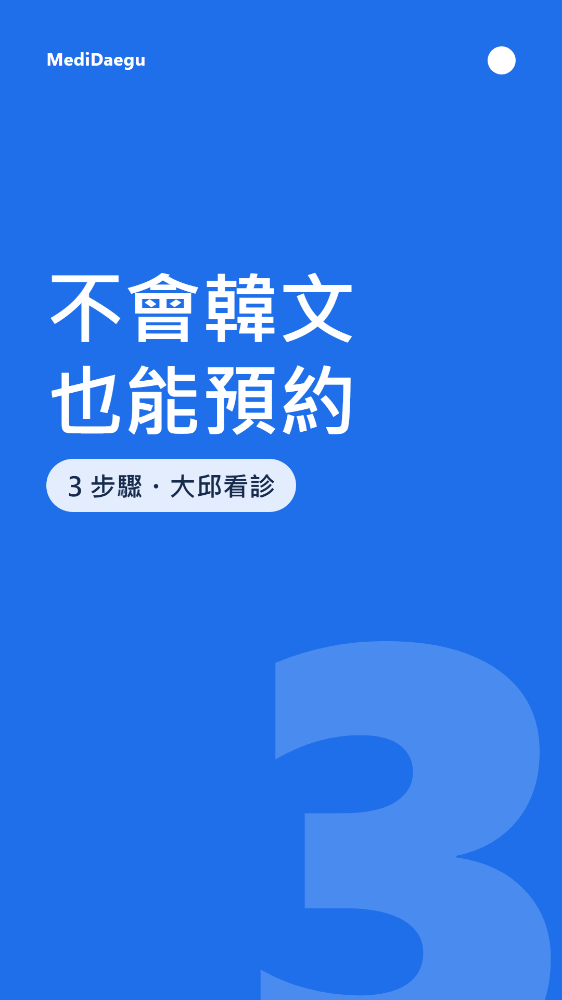
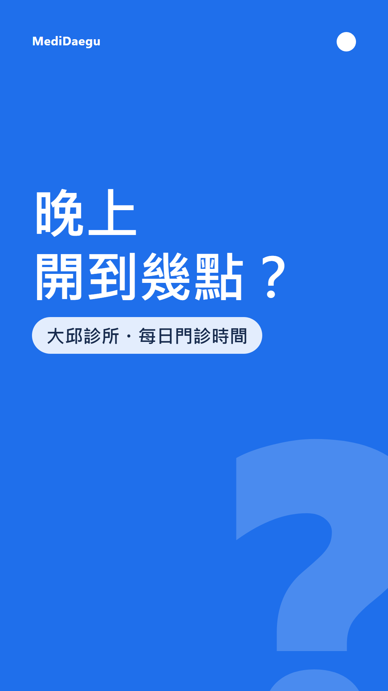
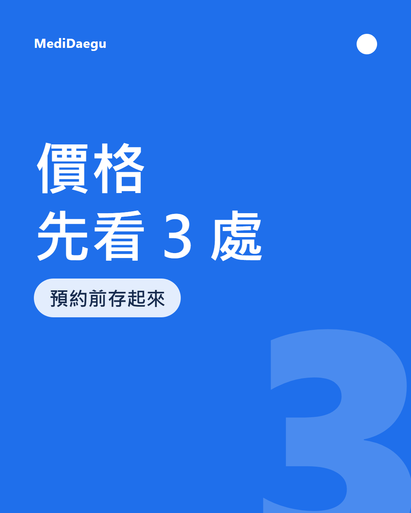

# 유입 마케팅안 — 틱톡 · 인스타그램 (초안)

> 작성 2026-11-19 · 근거: 틱톡 3차 VOC 138건([painpoint/voc_tiktok.md](../painpoint/voc_tiktok.md)) · 팀 규제 노트([규제-가격노출-의료광고.md](../research/의료관광/규제-가격노출-의료광고.md), [규제-병원연결-유인알선.md](../research/의료관광/규제-병원연결-유인알선.md))
> 상태: **Claude 초안, 팀 논의 전.** 규제 부분은 팀원 2(가격·규제) 확인 필요

## 0. 한 줄 방향

**병원·시술을 광고하지 않고, "대구에서 피부과 예약하는 법"을 알려 주는 정보 계정**으로 간다.
→ 틱톡에서 발견되고, 인스타에서 저장·신뢰를 쌓고, 프로필 링크로 메디대구(챗봇·상담 요청)에 들어오게 한다.

왜 이렇게 하나:
- 우리는 의료인이 아니라 **의료광고를 할 수 없음** (의료법 제56조 제1항, 팀 노트). 원칙도 "이벤트가·할인가, 병원·시술 광고 하지 않음"
- VOC에서 사람들이 막힌 곳은 **시술 자체보다 "어디서·어떻게 예약하나"**였음 (아래 1장)

## 1. VOC에서 가져온 콘텐츠 근거 (틱톡 3차, 138건)

| VOC에서 보인 것 | 건수·반응 | 콘텐츠로 바꾸면 |
|---|---|---|
| 예약 채널이 제각각, "어디서 어떻게 예약하는지 말해 주는 사람이 없다" | 병원 정보 36건 중 예약 방법·채널 10 (가장 많음) | **예약 방법 가이드** (메신저별·언어별) |
| 정보 공유 영상에 "도움 됐다, 한국어 앱은 부담" | T24-004, T10-049 등 칭찬 | 예약 앱·절차 **외국어 따라하기** |
| 효과·다운타임이 불확실 | 시술 정보·효과·회복 36건, **좋아요 714 (가장 많음)** | 시술별 **일반 회복 기간·일정 짜기** (출처 표시, 효과 약속 없음) |
| "엔화로 얼마?", "몇 엔이었어요?" | 가격 19건 중 가격 정보 없음 16 | **가격 범위 읽는 법** (공공 기준 범위 + 환율, 할인가 없음) |
| "아파요?" | 안전·통증 26건 중 통증·공포 22 | 통증을 말하지 않고 **상담 때 물어볼 질문 리스트**로 |
| 연락했는데 답이 없다, 출국 직전 (강도 2) | T10-021 | "요청 → 병원 응답 상태가 보인다"는 **서비스 기능 소개** |
| 공장식·업셀 불만, 홍보·협찬 영상이 많음 | ④ 불만 · `#PR` 영상 다수 | **협찬 없음 · 출처 표시**를 계정 정체성으로 |

## 2. 플랫폼 역할 나누기

> **대만 기준 수정 (2026-11-19)**: 대만은 틱톡 사용이 25%(최근 3개월), "가장 많이 쓰는 SNS" 4%로 소수이고, Instagram 21%·Facebook 51%, 메신저는 LINE 90%예요. 짧은 영상은 78%가 봐요 (TWNIC 2025, [대만-SNS-이용-현황.md](대만-SNS-이용-현황.md)). → **대만은 인스타 릴스(주) + Threads(Q&A) + Dcard(정보 글)**, 같은 영상을 유튜브 쇼츠·틱톡에 재업로드. 페이스북은 보조로 같이 올림(2026-11-19 팀 결정), LINE 상담 연결은 없음, 샤오훙수는 대만에서 1년 차단 중이라 제외. 아래 표의 틱톡 역할은 영어권·젊은 층 기준이에요

| | 틱톡 | 인스타그램 |
|---|---|---|
| 역할 | **발견** — 검색·추천으로 처음 만남 | **저장·신뢰·전환** — 다시 찾아보고 링크로 들어옴 |
| 형식 | 15~30초 세로 영상, 댓글 질문에 영상으로 답하기 | 캐러셀(가이드 5~8장) · 릴스(틱톡 재활용) · 하이라이트(FAQ) |
| 들어오는 길 | 검색어 (예: 韓国 皮膚科 予約, 大邱 皮膚科, Daegu dermatology) | 프로필 링크 → 메디대구 / DM 자동응답 → 챗봇 |
| 보는 숫자 | 조회·검색 유입·댓글 질문 수 | **저장 수** · 프로필 링크 클릭 · 상담 요청 제출 |

흐름: 틱톡 영상 → (프로필) → 인스타 가이드 저장 → 프로필 링크 → **메디대구 챗봇 / 상담 요청서** → 병원 응답 상태 확인

## 3. 콘텐츠 기둥 4개 (주 3~4개 발행 기준)

| 기둥 | 예시 제목 | 비중 |
|---|---|---|
| ① 예약 따라하기 | "대구 피부과, 외국인이 예약하는 3단계" · "LINE/WhatsApp/카카오톡, 뭐로 연락해야 하나" | 40% |
| ② 일정·회복 정보 | "2박 3일 대구 여행이면 회복 기간을 이렇게 확인하세요" (시술 추천 아님, 일반 정보 + 출처) | 25% |
| ③ 가격 읽는 법 | "한국 피부과 가격표, 이 칸을 보세요" · 공공 기준 가격 범위 → 엔·대만달러 환산 | 20% |
| ④ 댓글 Q&A | 실제 댓글 질문을 화면에 띄우고 답하기 ("다 영어 해요?", "밤 몇 시까지?") | 15% |

- 대구 여행 동선(공항·동성로 등)은 ①·②에 곁들이는 정도로. 대구 관련 숫자(노선·거리)는 아직 **미확인**이라 넣기 전에 출처 확인
- 언어: **번체 중국어(대만) → 영어** 먼저. 대만은 프레임워크 핵심 고객이자 사용자 테스트 대상. 일본어는 VOC에서 가장 많은 언어(일본어 75 · 영어 55)지만 **메디대구 웹에 일본어 화면이 아직 없어서**(지금 ko·en·zh-TW·zh-CN·vi) 링크로 들어와도 읽을 수 없음 → 웹에 일본어가 생긴 뒤에
- 같은 영상을 언어별 자막만 바꿔 3개 계정 또는 1개 계정 + 다국어 자막 → **1개 계정으로 시작해 반응 보고 나누기** 권장

## 4. 하지 말아야 할 것 (규제·원칙)

| 하지 않음 | 이유 |
|---|---|
| 특정 병원·의사 추천, 순위, "최고·유일" | 의료법 제56조 제2항 비교·과장 유형, 우리는 의료광고 주체가 될 수 없음 (제56조 제1항) |
| 치료 전후 사진, 환자 후기·경험담 영상 | 제56조 제2항 제2호 (치료경험담 등 효과 오인) |
| 할인가·이벤트가·"첫 방문 특가" | 제56조 제2항 제13호 유형 + 팀 원칙 |
| 시술을 무료로 받게 하고 후기 올리게 하는 인플루언서 협찬 | 경험담 광고 + 유인 문제 소지. 협찬을 하면 표시 의무(`#광고`)도 있음 |
| "이 시술 받으세요" 같은 시술 권유 | 진료 판단은 병원 몫 (챗봇 원칙과 같음) |

**확인 필요 (팀원 2)**
- 우리 SNS 게시물이 국내에서도 보이는데, 의료법 제56조 제2항 제12호 "외국인환자 유치 **국내광고**" 금지와 부딪히는지 → [규제-병원연결-유인알선.md](../research/의료관광/규제-병원연결-유인알선.md)의 해외진출법 제15조 특례와 함께 보기. 병원 이름이 안 나오는 "예약 방법 정보"는 광고가 아니라고 볼 여지가 있지만 **판단 근거는 아직 없음**
- 직접 유치(등록 유치사업자 가정)일 때 SNS 유료 광고(틱톡·메타 광고)를 해외 타깃으로 돌리는 것이 허용되는지 → 보건복지부·한국보건산업진흥원 질의 목록에 추가

## 5. 12/4 발표까지 해 볼 수 있는 것

예시 콘텐츠(프로필 · 틱톡 2개 · 인스타 캐러셀 1개 · 체크리스트): [유입마케팅-예시.html](유입마케팅-예시.html)

| 날짜 | 할 일 | 결과물 |
|---|---|---|
| 11/20~11/23 | 계정 이름 정하기 · 규제 확인(팀원 2) · 대본 6개 (예시 3개 + 3개) | 계정 · 대본 |
| 11/24~11/29 | 6개 발행 (이틀에 1개), 번체 중국어 자막 | 게시물 6개 |
| 11/30~12/2 | 숫자 모으기 (조회·저장·링크 클릭·댓글 질문), 대만 사용자 테스트 5명 | 지표표 · 테스트 메모 |
| 12/3 | 발표 장 1장 정리 | 발표 장 |
| **12/4** | **발표** — 예시 영상 1개 + 지표 + 테스트 반응 | 발표 |

- 발표 때는 **"광고 없이 정보로 들어오게 한다"**는 구조와 실제 수치(작아도 됨)를 함께 보여 주는 게 핵심
- 계정 만들기·게시는 팀이 직접 해요 (Claude는 대본·자막·캐러셀 문구 작성까지)

## 5-1. 예시 콘텐츠와 썸네일

색은 **메디대구 웹 테마**에 맞췄어요: 파랑 `#1f6feb` · 연하늘 `#e3edfd` · 남색 `#172b4d` · 흰색 (출처: `apps/web-platform/src/styles.css`). 글자는 번체 중국어(대만), 틱톡은 아래쪽·오른쪽이 버튼에 가려서 글자를 위·가운데에만 두었어요. 컷별 대본·자막 전체는 [유입마케팅-예시.html](유입마케팅-예시.html)에 있어요.

| 틱톡 #1 · 예약 따라하기 (25초) | 틱톡 #2 · 댓글 Q&A (15초) | 인스타 캐러셀 표지 (6장 중 1장) |
|---|---|---|
|  |  |  |
| 1080×1920 | 1080×1920 | 1080×1350 |
| 不會韓文也能預約 (한국어 몰라도 예약 가능) · 3단계: 번체 중국어·대만달러로 바꾸기 → 지도에서 피부과·진료시간 보기 → 상담 요청 보내고 응답 상태 보기 | 大邱的診所晚上開到幾點？ (대구 클리닉은 밤 몇 시까지?) → 병원마다 달라요, 카드를 누르면 요일별 진료시간이 보여요 | 韓國皮膚科價格 先看這3個地方 (가격, 이 3곳부터) · ① 가격 범위 ② 출처·기준일 ③ 포함 항목(서면 견적) |
| VOC: 예약 방법·채널 10건 (병원 정보 중 최다), "연락했는데 답이 없다" | VOC: "밤에 가고 싶은데 몇 시까지?" (T11-013) | VOC: 가격 정보 없음 16건, "체험가로 될까 불안", 묶음 권유 (강도 3) |

- 인스타 표지의 가격(₩○○)은 게시 전에 공공데이터 가격 범위와 출처·기준일로 채워요
- 틱톡 배경은 지금 그래픽이에요. 대구 거리 영상(얼굴 없음)을 찍으면 그 장면 위에 글자만 얹어요
- 썸네일 원본(HTML)은 [thumbnails/src/](thumbnails/src/)에 있어요. 글자를 바꾼 뒤 Chrome 헤드리스로 다시 찍으면 돼요:
  `python -I -X utf8 thumbnails/src/make_thumbs.py` 후 Chrome 헤드리스로 찍기 ([README.md](README.md))

## 6. 남은 질문

- 계정 이름을 "MediDaegu"로 할지, 정보 계정 느낌의 이름(예: "Daegu Skin Guide")으로 할지 — 서비스 이름이 드러나면 광고로 보일 가능성과 브랜드 인지의 균형
- 영상에 누가 나올지 (팀원 얼굴 vs 화면 녹화·자막만) — 개인정보 원칙상 **화면 녹화·자막형**이 무난
- 성과 기준: 발표용으로는 "상담 요청 n건"이 가장 좋지만, 기간이 짧아 **저장 수·링크 클릭**이 현실적

## 출처

| 자료 | 위치 | 등급 | 기준 시점 | 확인일 |
|---|---|---|---|---|
| 틱톡 3차 VOC 분류 138건 | [painpoint/voc_tiktok.md](../painpoint/voc_tiktok.md) · [voc_tt_classified.csv](../painpoint/voc_tt_classified.csv) | 팀 내부 (SNS 댓글 분류, 검수 14차 채택) | 2023-08 ~ 2026-11 댓글 | 2026-11-19 |
| 의료법 제56조·제57조 정리 | [규제-가격노출-의료광고.md](../research/의료관광/규제-가격노출-의료광고.md) (원문 https://www.law.go.kr/법령/의료법) | 공식 (팀 노트 경유) | 시행 2026-10-02 | 2026-11-19 |
| 의료해외진출법 제15조 · 의료법 제56조 제2항 제12호 정리 | [규제-병원연결-유인알선.md](../research/의료관광/규제-병원연결-유인알선.md) | 공식 (팀 노트 경유) | 2026-10-29 확인분 | 2026-11-19 |
