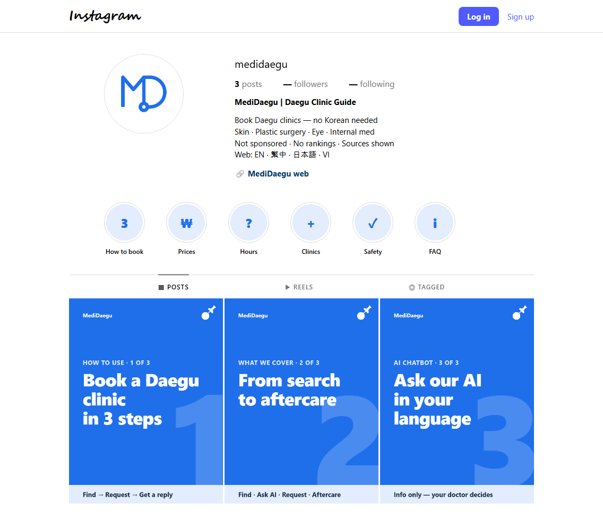
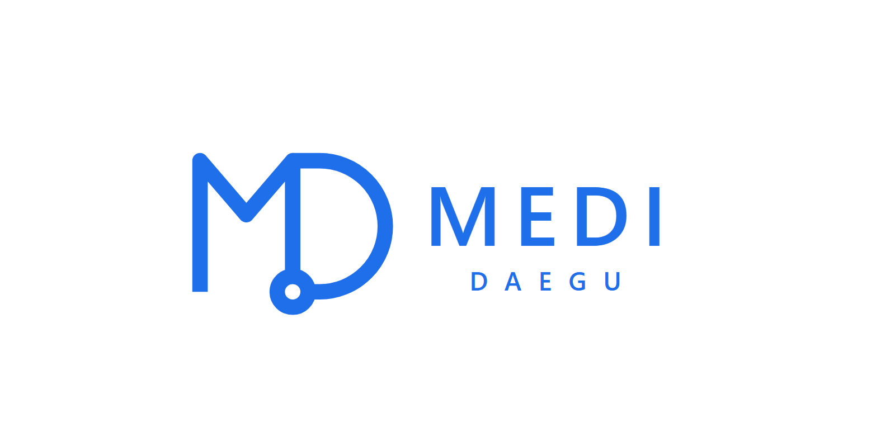
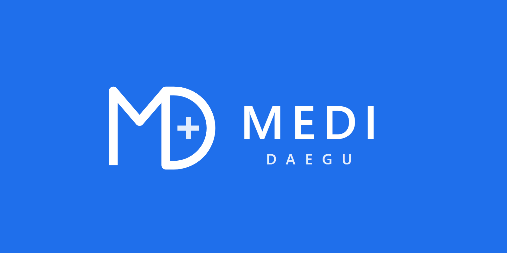
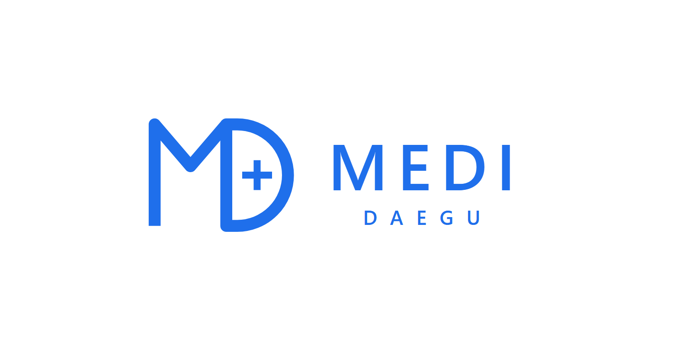
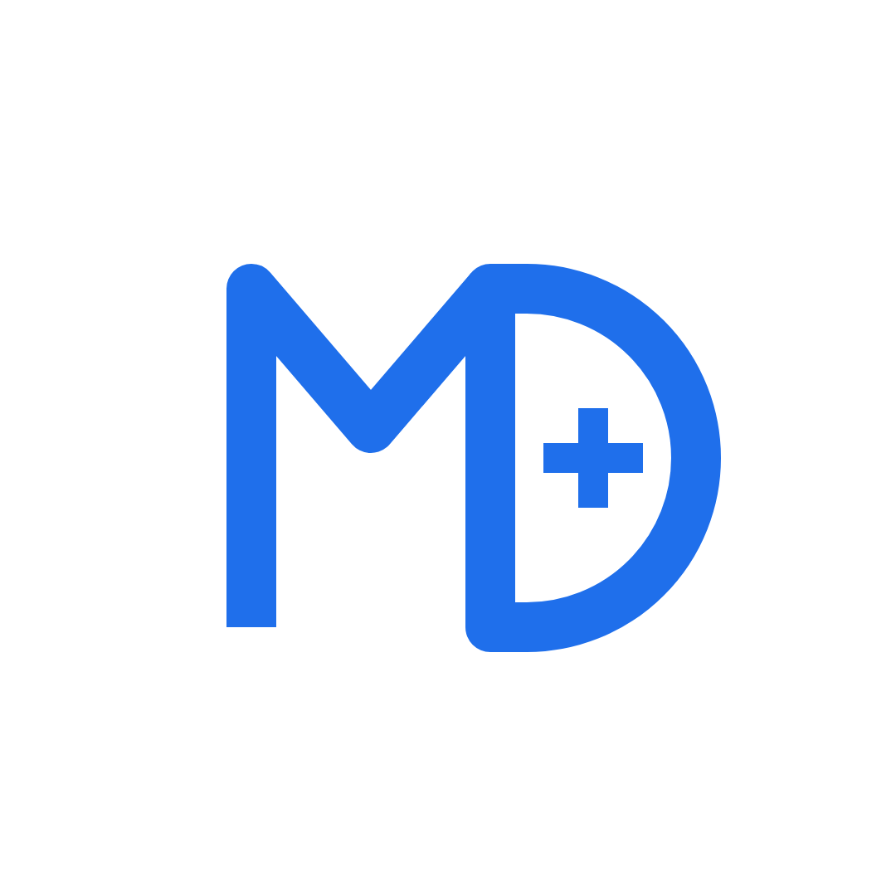
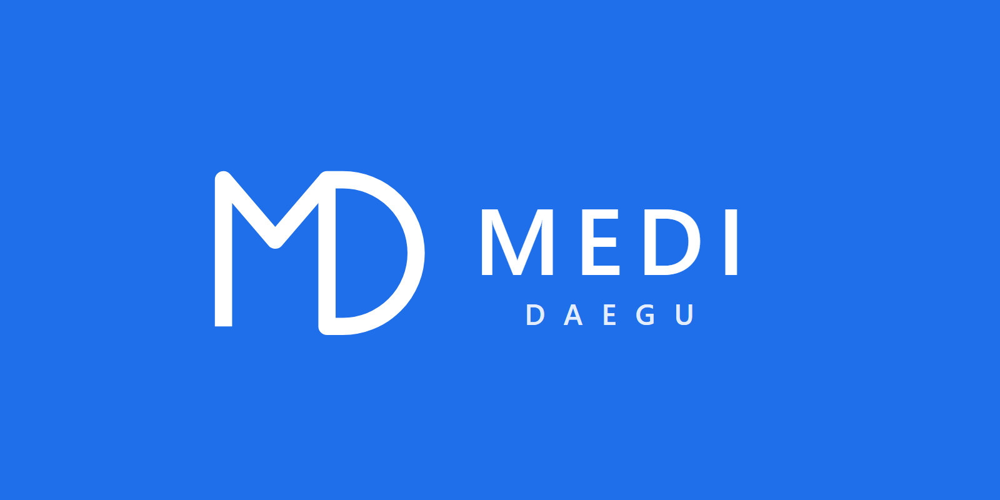
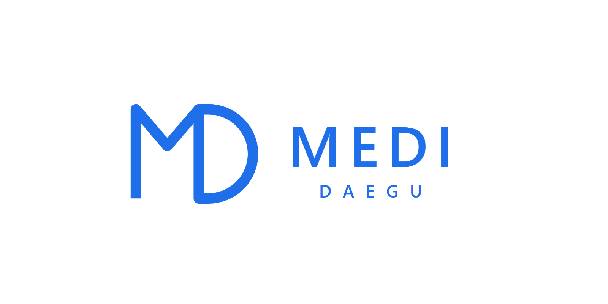
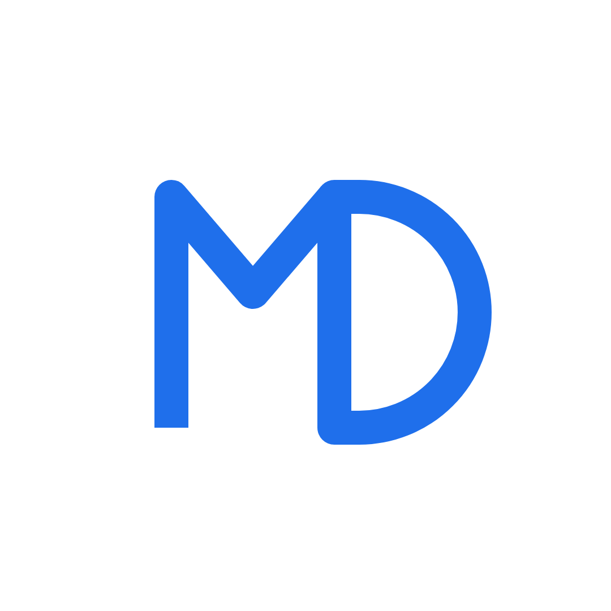
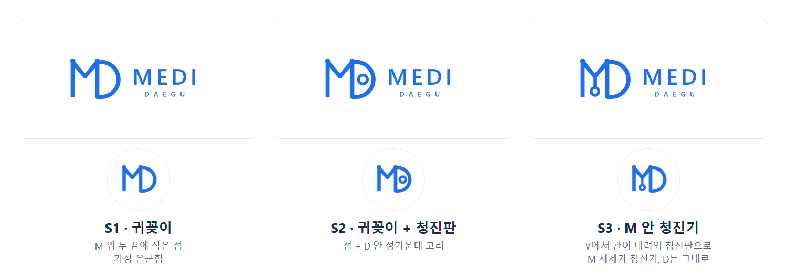
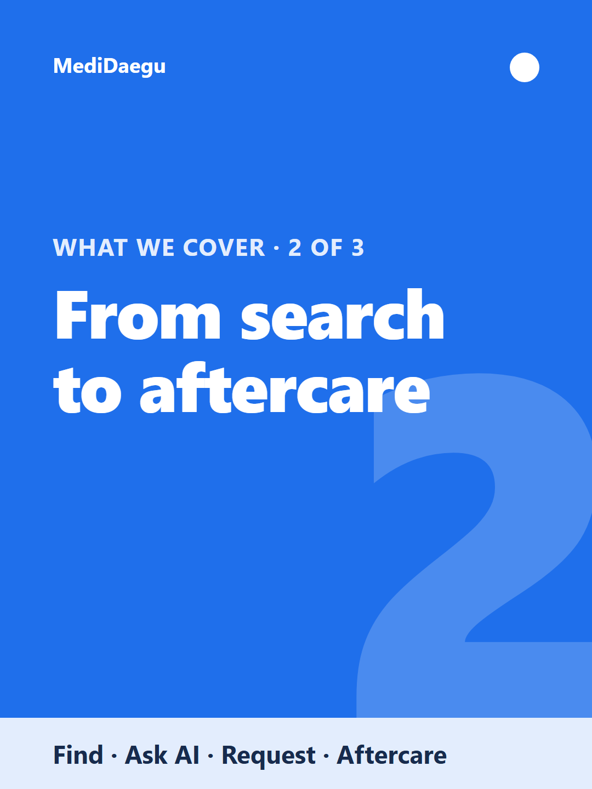

# 인스타그램 계정 구성 — MediDaegu (영어)

> 작성 2026-11-19 · 상태: **Claude 초안, 팀 논의 전** (게시 전 규제 확인은 팀원 2)
> 정한 것: 계정 이름 **MediDaegu** · 계정 언어 **영어로 통일** · 메인 컬러 메디대구 파랑 유지 · **로고 v8 확정: MD 모노그램 + 청진판 고리 · 흰 배경 (2026-11-20)** · **게시물은 고정 3개(이용 방법 · 서비스 범위 · AI 챗봇)만 (2026-11-20)**
> 관련: 전체 전략 [유입마케팅-국가별-진료과별.md](유입마케팅-국가별-진료과별.md) · 대만 세부안 [유입마케팅-인스타-Dcard.md](유입마케팅-인스타-Dcard.md)

## 1. 계정 화면 (목업)



[instagram/account_mockup.png](instagram/account_mockup.png) · 1136×2140 · 로그인 전 웹 화면 기준. 팔로워·팔로잉은 새 계정이라 "—"로 둠

## 2. 프로필

### 2-1. 프로필 사진 (로고 v8 확정 — MD 모노그램 + 청진판 고리, 흰 배경)

 

**v8 (2026-11-20 확정)**: 팀이 고른 시안을 벡터로 다시 그렸어요. M의 오른쪽 기둥(= D의 기둥)이 아래로 내려와 **작은 고리(청진판)**로 끝나고, D의 둥근 선이 그 고리로 들어가요. 선 굵기·색·MEDI / DAEGU 글자는 v6 그대로라 세련된 느낌을 유지하면서 청진기가 살짝 보여요. 프로필 사진 = [logo_v8_icon_white.png](instagram/logo_v8_icon_white.png) (= [profile.png](instagram/profile.png)) · 파랑 배경 보관본 [가로형](instagram/logo_v8_lockup_blue.png) · [아이콘](instagram/logo_v8_icon_blue.png) · 생성기 [instagram/src/make_logo_v8.py](instagram/src/make_logo_v8.py)

아래는 v8에 이르기까지의 이전 버전 기록이에요.

#### v6 (이전 확정본) — MD 모노그램, 흰 배경 · 십자 없음


팀이 보여 준 참고 느낌(같은 굵기 선 하나로 그린 기하학적 이니셜 + 오른쪽에 큰 글자·작은 글자 두 줄)을 따라, **MediDaegu의 약자 MD**로 만들었어요 (2026-11-20). 색은 메디대구 파랑·흰색·연하늘 그대로예요.

| 요소 | 뜻 |
|---|---|
| **MD 모노그램** | M의 오른쪽 기둥을 D의 기둥으로 같이 써서 두 글자를 한 모양으로 이음. 선 굵기는 모두 같음 |
| D 안쪽 **정가운데의 각진 진료 십자** | 메디컬 느낌을 **과하지 않게** 더함 — 모서리가 각진 십자를 D 빈 공간의 정가운데에 작게, 선은 모노그램보다 얇게. 파랑 배경에선 연하늘, 흰 배경에선 파랑 (2026-11-20) |
| 둥근 모서리 | 딱딱한 병원 느낌을 줄이고 부드럽게 |
| 가로형 글자 | 큰 **MEDI** + 작은 자간 넓은 **DAEGU** 두 줄, **DAEGU를 MEDI 가운데에 맞춤** |

**M 가운데 V**: V 꼭짓점을 조금 올려 V 사이 빈 공간을 줄였어요 (2026-11-20)

**네 가지 버전** — 배경 2개 × 십자 있음·없음

| | 파랑 배경 | 흰 배경 |
|---|---|---|
| **십자 있음** 가로형 |  |  |
| **십자 있음** 아이콘 |  |  |
| **십자 없음** 가로형 |  |  |
| **십자 없음** 아이콘 |  |  |
| 쓰는 곳 | 프로필 사진·SNS·영상 표지·발표 자료 | 웹 머리글·문서·명함처럼 바탕이 흰 곳 |

- v6 때 확정했던 것: 흰 배경 · 십자 없음 → [logo_v6_plain_icon_white.png](instagram/logo_v6_plain_icon_white.png) (v8로 바뀜)
- 흰 프로필 사진이 흰 화면에 묻히지 않게, 목업에서는 아바타 둘레에 얇은 회색 테두리를 넣었어요 (실제 앱은 자체 테두리 방식을 따름)
- 파랑 배경·십자 있는 버전은 필요할 때 쓰도록 파일만 남겨 둬요

| 파일 | 크기 | 십자 | 배경 |
|---|---|---|---|
| [logo_v6_lockup_blue.png](instagram/logo_v6_lockup_blue.png) · [logo_v6_lockup_white.png](instagram/logo_v6_lockup_white.png) | 1600×800 | 있음 | 파랑 · 흰 |
| [logo_v6_icon_blue.png](instagram/logo_v6_icon_blue.png) · [logo_v6_icon_white.png](instagram/logo_v6_icon_white.png) | 1080×1080 | 있음 | 파랑 · 흰 |
| [logo_v6_plain_lockup_blue.png](instagram/logo_v6_plain_lockup_blue.png) · [logo_v6_plain_lockup_white.png](instagram/logo_v6_plain_lockup_white.png) | 1600×800 | 없음 | 파랑 · 흰 |
| [logo_v6_plain_icon_blue.png](instagram/logo_v6_plain_icon_blue.png) · [logo_v6_plain_icon_white.png](instagram/logo_v6_plain_icon_white.png) | 1080×1080 | 없음 | 파랑 · 흰 |

생성기: [instagram/src/make_logo_v6.py](instagram/src/make_logo_v6.py)

**v7 시안 — MD를 다시 조합해 청진기를 살짝 떠올리게 (2026-11-20, 참고용 — 팀은 v8을 고름)**

v6의 선 굵기·색·글자(MEDI / DAEGU)는 그대로 두고 **M과 D만** 다시 조합했어요. 청진기 부품을 글자에 맞췄어요: 귀꽂이 2개 = M 위 두 끝의 점 · Y자 관 = M의 V · 청진판 = 작은 고리



| 안 | 바꾼 것 | 느낌 |
|---|---|---|
| S1 · 귀꽂이 | M 위 두 끝에 작은 점 | 가장 은근함. 청진기인지 알아보기는 어려움 |
| S2 · 귀꽂이 + 청진판 | 점 + D 안 정가운데 작은 고리 | D 안 고리가 눈(目)처럼 보일 수 있음 |
| **S3 · M 안 청진기 (추천)** | 점 + M의 V 꼭짓점에서 관이 내려와 두 다리 사이 고리(청진판)로 끝남. D는 그대로 | **M 자체가 청진기 모양**이 되면서 MD는 그대로 읽힘. 선 굵기·색이 같아 v6의 세련된 느낌 유지 |

파일: [logo_v7_S3_lockup.png](instagram/logo_v7_S3_lockup.png) · [logo_v7_S3_icon.png](instagram/logo_v7_S3_icon.png) (S1·S2도 같은 이름 규칙) · 생성기 [instagram/src/make_logo_v7.py](instagram/src/make_logo_v7.py)


- 참고 이미지는 분위기(선 하나로 된 이니셜 + 두 줄 글자)만 따랐고, 모양은 MD로 새로 그렸어요
- 이전 시안: v3 [logo_sheet.png](instagram/logo_sheet.png) · v4 [logo_sheet_v4.png](instagram/logo_sheet_v4.png) · v5 [logo_sheet_v5.png](instagram/logo_sheet_v5.png)

### 2-2. 이름·소개 (영어)

| 칸 | 내용 | 글자 수 |
|---|---|---|
| 사용자 이름 | `medidaegu` (사용 가능 여부 확인 필요) | — |
| 이름 | `MediDaegu \| Daegu Clinic Guide` | 30 (제한 약 30) [S2] |
| 소개 | `Book Daegu clinics — no Korean needed`<br>`Skin · Plastic surgery · Eye · Internal med`<br>`Not sponsored · No rankings · Sources shown`<br>`Web: EN · 繁中 · 日本語 · VI` | 149 (제한 150) [S2] |
| 링크 | 메디대구 웹 주소 (주소 정해지면 넣기) | — |

한국어 뜻: 대구 병원 예약 — 한국어 몰라도 돼요 / 피부·성형·안과·내과 / 협찬 없음 · 순위 없음 · 출처 표시 / 웹: 영어·번체·일본어·베트남어

- 소개 마지막 줄의 일본어(日本語)는 **웹 일본어 화면이 배포된 뒤** 넣어요. 일본어 화면은 `frontend-ja` 브랜치로 원격에 올라갔고(2026-11-19, `frontend`로 PR 전), 로컬에서 메뉴·메인 지도가 일본어로 나오는 것까지 확인. 백엔드가 아직 일본어·엔화를 받지 않아 가입·예약은 오류(422), JPY는 원화로 표시

### 2-3. 하이라이트 (스토리 묶음 6개)

| 하이라이트 | 아이콘 | 넣을 스토리 |
|---|---|---|
| How to book | `3` | 예약 3단계 화면 녹화 |
| Prices | `₩` | 가격 범위·출처 보는 법, 통화 바꾸기 |
| Hours | `?` | 진료시간 찾는 법 |
| Clinics | `+` | 진료과 4개 소개 (피부·성형·안과·내과) |
| Safety | `✓` | 등록 유치기관 확인법 |
| FAQ | `i` | 댓글·DM 질문 모음 |

## 3. 게시물 — 고정 3개만 (이용 방법 · 서비스 범위 · AI 챗봇)

2026-11-20 팀 결정: **고정 게시물 3개만 두고 다른 게시물은 없앰** (유튜브·페이스북·Dcard·샤오훙수도 같음). 처음 안 "3가지 약속(광고 없음·순위 없음·출처 표시)" 대신 **처음 온 사람이 바로 알아야 할 것** 3가지로 바꿈

**형식**: 1080×1440 (프로필 그리드 3:4) · 파랑 썸네일 v2 (파랑 바탕 · 흰 글자 · 연하늘 띠) · 아래 띠에 한 줄 요약 · 오른쪽 아래 큰 숫자 · 각 게시물은 캐러셀로 이어짐

| # | 게시물 (영어) | 한국어 뜻 | 아래 띠 | 캐러셀 다음 장에 넣을 것 | 근거 |
|---|---|---|---|---|---|
| 1 📌 | **HOW TO USE · 1 OF 3** · Book a Daegu clinic in 3 steps | 이용 방법: 3단계로 대구 병원 예약 | Find → Request → Get a reply | ① 언어·통화 고르기 ② 지도에서 병원 찾고 진료시간 보기 ③ 상담 요청 보내고 병원 답 상태 확인 (웹 화면 캡처) | VOC: 예약 방법·채널 10건 (가장 많음), "연락했는데 답이 없다" [S3] |
| 2 📌 | **WHAT WE COVER · 2 OF 3** · From search to aftercare | 서비스 범위: 병원 찾기부터 사후관리까지 | Find · Ask AI · Request · Aftercare | 해 주는 것: 병원 찾기(위치·진료시간·외국어 상담·가격 범위) · AI 챗봇 · 상담 요청과 병원 답 확인 · 사후관리(귀국 뒤 질문, 영수증 금액 확인) / **하지 않는 것**: 진단·치료 권유 · 병원 추천·순위 · 할인가 · 결제·항공·숙박 대행 → 상세 [마케팅-유입방법-고안.md](마케팅-유입방법-고안.md) "서비스 범위" | 서비스 핵심 기능 · 의료법 제56조 [S4] |
| 3 📌 | **AI CHATBOT · 3 OF 3** · Ask our AI in your language | AI 챗봇: 내 언어로 물어보기 | Info only — your doctor decides | 물어볼 수 있는 것: 병원 정보 · 가격 · 통역 (웹 챗봇 메뉴) / 정보만 주고 **진료 판단은 의사**가 함 | 웹 챗봇 화면 "Find Daegu medical and travel information together" · 진료 판단은 병원 몫 (서비스 원칙) |

<table><tr>
<td></td><td></td><td></td>
</tr></table>

파일: [instagram/posts/](instagram/posts/) (`post_01.png` ~ `post_03.png`)

- 예약 방법·가격·진료시간·진료과 안내는 게시물 대신 **하이라이트(스토리)와 릴스**로 보여 줘요 (2-3절)

### 3-1. 캡션 틀 (영어)

```
[제목 한 줄]
[2~3줄 설명 — 예약·가격·일정 정보만]

[JA] 日本語の一行説明

👉 Book in English / 日本語 (繁中 · Tiếng Việt too): link in bio
MediDaegu does not recommend specific clinics. Treatment and fees are decided by each clinic.

#Daegu #KoreaTravel #KoreaClinic #MedicalTourismKorea #DaeguTravel
```

마지막 두 줄(특정 병원 추천 안 함 · 진료와 비용은 병원이 정함)은 모든 게시물에 넣어요.

### 3-2. 올리는 순서

1. 고정 3개(1~3)를 올리고 프로필에 고정
2. 그 뒤로는 게시물을 늘리지 않고 **릴스와 스토리(하이라이트)**만 올림. 릴스 표지는 [thumbnails/reels_en.png](thumbnails/reels_en.png) 같은 9:16 v2 디자인

## 4. 영어 + 일본어로 하면서 바뀌는 것 (인스타그램·유튜브 공통)

| 항목 | 전 (국가별 안) | 지금 |
|---|---|---|
| 게시물·캡션 언어 | 타깃별 5개 언어 버전 | **영어 + 일본어** (이미지는 영어, 캡션에 일본어 한 줄 · 2026-11-20 일본어 추가) |
| 다른 언어 사용자 | 언어별 자막 영상 | 캡션에 "웹은 繁中·Tiếng Việt도 있음" 안내 → **언어 선택은 웹에서** |
| 대만 번체 콘텐츠 | 인스타 + Dcard | **Dcard에서만 번체** (인스타·유튜브는 영어), Dcard는 대만만 타깃 |
| 중국 간체 콘텐츠 | — | **샤오훙수에서만 간체**, 샤오훙수는 중국만 타깃 |
| 베트남 | 페이스북 주 채널 | 그대로 (페이스북은 이 문서 범위 밖) |

- 영어 통일은 관리가 쉽지만, 영어가 익숙하지 않은 대만·일본·베트남 사용자에게는 덜 닿을 수 있어요 (도달 차이는 **미확인**). 게시 2주 뒤 언어권별 반응(댓글 언어, 프로필 방문)을 보고 다시 판단

## 5. 참고한 예시와 다르게 한 점

참고: 트립닥 인스타 계정 화면 (팀원 제공 스크린샷, 2026-11-19)

| | 예시 계정 | MediDaegu |
|---|---|---|
| 맨 위 고정 3개 | 정책 시리즈 ("3無 정책") | **같은 방식 차용** — 고정 3개 시리즈 (이용 방법 · 서비스 범위 · AI 챗봇, 게시물은 이 3개만) |
| 게시물 아래 파란 띠 질문 | 있음 | **차용** — 연하늘 띠에 다음 장에서 답할 질문 |
| 배경 | 지구·우주 사진 | 사진 없이 **파랑 한 색 + 큰 숫자** (기억되는 시그니처) |
| 대상 | 병원(입점·수수료 홍보) | **환자** (예약 정보) |
| 언어 | 한국어 중심 | **영어 통일** |

## 6. 넣지 않는 것

| 하지 않음 | 이유 |
|---|---|
| 특정 병원·의사 추천, 순위, "best" | 의료법 제56조 제2항, 의료인이 아니라 의료광고 불가 (제56조 제1항) [S4] |
| 전후 사진, 환자 후기·경험담 | 제56조 제2항 제2호 [S4] |
| 할인가·이벤트가 | 제56조 제2항 제13호 유형 + 팀 원칙 [S4] |
| 병원 이름·로고가 보이는 화면 | 특정 병원 광고로 보일 수 있음 |

- 확인 필요 (팀원 2): 해외 대상 게시물이 국내에서도 보일 때 "외국인환자 유치 국내광고" 금지(제56조 제2항 제12호)와 부딪히는지

## 7. 파일

| 파일 | 내용 |
|---|---|
| [instagram/account_mockup.png](instagram/account_mockup.png) | 계정 화면 목업 |
| [instagram/profile.png](instagram/profile.png) | 프로필 사진 1080×1080 |
| [instagram/posts/](instagram/posts/) | 고정 게시물 3개 1080×1440 |
| [instagram/src/make_instagram.py](instagram/src/make_instagram.py) | 위 파일을 만드는 생성기 (글자를 바꾼 뒤 다시 실행 → Chrome 헤드리스로 찍기) |

다시 만들기: `python -I -X utf8 instagram/src/make_instagram.py` 후 `chrome --headless=new --window-size=1080,1440 --screenshot=post_01.png instagram/src/post_01.html` (프로필 `1080,1080` · 목업 `1136,2140`)

## 출처

| 번호 | 자료 | 위치·URL | 등급 | 기준 시점 | 확인일 |
|---|---|---|---|---|---|
| S1 | 메디대구 웹 테마 색 | frontend 브랜치 `apps/web-platform/src/styles.css` | 팀 내부 | 2026-11-19 | 2026-11-19 |
| S2 | 인스타그램 이름 약 30자 · 소개 150자 제한 (공식 도움말 페이지는 못 찾음, 제3자 안내 2곳이 같은 값) | https://bitly.com/blog/instagram-character-limit/ · https://www.sendible.com/insights/instagram-character-limit | 개인·업체 블로그 (공식 미확인 → 앱에서 최종 확인) | 2026 | 2026-11-19 |
| S3 | 틱톡 3차 VOC 138건 (검수 14차 채택) | [../painpoint/voc_tiktok.md](../painpoint/voc_tiktok.md) (브랜치) | 팀 내부 | 2023-08 ~ 2026-11 | 2026-11-19 |
| S4 | 의료법 제56조 정리 (원문 https://www.law.go.kr/법령/의료법) | [../research/의료관광/규제-가격노출-의료광고.md](../research/의료관광/규제-가격노출-의료광고.md) (브랜치) | 공식 (팀 노트 경유) | 시행 2026-10-02 | 2026-11-19 |
| S5 | 타깃별 환자·진료과 비중·대구 등록외국인·등록 유치기관 — 출처 S1~S5 | [유입마케팅-국가별-진료과별.md](유입마케팅-국가별-진료과별.md) 1장 (진흥원 2025 보고서·법무부 등록외국인) · [../market/verify.md](../market/verify.md) D31 (대구 등록 유치기관 161곳, 공공데이터) (브랜치) | 통계·공식 (팀 정리) | 2025 ~ 2026-09 | 2026-11-19 |
| 참고 | 트립닥 인스타그램 계정 화면 | 팀원 제공 스크린샷 (저장소에 없음) | 개인 (경쟁사 공개 화면) | 2026-11-19 | 2026-11-19 |
