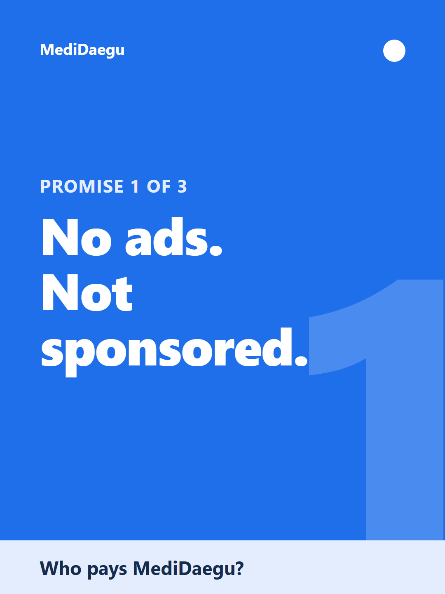
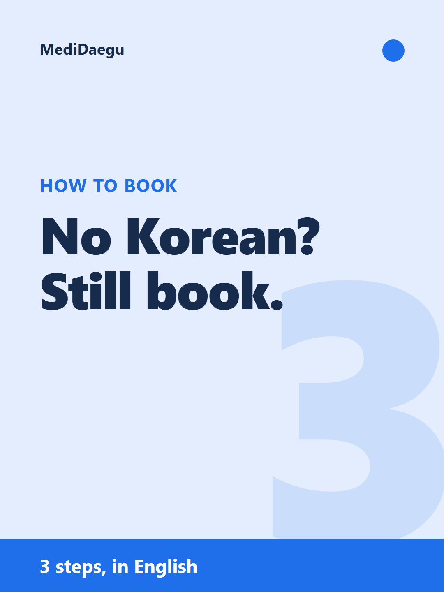
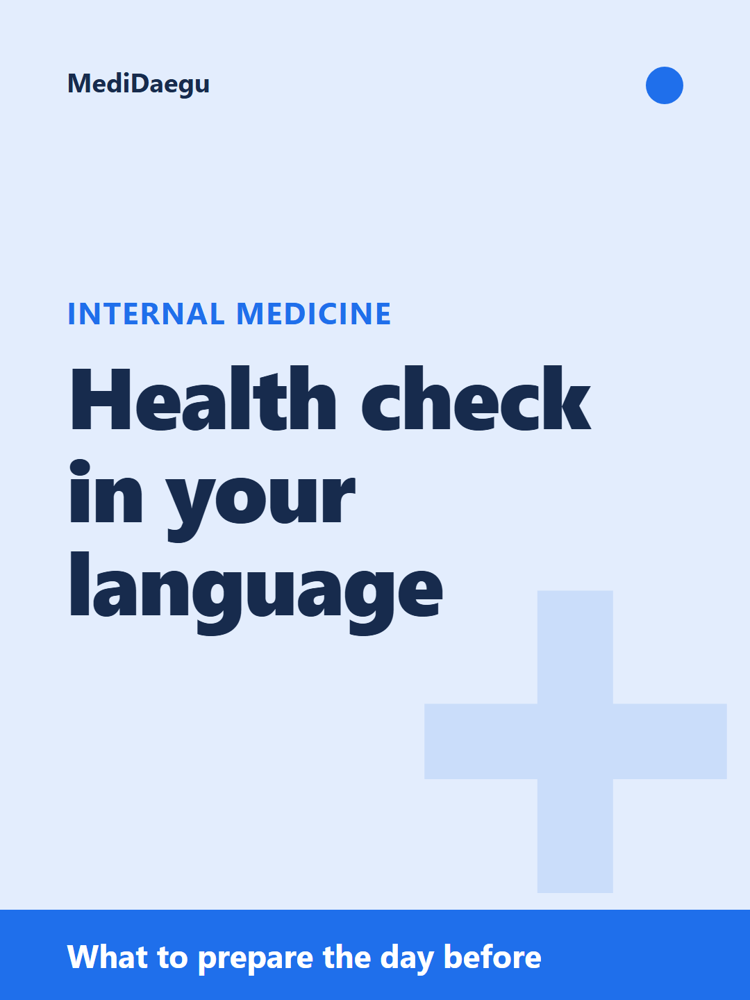

# 인스타그램 계정 구성 — MediDaegu (영어)

> 작성 2026-11-19 · 상태: **Claude 초안, 팀 논의 전** (게시 전 규제 확인은 팀원 2)
> 정한 것: 계정 이름 **MediDaegu** · 계정 언어 **영어로 통일** · 메인 컬러 메디대구 파랑 유지 · **로고 확정 (흰 M + 연하늘 점, 2026-11-19)** · **고정 게시물 3개만 파랑 썸네일, 나머지는 연하늘 바탕**
> 관련: 전체 전략 [유입마케팅-국가별-진료과별.md](유입마케팅-국가별-진료과별.md) · 대만 세부안 [유입마케팅-인스타-Dcard.md](유입마케팅-인스타-Dcard.md)

## 1. 계정 화면 (목업)


[instagram/account_mockup.png](instagram/account_mockup.png) · 1136×2140 · 로그인 전 웹 화면 기준. 팔로워·팔로잉은 새 계정이라 "—"로 둠

## 2. 프로필

### 2-1. 프로필 사진 (로고 — 확정)


| 요소 | 뜻 |
|---|---|
| 파랑 바탕 `#1f6feb` | 메디대구 웹 메인 컬러 그대로 [S1] |
| 흰 굵은 **M** | MediDaegu 첫 글자. 작은 원 안에서도 읽히는 한 글자 |
| 오른쪽 위 연하늘 **점** | 게시물 오른쪽 위 점과 같은 브랜드 점 → 프로필과 게시물이 한 세트로 보이게 |

1080×1080, 원형으로 잘려도 핀·점이 모두 안쪽에 들어오게 배치. 파일: [instagram/profile.png](instagram/profile.png)

### 2-2. 이름·소개 (영어)

| 칸 | 내용 | 글자 수 |
|---|---|---|
| 사용자 이름 | `medidaegu` (사용 가능 여부 확인 필요) | — |
| 이름 | `MediDaegu \| Daegu Clinic Guide` | 30 (제한 약 30) [S2] |
| 소개 | `Book Daegu clinics — no Korean needed`<br>`Skin · Plastic surgery · Eye · Internal med`<br>`Not sponsored · No rankings · Sources shown`<br>`Web: EN · 繁中 · 日本語 · VI` | 149 (제한 150) [S2] |
| 링크 | 메디대구 웹 주소 (주소 정해지면 넣기) | — |

한국어 뜻: 대구 병원 예약 — 한국어 몰라도 돼요 / 피부·성형·안과·내과 / 협찬 없음 · 순위 없음 · 출처 표시 / 웹: 영어·번체·일본어·베트남어

- 소개 마지막 줄의 일본어(日本語)는 **웹 일본어 화면이 배포된 뒤** 넣어요. 일본어 화면은 `frontend-ja` 브랜치로 원격에 올라갔고(2026-11-19, `frontend`로 PR 전), 로컬에서 메뉴·메인 지도가 일본어로 나오는 것까지 확인. 백엔드가 아직 일본어·엔화를 받지 않아 가입·예약은 오류(422), JPY는 원화로 표시

### 2-3. 하이라이트 (스토리 묶음 6개)

| 하이라이트 | 아이콘 | 넣을 스토리 |
|---|---|---|
| How to book | `3` | 예약 3단계 화면 녹화 |
| Prices | `₩` | 가격 범위·출처 보는 법, 통화 바꾸기 |
| Hours | `?` | 진료시간 찾는 법 |
| Clinics | `+` | 진료과 4개 소개 (피부·성형·안과·내과) |
| Safety | `✓` | 등록 유치기관 확인법 |
| FAQ | `i` | 댓글·DM 질문 모음 |

## 3. 게시물 12개 (그리드)

**형식**: 1080×1440 (프로필 그리드 3:4) · 큰 영어 제목 2~3줄 · 아래 띠에 "다음 장에서 답하는 질문" · 오른쪽 아래 큰 숫자·기호 · 각 게시물은 캐러셀(여러 장)로 이어짐

| | 고정 게시물 1~3 | 일반 게시물 4~12 |
|---|---|---|
| 디자인 | **파랑 썸네일 v2** (파랑 바탕 · 흰 글자 · 연하늘 띠) | **연하늘 바탕** · 남색 글자 · 파랑 띠·라벨·점 |
| 이유 | 프로필 맨 위에서 "3가지 약속"이 한눈에 튀게 | 같은 색 계열로 통일하되 고정 게시물과 구분 |

| # | 게시물 (영어) | 한국어 뜻 | 아래 띠 질문 | 근거 | 진료과 |
|---|---|---|---|---|---|
| 1 📌 | **PROMISE 1 OF 3** · No ads. Not sponsored. | 광고 없음, 협찬 없음 | Who pays MediDaegu? | VOC: 홍보·협찬 영상이 많아 칭찬 쪽으로 기울 수 있음 [S3] | 공통 |
| 2 📌 | **PROMISE 2 OF 3** · No rankings. No "best clinic". | 순위 없음, "최고 병원" 없음 | How are clinics listed? | 의료법 제56조 제2항 비교·과장 금지 [S4] | 공통 |
| 3 📌 | **PROMISE 3 OF 3** · Every number has a source. | 모든 숫자에 출처 | Where do prices come from? | 팀 원칙 (출처 없는 숫자 안 씀) | 공통 |
| 4 | HOW TO BOOK · No Korean? Still book. | 한국어 몰라도 예약 | 3 steps, in English | VOC: 예약 방법·채널 10건 (병원 정보 중 최다) [S3] | 공통 |
| 5 | PRICES · Check 3 things before you pay | 결제 전 3가지 확인 | Range · Source · What's included | VOC: 가격 정보 없음 16건, 묶음 권유(강도 3) [S3] | 공통 |
| 6 | CLINIC HOURS · Open late? Check first. | 늦게까지 하나? 먼저 확인 | Daily hours for each clinic | VOC: "밤 몇 시까지?" [S3] · 등록기관 진료시간 데이터 | 공통 |
| 7 | DERMATOLOGY · Book a skin clinic in Daegu | 대구 피부과 예약 | Before you go: recovery time | 대만·중국·일본 피부 비중 66~80% [S5] | 피부과 |
| 8 | PLASTIC SURGERY · 5 questions for your consult | 상담 때 물어볼 5가지 | Ask for a written estimate | 일본 성형 비중 16.3%, 대구 진료과 1위 [S5] | 성형외과 |
| 9 | EYE CLINIC · Plan your eye exam day | 안과 검사 날 일정 짜기 | Exam first, the doctor decides | 대만 질환 1위 '눈' `[추정]` [S5] | 안과 |
| 10 | INTERNAL MEDICINE · Health check in your language | 외국어로 건강검진 | What to prepare the day before | 대구 등록외국인 1위 베트남 13,321명 [S5] | 내과 |
| 11 | SAFETY · Is the clinic registered? | 등록된 병원인가? | How to check in 1 minute | 대구 등록 유치기관 161곳 데이터 [S5] | 공통 |
| 12 | AFTER YOUR VISIT · Receipts & aftercare | 영수증·사후관리 | Keep it all in one place | 서비스 기능 (진료 후 영수증·결제 금액 확인, 사후관리) | 공통 |

📌 = 프로필 맨 위 **고정 게시물 3개** ("3가지 약속" 시리즈)

<table><tr>
<td></td><td></td><td></td><td></td>
</tr></table>

파일: [instagram/posts/](instagram/posts/) (`post_01.png` ~ `post_12.png`)

### 3-1. 캡션 틀 (영어)

```
[제목 한 줄]
[2~3줄 설명 — 예약·가격·일정 정보만]

👉 Book in English (繁中 · Tiếng Việt too): link in bio
MediDaegu does not recommend specific clinics. Treatment and fees are decided by each clinic.

#Daegu #KoreaTravel #KoreaClinic #MedicalTourismKorea #DaeguTravel
```

마지막 두 줄(특정 병원 추천 안 함 · 진료와 비용은 병원이 정함)은 모든 게시물에 넣어요.

### 3-2. 올리는 순서

1. 고정 3개(1~3)를 먼저 올리고 프로필에 고정
2. 4~6 (공통 정보) → 7~10 (진료과) → 11~12 (안전·사후관리)
3. 주 3회 (게시물 2 + 릴스 1). 릴스 표지는 [thumbnails/reels_en.png](thumbnails/reels_en.png) 같은 9:16 v2 디자인

## 4. 영어 통일로 바뀌는 것

| 항목 | 전 (국가별 안) | 지금 |
|---|---|---|
| 게시물·캡션 언어 | 타깃별 5개 언어 버전 | **영어 하나** |
| 다른 언어 사용자 | 언어별 자막 영상 | 캡션에 "웹은 繁中·Tiếng Việt도 있음" 안내 → **언어 선택은 웹에서** |
| 대만 번체 콘텐츠 | 인스타 + Dcard | **Dcard에서만 번체** (인스타는 영어) |
| 베트남 | 페이스북 주 채널 | 그대로 (페이스북은 이 문서 범위 밖) |

- 영어 통일은 관리가 쉽지만, 영어가 익숙하지 않은 대만·일본·베트남 사용자에게는 덜 닿을 수 있어요 (도달 차이는 **미확인**). 게시 2주 뒤 언어권별 반응(댓글 언어, 프로필 방문)을 보고 다시 판단

## 5. 참고한 예시와 다르게 한 점

참고: 트립닥 인스타 계정 화면 (팀원 제공 스크린샷, 2026-11-19)

| | 예시 계정 | MediDaegu |
|---|---|---|
| 맨 위 고정 3개 | 정책 시리즈 ("3無 정책") | **같은 방식 차용** — "3가지 약속" 시리즈 |
| 게시물 아래 파란 띠 질문 | 있음 | **차용** — 연하늘 띠에 다음 장에서 답할 질문 |
| 배경 | 지구·우주 사진 | 사진 없이 **파랑 한 색 + 큰 숫자** (기억되는 시그니처) |
| 대상 | 병원(입점·수수료 홍보) | **환자** (예약 정보) |
| 언어 | 한국어 중심 | **영어 통일** |

## 6. 넣지 않는 것

| 하지 않음 | 이유 |
|---|---|
| 특정 병원·의사 추천, 순위, "best" | 의료법 제56조 제2항, 의료인이 아니라 의료광고 불가 (제56조 제1항) [S4] |
| 전후 사진, 환자 후기·경험담 | 제56조 제2항 제2호 [S4] |
| 할인가·이벤트가 | 제56조 제2항 제13호 유형 + 팀 원칙 [S4] |
| 병원 이름·로고가 보이는 화면 | 특정 병원 광고로 보일 수 있음 |

- 확인 필요 (팀원 2): 해외 대상 게시물이 국내에서도 보일 때 "외국인환자 유치 국내광고" 금지(제56조 제2항 제12호)와 부딪히는지

## 7. 파일

| 파일 | 내용 |
|---|---|
| [instagram/account_mockup.png](instagram/account_mockup.png) | 계정 화면 목업 |
| [instagram/profile.png](instagram/profile.png) | 프로필 사진 1080×1080 |
| [instagram/posts/](instagram/posts/) | 게시물 12개 1080×1440 |
| [instagram/src/make_instagram.py](instagram/src/make_instagram.py) | 위 파일을 만드는 생성기 (글자를 바꾼 뒤 다시 실행 → Chrome 헤드리스로 찍기) |

다시 만들기: `python -I -X utf8 instagram/src/make_instagram.py` 후 `chrome --headless=new --window-size=1080,1440 --screenshot=post_01.png instagram/src/post_01.html` (프로필 `1080,1080` · 목업 `1136,2140`)

## 출처

| 번호 | 자료 | 위치·URL | 등급 | 기준 시점 | 확인일 |
|---|---|---|---|---|---|
| S1 | 메디대구 웹 테마 색 | frontend 브랜치 `apps/web-platform/src/styles.css` | 팀 내부 | 2026-11-19 | 2026-11-19 |
| S2 | 인스타그램 이름 약 30자 · 소개 150자 제한 (공식 도움말 페이지는 못 찾음, 제3자 안내 2곳이 같은 값) | https://bitly.com/blog/instagram-character-limit/ · https://www.sendible.com/insights/instagram-character-limit | 개인·업체 블로그 (공식 미확인 → 앱에서 최종 확인) | 2026 | 2026-11-19 |
| S3 | 틱톡 3차 VOC 138건 (검수 14차 채택) | [../painpoint/voc_tiktok.md](../painpoint/voc_tiktok.md) (브랜치) | 팀 내부 | 2023-08 ~ 2026-11 | 2026-11-19 |
| S4 | 의료법 제56조 정리 (원문 https://www.law.go.kr/법령/의료법) | [../research/의료관광/규제-가격노출-의료광고.md](../research/의료관광/규제-가격노출-의료광고.md) (브랜치) | 공식 (팀 노트 경유) | 시행 2026-10-02 | 2026-11-19 |
| S5 | 타깃별 환자·진료과 비중·대구 등록외국인·등록 유치기관 — 출처 S1~S5 | [유입마케팅-국가별-진료과별.md](유입마케팅-국가별-진료과별.md) 1장 (진흥원 2025 보고서·법무부 등록외국인) · [../market/verify.md](../market/verify.md) D31 (대구 등록 유치기관 161곳, 공공데이터) (브랜치) | 통계·공식 (팀 정리) | 2025 ~ 2026-09 | 2026-11-19 |
| 참고 | 트립닥 인스타그램 계정 화면 | 팀원 제공 스크린샷 (저장소에 없음) | 개인 (경쟁사 공개 화면) | 2026-11-19 | 2026-11-19 |
