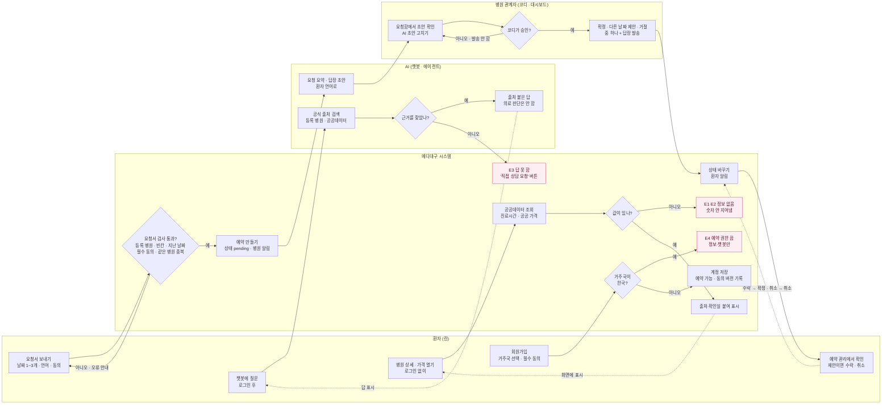

# 프로세스 플로우 — 단계마다 누가 개입하나

> 작성 2026-11-17 · 사용자 플로우([userflow.md](userflow.md))에 섞여 있던 **시스템 판단 · AI · 병원 관계자 일**을 따로 뺌 · 그림 버전: [processflow.html](processflow.html)
> **가로 = 전체 흐름 (① 찾기 → ⑥ 결과) · 세로 = 그 단계에 개입하는 층 (환자 · 메디대구 시스템 · AI · 병원 관계자)** — 맨 윗줄(환자)만 읽으면 사용자 플로우 (11/17 행·열 바꿈)
> **11/19 VOC 3차(틱톡 138건) 제안 추가** — 아래 "VOC 3차 제안" 표, 그림에서는 주황 글씨 (팀 결정 전, 근거: [../painpoint/voc_3차_반영.md](../painpoint/voc_3차_반영.md))
> 예약 상태 이름은 백엔드 `ai/agent/tools/booking_store.py` (`backend` 브랜치) `TRANSITIONS`와 같음

## 단계 × 층 (누가 개입하나)

| 층 \ 단계 | ① 찾기·비교 | ② 로그인·가입 | ③ 묻기 | ④ 예약 요청 | ⑤ 병원 처리 | ⑥ 결과 |
|---|---|---|---|---|---|---|
| **환자 (린)** = 사용자 플로우 | 메인·병원 정보·상세·가격 | 거주국 선택·동의 | 챗봇에 질문 | 요청서 보내기 | (답 기다림) | 예약 관리 확인 · 제안이면 수락/취소 |
| **메디대구 시스템** | 공공데이터 조회 → ◇값이 있나? → 출처·확인일 표시 / **E1·E2 정보 없음** | ◇거주국 한국? → **E4 예약 권한 끔** / 계정 저장 | **E3 '직접 상담 요청' 버튼** | ◇요청서 검사 → 예약 만들기(pending, 병원 알림) / 오류 안내 | — | 상태 바꾸기 · 환자 알림 |
| **AI** | — | — | 공식 출처 검색 → ◇근거? → 출처 붙은 답 | — | 요청 요약 · 답장 초안 (환자 언어) | — |
| **병원 관계자 (코디)** | — | — | — | — | 초안 확인·수정 → ◇승인? → 확정·제안·거절 + 발송 | (무응답 → expired, 기한 [U]) |

## 같은 흐름 (Mermaid)

## 예약 상태 (백엔드와 같음)

| 지금 상태 | 행동 (누가) | 다음 상태 | 환자 화면 |
|---|---|---|---|
| — | 요청서 보내기 (환자, 검사 통과) | `pending` | 요청됨 |
| `pending` | confirm (병원) | `confirmed` | 확정 |
| `pending` | reject (병원) | `rejected` | 거절 |
| `pending` | propose (병원, 제안 날짜 필수) | `proposed` | 다른 날짜 제안 |
| `proposed` | accept (환자) | `confirmed` | 확정 |
| `pending` · `proposed` | cancel (환자) | `cancelled` | 취소 |
| `pending` · `proposed` | 병원 무응답 | `expired` | 만료 — **기한 [U] 미정** (스키마에만 있고 전이 규칙 없음) |

## 판단 6개와 담당

| # | 판단 | 누가 | 아니오일 때 | 개발 영역 |
|---|---|---|---|---|
| 1 | 거주국이 한국인가 (회원가입 때, 11/13) | 시스템 | — (예면 E4 예약 권한 끔) | 백엔드 A |
| 2 | 진료시간·공공 가격 값이 있나 | 시스템 | E1·E2 "정보 없음", 숫자 안 만듦 | 백엔드 A · 프론트 |
| 3 | 챗봇이 공식 출처에서 근거를 찾았나 | AI | E3 "직접 상담 요청" 버튼 | AI |
| 4 | 요청서 검사 통과 (등록 병원 · 빈칸 · 지난 날짜 · 필수 동의 · 같은 병원 열린 요청 중복) | 시스템 | 오류 안내 → 환자가 고침 | 백엔드 A |
| 5 | 코디가 AI 초안을 승인했나 | 병원 코디 | 발송 안 함, 다시 고침 | 백엔드 B · 프론트(대시보드) |
| 6 | 확정 · 다른 날짜 제안 · 거절 중 무엇 | 병원 코디 | — | 백엔드 B |

## 지키는 규칙

- **AI는 초안만 만들고, 발송은 코디 승인 후** (BM 핵심 활동 "AI 상담 운영 (발송은 코디 승인 후)")
- 공공 자료가 없으면 숫자를 지어내지 않음 (E1·E2)
- 챗봇은 의료 판단을 하지 않고 병원 상담으로 넘김 (E3, 의료법)
- 같은 병원에 열린 요청(`pending`·`proposed`)이 있으면 새 요청을 막음 (`booking.duplicate`)
- 동의는 종류·버전을 같이 저장 (`consents: kind, version`)

## VOC 3차 제안 (11/19, 팀 결정 전)

틱톡 「한국 피부과 예약」 댓글 138건([../painpoint/voc_tiktok.md](../painpoint/voc_tiktok.md))에서 나온 목소리 → 흐름에서 바꿀 곳. **새 판단(마름모)은 늘리지 않고, 화면에 보이는 정보와 요청서 칸만 늘림**

| 단계 | 층 | 지금 | 제안 | VOC 근거 |
|---|---|---|---|---|
| ③ 묻기 (11/19 팀 결정: 요청서 칸 대신 챗봇) | AI | 공식 출처 검색 → 출처 붙은 답 | **환자가 챗봇에 체류 일정(출국일) · 받고 싶은 시술 · 미리 본 가격을 말하면, 그 진료과이고 체류 기간 안에 진료하는 등록 병원을 안내** — 요청서 칸은 늘리지 않음. 병원 검색·필터일 뿐 시술이 맞는지는 판단하지 않음, 가격은 공공 가격 범위만 (없으면 "정보 없음") | 일정: "하고 싶은데 2주 휴가를 내야 하나" (시술 후 일정이 걱정) · 가격: "병원 SNS에서 본 1회 체험가로 해 달라고 하면 되나, 가 보면 정가로 계산될까 불안" (강도 2) |
| ④ → ⑥ 기다림 | 환자 | 병원 답 기다림 | **팀 계획(11/19): 병원별 "N시간 이내 답장률 %"를 병원 정보와 상담 채팅에 표시** → 요청 전에 답이 빠른 병원을 고를 수 있음 | "일주일 전 여러 채널로 연락했는데 답이 없다, 다음 주 출국"(T10-021, 강도 2) |
| ⑤ 병원 처리 | 병원 관계자 | 확정·제안·거절 + 답장 발송 | **+ 확정 답장에 금액(단품·묶음 구분) · 소요 시간** | "홈페이지 단품은 안 해 주고 3~4개 묶음 권유, 5만 엔 가까이 — 가지 말 걸"(T17-009, 강도 3) · "시간이 얼마나 걸렸나" |
| ⑤ 무응답 | 시스템 | `expired` 기한 [U] | **위 답장률 표시로 대응** (팀 계획) — 답장률은 병원 답장 시간 기록이 있어야 계산됨 | 위 무응답 불만 |
| ⑥ 결과 | 환자 | 예약 관리 확인 | **+ 확정이면 금액 · 병원 주소** (길찾기는 안 함 — 주소는 병원 정보, 지도는 병원 상세에 이미 있음) | "예약했는데 위치를 모르겠다"(T11-001, ③) |
| ⑥ 알림 | 시스템 | 웹 알림 | **메신저 알림 검토** (일본어 LINE · 영어 WhatsApp·인스타 폼) | 예약 방법·채널 21건 (틱톡 10 · 대만·대구 5 · 인스타 6) |
| ③ 묻기 | AI | 공식 출처 검색 → 출처 붙은 답 | **챗봇이 받을 질문 추가**: 진료 마감 시간, 예약 방법 · **효과·회복 기간·소요 시간은 진료 관련이라 답하지 않고 E3 "직접 상담 요청"(병원에 묻기)으로 넘김** | "밤 몇 시까지?" · "효과·다운타임" 묶음 58건 (좋아요 714) → 병원 상담으로 |

## 확인 필요

- `expired` 기한 (병원 무응답 며칠 뒤 만료?) — 백엔드 B와 정함 (지금 계약은 "희망 날짜가 모두 지나면 expired")
- **답장률 표시 (11/19 팀 계획)**: "N시간 이내 답장률 %"의 N과 계산 기간, 답장 시간 기록(요청 시각 → 첫 답장 시각) — 백엔드 B
- 알림 채널: 웹 알림만? 이메일·LINE? (VOC "예약 방법·채널" **21건** — 대만·일본은 LINE, 영어권은 WhatsApp·인스타 폼)
