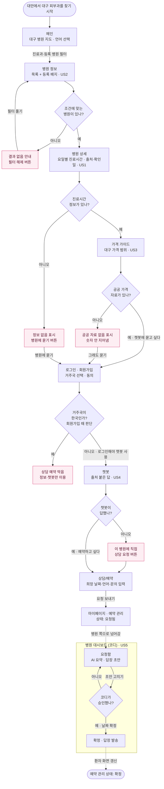

# 유저 플로우 — 린의 "병원 찾기 → 상담 예약 확정" + 코디 답장

> 작성 2026-11-12 · 입력: [scenario.md](scenario.md) US1~US5 · 화면 이름은 웹사이트 메뉴 그대로 (`apps/web-platform` ko.json `nav`) · 그림 버전: [userflow.html](userflow.html)
> 기호: 둥근 상자 = 시작·끝 · 사각 = 화면 · 마름모 = 분기 · 화살표 라벨 = 사용자 행동

## 주 경로 + 예외

## 경로 위의 유저 스토리

| 스토리 | 화면 | 예외 분기 |
|---|---|---|
| US2 등록 병원 찾기 | 메인 → 병원 정보 | E0 결과 없음 |
| US1 진료시간 확인 | 병원 상세 | E1 진료시간 정보 없음 |
| US3 가격 범위 | 가격 가이드 | E2 공공 자료 없음 |
| US4 챗봇 → 상담 예약 | 로그인·회원가입(거주국 확인) → 챗봇 → 상담/예약 → 마이페이지 | E4 국내 거주 · E3 챗봇 미답 |
| US5 코디 답장 | 병원 대시보드 요청함 → 확정 | 승인 전 발송 없음 |

- 예외 분기 **5개** (수업 기준 2개 이상)
- 목표 화면(끝): "예약 관리 상태: 확정" — 시작에서 최단 경로는 메인 → 병원 정보 → 병원 상세 → 로그인 → 챗봇 → 상담/예약 → 마이페이지 → (코디 확정)
- **챗봇은 로그인해야 쓸 수 있음** (11/12 팀 결정, 지금 코드 `/chatbot`과 같음). 메인·병원 정보·병원 상세·가격 가이드는 로그인 없이
- **한국 거주 여부는 회원가입 때 거주국으로 판단** (11/13 팀 결정) — 한국 거주면 상담 예약을 막고 정보·챗봇만
- 가격 가이드는 주 경로에서 건너뛸 수 있음 (상세 → 로그인 → 챗봇으로 바로)
