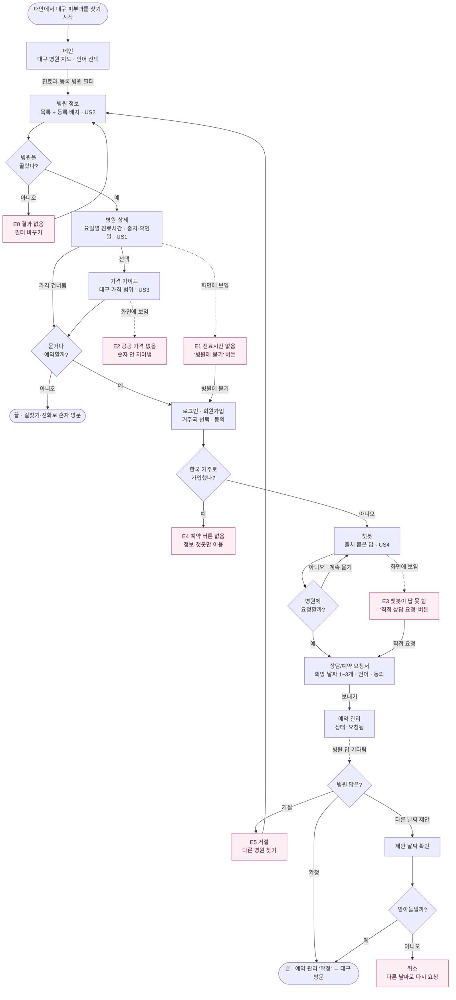

# 사용자 플로우 — 린의 "병원 찾기 → 상담 예약 확정"

> 작성 2026-11-12 · **11/17 사용자 플로우와 프로세스 플로우로 나눔** — 이 문서는 **린이 보고 고르는 것만**. 시스템·AI·병원 코디가 판단하는 것은 [processflow.md](processflow.md)
> 입력: [scenario.md](scenario.md) US1~US5 · 화면 이름은 웹사이트 메뉴 그대로 (`apps/web-platform` ko.json `nav`) · 그림 버전: [userflow.html](userflow.html)
> 기호: 둥근 상자 = 시작·끝 · 사각 = 화면 · 마름모 = **린이 정하는 것** · 분홍 = 린이 보게 되는 예외 화면 · 화살표 라벨 = 린의 행동

## 주 경로 + 예외

## 경로 위의 유저 스토리

| 스토리 | 화면 | 예외 화면 |
|---|---|---|
| US2 등록 병원 찾기 | 메인 → 병원 정보 | E0 결과 없음 |
| US1 진료시간 확인 | 병원 상세 | E1 진료시간 없음 |
| US3 가격 범위 | 가격 가이드 | E2 공공 가격 없음 |
| US4 챗봇 → 상담 예약 | 로그인·회원가입 → 챗봇 → 상담/예약 요청서 → 예약 관리 | E4 한국 거주 · E3 챗봇이 답 못 함 |
| (결과) 병원 답 받기 | 예약 관리 (확정 · 다른 날짜 제안 · 거절) | E5 거절 · 제안 거부 → 취소 |
| US5 코디 답장 | 병원 쪽 일이라 → [processflow.md](processflow.md) | 코디 승인 전 발송 없음 |

- 마름모는 모두 **린이 정하는 것** (병원 고르기 · 묻거나 예약하기 · 요청하기 · 제안 받기) + 가입 때 고른 거주국. "데이터가 있나?", "챗봇이 답했나?", "요청서 검사 통과?" 같은 **시스템 판단은 프로세스 플로우로 옮김** (11/17)
- 예외 화면 **6개 + 취소** (수업 기준 2개 이상)
- 목표 화면(끝): "예약 관리 상태: 확정". 최단 경로: 메인 → 병원 정보 → 병원 상세 → 로그인 → 챗봇 → 요청서 → 예약 관리 → (병원 확정)
- 린이 보는 예약 상태 5개: 요청됨 · 확정 · 다른 날짜 제안 · 거절 · 취소 (백엔드 상태 이름은 processflow.md)
- **챗봇은 로그인해야 쓸 수 있음** (11/12 팀 결정). 메인·병원 정보·병원 상세·가격 가이드는 로그인 없이
- **한국 거주 여부는 회원가입 때 거주국으로 판단** (11/13 팀 결정) — 한국 거주면 예약 버튼 없음, 정보·챗봇만
- **확인 필요 (VOC v3 → v4 11/19)**: "예약 방법·채널" **21건** (인스타 6 · 대만·대구 5 · **틱톡 10** — LINE·WhatsApp·인스타 폼·예약 앱·워크인이 섞임) → 요청서 화면에 "이렇게 예약돼요" 안내를 넣을지 팀 결정 (새 예외는 아님)
- **VOC 3차 제안 (11/19)**: ① 출국일·받을 시술·미리 본 가격은 **요청서가 아니라 챗봇에 말하면 맞는 병원을 안내** (11/19 팀 결정) ② 병원 정보·상담 채팅에 병원별 "N시간 이내 답장률 %" (팀 계획) ③ "확정" 화면에 금액·병원 주소 (길찾기는 안 함) → 화면만 바뀌고 린이 정하는 것(마름모)은 그대로. 자세히: [processflow.md](processflow.md) "VOC 3차 제안"
