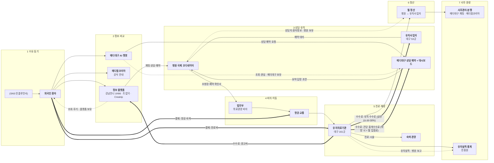

# STEP 2·3 · 밸류체인 작성 절차 + 의료관광 산업 밸류체인

> 작성 2026-11-10 · 상태: **초안** (★ 팀 확인 필요)
> 앞 단계: [step0_대상정의.md](step0_대상정의.md) · [step1_산업구조.md](step1_산업구조.md) · 기업 원페이지 `research/company/`
> 표기: [I] 해석 · [U] 미확인 · 숫자는 원문 확인분만 (금액·비율은 출처 있는 것만)
> 화살표: `-->` 서비스·활동 · `==>` 돈 · `-.->` 데이터

## STEP 2 · 작성 절차 (Day10 6단계를 메디대구에 적용)

| # | Day10 절차 | 이번 분석에서 한 일 | 산출물 · 결정 근거 |
|---|---|---|---|
| 1 | 활동 동사 추출 | STEP 0 기능 6개와 산업 흐름에서 동사 뽑기 — 알아보다·비교하다(병원) · 문의하다·예약하다 · 확정하다 · (비자) 신청하다 · 이동하다 · 진료하다 · 정산하다 · 사후 관리하다 · 요약·집계하다 | 동사 11개 → 주활동 7단계로 묶음, "요약·집계"는 지원활동(기술·데이터) |
| 2 | 단계 5개 내외로 합치기 | 산업 수준은 **7단계**(STEP 3), 메디대구 체인은 **5단계**(STEP 4)로. 돈이 바뀌지 않는 단계는 합침 | 7단계: 수요 → 정보·비교 → 상담·유치 → 비자·이동 → 진료·체류 → 정산 → 사후·환류 |
| 3 | 이해관계자 배치 | 여섯 유형(환자 / 병원 / 플랫폼·유치사업자 / 인프라·관광 / 공공·규제 / 데이터)으로 단계마다 하는 사람·(영향 주는 사람) | 실명은 STEP 1 원페이지에서 확인한 곳만. 없으면 유형명 + [U] |
| 4 | 돈·데이터 흐름 | 돈: 시작점 **환자 지출**(진료비 + 여행비) → 병원 매출에서 **광고비·유치 수수료·입점료**가 중개자로 빠짐 → 끝점 병원 순매출. 데이터: 단계마다 생성 지점·보유자 | 돈의 시작점은 하나(환자)지만, 중개자 몫은 전부 **병원이 다시 냄** = 일반 플랫폼과 다른 점 [I] |
| 5 | 마커 (세 렌즈) | STEP 4에서 병목 2 · 비용 2 · 기회 3, 우선 기회 1개 | (STEP 4) |
| 6 | AI 초안 → 사람 검증 | 일반론 단계 → 의료관광 용어로 / 이름 없는 상자 → 원페이지 실명 / 숫자 → 원문 확인분만 / 대구 맥락 / 마커 남발 점검 | 이 초안의 ★ 칸 |

## STEP 3 · 의료관광(외국인환자 유치) 산업 7단계 밸류체인

### 3-1. 표

| 층 | 1 수요·동기 | 2 정보·비교 | 3 상담·유치(예약) | 4 비자·이동 | 5 진료·체류 | 6 정산 | 7 사후·환류 |
|---|---|---|---|---|---|---|---|
| **하는 일** | 한국 진료를 결심 (가격·K-뷰티·의료 수준) | 병원·가격·후기 탐색 | 상담·견적·예약, 예약 대리 | 초청장·예약 확인서 → 의료관광 비자, 항공·입국 | 진료·시술, 통역, 숙박·관광 | 병원 ↔ 유치사업자 월 정산 | 귀국 후 관리, 분쟁, 후기, 실적 통계 |
| **주요 플레이어** | **외국인 환자**, (SNS·인플루언서), (현지 에이전시) | **강남언니 UNNI**, **트립닥**, Creatrip, **메디컬코리아**, (검색·지도) | **유치사업자**(대구 53곳), 언니가이드, Bookimed, **병원 국제 코디네이터** | **법무부**, 병원·유치업체(서류), 항공사 | **유치의료기관**(대구 161곳), 의료통역사, 숙박·관광 | **병원**, **유치사업자** | 병원, **메디컬코리아·의료분쟁조정중재원**, **진흥원(통계)** |
| **돈 ⇐** | **시작점** 환자 지출 (진료비 + 여행비) | 광고비 (병원 → 플랫폼) | 유치 수수료 (병원 → 유치사업자, 상한 15·20·30%) | 항공·비자 비용 (환자 → 항공사 등) | **끝점** 병원 진료 매출, 숙박·관광 소비 | 수수료 지급 (익월 15일까지, 완납 건) | (재방문 지출) |
| **데이터 ⇢** | 검색·관심 — SNS·검색 플랫폼 보유 | 조회·저장·후기 — 플랫폼 보유, **병원·지역에 미공유** | 상담지·환자정보 — 병원·유치사업자 보유 | 출입국·비자 — 법무부 보유 | 진료기록 — 병원 / 카드 소비 — 카드사 | 정산 내역서·수수료 청구서 — 병원·유치사업자 | 유치실적 통계 — 진흥원 → **정책 환류** |
| **메디대구** | 미포함 (수요는 분석 대상) | **AI 챗봇** (탐색·추천·가격·절차 안내) | **상담 예약 + 병원 대시보드** (요약·번역·답장 초안) | 안내만 (챗봇 RAG) | 미포함 (병원 몫) | **건당 중개수수료 받는 자리** | **사후관리 채팅 + 마이페이지**, 대시보드 집계 |

### 3-2. 지원활동 (모든 단계에 걸침)

| 층 | 내용 |
|---|---|
| **공공·규제** | 보건복지부(유치 등록·수수료 상한 고시), 진흥원(메디컬코리아·통계), 법무부(의료관광 비자), 대구시·수성구(조례·특구), 의료법(무면허 의료행위·국내광고 금지) |
| **인프라·데이터** | 심평원 공공데이터(병원·진료시간·비급여), 메디컬코리아 등록 목록, 결제·환율(한국은행), 번역·LLM, 지도 |

### 3-3. Mermaid (산업 수준)

### 3-4. 이 그림에서 보이는 것 [I]
- **메디대구는 2·3단계(정보·비교 → 상담·유치)의 연결부**에 서고, 7단계(사후)로 한 발 걸친다. 4·5단계(비자·진료)는 병원·공공 몫
- **돈은 전부 5단계(병원 매출)에서 거꾸로 빠져나간다.** 광고비(2단계), 유치 수수료(3단계), 메디대구 입점료·수수료(3단계)가 모두 병원 지갑에서 나옴 → 병원 입장에서 "어느 중개자가 환자를 데려왔는지"가 비용 판단의 핵심 = 대시보드의 역할
- **데이터는 단계마다 끊긴다.** 2단계 조회·후기는 플랫폼에, 3단계 상담지는 병원·유치사업자에, 7단계 실적은 진흥원에 → 이 끊김이 STEP 4 마커(병목·기회) 후보
- 비자(4단계)는 **3단계 예약 확인서가 있어야** 시작됨 → 상담 예약이 빨리 확정될수록 뒤 단계가 열림

## 확인 기록

| 날짜 | 칸 | 결정 |
|---|---|---|
| 2026-11-10 | STEP 3 7단계 구분 | 이대로 확정 |

## 출처

- 단계·플레이어·숫자는 [step1_산업구조.md](step1_산업구조.md) 출처표와 `research/company/` 원페이지 출처표를 따름
  - 대구 등록 병원 161곳·유치사업자 53곳: 메디컬코리아 사이트 (공식, 2026-10-30 팀원 확인)
  - 수수료 상한 15·20·30%: 외국인환자 유치 수수료율 통합 고시 제3조 (공식, 2026-11-09 팀 노트 원문 대조)
  - 정산 기한: KHIDI 「2025 외국인환자 다국어 서식집」 p.45·48–49 (공식)
- 단계 구분은 일반적 의료관광 흐름(수요 → 정보 → 상담·유치 → 비자·이동 → 진료·체류 → 정산 → 사후)을 이 과정 용어로 재구성한 개념도 [I]
