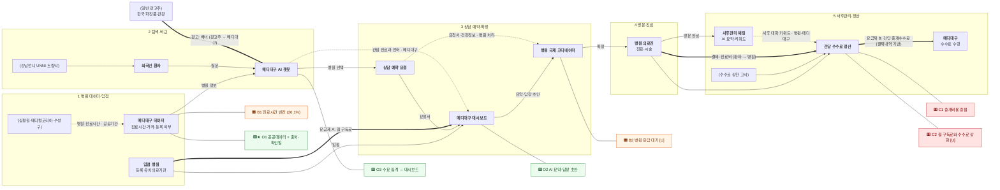

# STEP 4 · 메디대구 체인 네 층 맵 v1

> 작성 2026-11-10 · 상태: **v1 확정** (5단계 구분·우선 기회 O1)
> 앞 단계: [step2-3_산업밸류체인.md](step2-3_산업밸류체인.md) — 산업 7단계 중 메디대구가 닿는 줄기(2 정보·비교 → 3 상담·유치 → 5 진료 → 6·7 정산·사후)를 다섯 단계로 다시 자름
> 표기: **하는 사람** · (영향 주는 사람) · [I] 해석 · [U] 미확인 · 숫자는 원문 확인분만
> 마커: 🟧 병목 · 🟥 비용 · 🟩 기회 · ★ 우선 기회 (병목 2 · 비용 2 · 기회 3, 단계당 최대 2개)

## 4-1. 네 층 표

| 층 | 1 병원 데이터·입점 | 2 탐색·비교 | 3 상담 예약·확정 | 4 방문·진료 | 5 사후관리·정산 |
|---|---|---|---|---|---|
| **① 활동** | 공공데이터로 병원 정보(진료시간·가격) 정리, 등록 유치의료기관 입점 | 환자가 자기 언어로 챗봇에 묻고 병원 찾기·비교 | 상담 예약 요청 → 병원이 확인·확정·시간 제안 | 대구 방문, 진료·시술 | 방문 후 병원과 채팅(**사후관리 지원 병원만**), AI 요약·키워드, 건당 수수료 정산 |
| **② 이해관계자** | **메디대구**(데이터), **입점 병원**(등록 유치의료기관) · (심평원·메디컬코리아·수성구 데이터) · (복지부 등록제) | **외국인 환자**, **메디대구 AI 챗봇** · (강남언니 UNNI·트립닥) · (의료법 제27조 제1항: 의료 판단 금지) | **병원 국제 코디네이터**, **메디대구 대시보드**, **환자** · (개인정보보호법: 건강정보 별도 동의) | **병원 의료진**, **환자** · (의료통역사) | **병원**, **환자**, **메디대구** · (메디컬코리아·의료분쟁조정중재원) · (수수료 상한 고시) |
| **③ 돈 ⇐** | 입점 시 **요금제 선택**: A 월 구독료 (병원 → 메디대구, 매월 정액) | 환자 무료 · **광고 배너** (일반 광고주: 한국 화장품·관광 등 → 메디대구) | — | **시작점** 환자 진료비 (환자 → 병원) | 요금제 B 중개수수료 = 병원 결제내역 기준 월 경유 진료비 합계 × 지정 % (병원 → 메디대구, 상한 의원 30%·병원 20%·상급종합 15%) · 사후관리 건당 비용 (병원 → 메디대구) · **끝점** 병원 순매출 |
| **④ 데이터 ⇢** | 진료시간·가격·등록 여부 — 원천 심평원·메디컬코리아, 가공본 메디대구 보유 (출처·확인일) | 질문·조회·관심 진료과·언어 — 메디대구 보유 | 요청서·환자정보·건강정보 — 처리 주체 병원, 메디대구 수탁 | 진료기록 — 병원만 보유 (메디대구 없음) | 사후 대화·키워드 — 병원·메디대구 / 정산 내역 — 병원·메디대구 |
| **마커** | 🟧 B1 진료시간 빈칸 · 🟩★ O1 공공데이터 + 출처·확인일 | 🟩 O3 수요 데이터 → 대시보드 | 🟧 B2 병원 응답 대기 [U] · 🟩 O2 AI 요약·답장 초안 | (없음) | 🟥 C1 병원 중개비용 중첩 · 🟥 C2 월 구독료(A)와 수수료 상한 [U] |
| **⑤ 메디대구 기능** | (데이터 파이프라인), 회원가입 구분(병원) | **AI 챗봇**, 가격 위치 표시, 광고 배너 | **상담 예약**, **입점 병원 대시보드** | 미포함 | **이용 인증(영수증) → 사후관리**, **마이페이지**, 대시보드 집계 (step5 5-8) |

- 피드백: 5단계 사후 대화·키워드와 2단계 수요 데이터 → **대시보드**(병원) → 병원이 안내·응대 개선 → 1단계 병원 정보 보강

## 4-2. 마커 근거

| 마커 | 단계 | 내용 | 근거 | 등급 |
|---|---|---|---|---|
| 🟧 **B1** 병목 | 1 | 진료시간 데이터가 비어 있음 — 심평원 월요일 진료시간 채움 전체 26.1%, 피부과 21.4%, 성형외과 14.1% | [subject.md](../subject/subject.md) 필요한 데이터 표 (심평원 API 수집 2026-10-28) | 공식 |
| 🟧 **B2** 병목 | 3 | 요청 후 병원 응답 대기 — 답이 늦으면 환자가 다른 지역·플랫폼으로 이동할 수 있음 (고객 여정의 "결정적 순간 ③") | [고객층-고객여정지도.md](../research/11.09/고객층-고객여정지도.md) 3절 결정적 순간 2 | [가정] → [U], 병원·환자 인터뷰로 확인 |
| 🟥 **C1** 비용 | 5 | 병원이 여러 중개자에게 동시에 냄 — 광고비(강남언니·바비톡: 조회·클릭당) + 유치 수수료(유치업체·Bookimed: 환자당) + 월 구독료 또는 건당 수수료(메디대구). 광고비 차감이 "사실상 가입비"라는 병원 불만 보도 있음 | [병원과금-비교.md](../research/company/병원과금-비교.md) | 공식(과금 방식) + 언론 + [I] |
| 🟥 **C2** 비용 | 5 | **요금제 A 월 구독료 문제** (11/12 선택형). 정액 구독료가 유치 대가로 보아 수수료율 상한 계산에 들어가는지 모름 → 환자가 적은 달엔 상한 초과 가능. **같은 구조를 쓰는 플랫폼을 찾지 못함** — 가장 가까운 Bookimed는 입점 무료 + 환자당 수수료 | [병원과금-비교.md](../research/company/병원과금-비교.md), [step0_대상정의.md](step0_대상정의.md) 7절 T1 | [U] |
| 🟩★ **O1** 기회 | 1 | 공공데이터 진료시간·가격 + 출처·확인일 — 경쟁사 중 출처를 내세우는 곳 없음, 트립닥은 진료시간 기준이 섞인 사례 | [step1_산업구조.md](step1_산업구조.md) 1-6, [트립닥.md](../research/company/트립닥.md) | 공식 + [I] |
| 🟩 **O2** 기회 | 3 | AI 요약·번역·답장 초안(직원 승인 후 발송)으로 병원 응답을 빠르게 → B2 대기 줄이기 | plan.md 12-2 병원 쪽 요청 정리 | [I] |
| 🟩 **O3** 기회 | 2 | 질문·관심 진료과·언어 비식별 집계 → 대시보드로 "입점 효과" 증명 (건당 요금제 병원 유지 / 월 구독료 요금제 설득 근거) | STEP 1 특징 5(양면 시장·콜드스타트) | [I] |

## 4-3. 우선 기회 ★ (영향 × 실현 가능성)

| | 실현 가능성 높음 | 실현 가능성 낮음 |
|---|---|---|
| **영향 큼** | **O1 공공데이터 + 출처·확인일** — 데이터가 이미 있고(병원 4,242곳 수집), 환자가 이탈하는 "비교·결정" 단계를 직접 메움 | C2 월 구독료·상한 확인 — 질의 회신 필요 (출시 전) |
| **영향 중간** | O2 AI 요약·답장 초안 — AI 도구 일부 구현됨 / O3 대시보드 집계 — 채팅 데이터가 쌓여야 함 | B2 응답 지연 실측 — 병원 인터뷰 필요 |

- ★ **O1 확정 (2026-11-10)**. O3는 BM(구독료 요금제) 설득에 중요하지만 초기 데이터가 없어 다음 순위

## 4-4. Mermaid

- 그림에서 돈 화살표는 레이아웃 오류를 피하려고 **앞으로만** 그렸어요. 실제 방향(환자 → 병원 → 메디대구)은 라벨과 4-1 표 기준

## 4-5. Day10 품질 체크리스트

| 항목 | 상태 |
|---|---|
| 구조: 단계 5개 · 이해관계자 2개 이상 · 실명 | 충족 (실명은 원페이지 확인분) |
| 흐름: 돈 시작·끝점 · 데이터 보유자 · 피드백 | 충족 (피드백은 4-1 아래 문장, 그림에는 대시보드로 수렴) |
| 분석: 병목 2 · 비용 2 · 기회 3 · 우선 기회 1 | 충족 (우선 기회 O1 확정 2026-11-10) |
| 근거: 마커마다 출처 | 부분 — C1·O2·O3는 [I], C2·B2는 [U] |

- 2026-11-10 수정: 병원 서식 재입력·서식 자동 채움은 **메디대구 범위에서 제외** (팀 결정) → B2를 "병원 응답 대기"로 교체, O2에서 서식 자동 채움 삭제

## 확인 기록

| 날짜 | 칸 | 결정 |
|---|---|---|
| 2026-11-10 | 5단계 구분 · 우선 기회 O1 | 확정 |
| 2026-11-12 | ② 이해관계자 · ③ 돈 · 그림 | 제휴 유치업체 경로·법무부 비자 삭제 (직접 유치업자, 비자 범위 밖), 사후관리 지원 병원·건당 비용 추가 |
| 2026-11-12 | ③ 돈 · C2 · 그림 | 요금제 선택(A 월 구독료 / B 건당 수수료) 반영, C2를 구독료 문제로 교체 |
| 2026-11-12 | ③ 돈 · 그림 | 광고 배너(2단계, 일반 광고주 → 메디대구) 추가, 중개수수료 = 월 진료비 합계 × 지정 %, 사후관리 비용은 병원 부담 |

## 출처

| # | 이름 | URL / 위치 | 등급 | 기준 시점 | 확인일 |
|---|---|---|---|---|---|
| [1] | 심평원 의료기관별상세정보서비스 — 월요일 진료시간 채움 26.1%·피부과 21.4%·성형외과 14.1% (B1) | 공공데이터포털 API (URL 미기재) — subject/subject.md 필요한 데이터 표 | 공식 | 2026-10-28 수집 | 2026-10-28 |
| [2] | 심평원 대구 병원 목록 4,242곳 (O1·4-3) | data/README.md, data/정합성점검.md | 공식 | 2026-10-28 수집 | 2026-11-11 |
| [3] | 고객여정지도 결정적 순간 (B2) | `research-data` 브랜치 research/11.09/고객층-고객여정지도.md 3절 | 팀 내부 [가정] | 2026-11-09 | 2026-11-09 |
| [4] | 병원 과금 방식 비교 (C1·C2) | `main` 브랜치 research/company/병원과금-비교.md | 공식(과금 방식)·언론 | 2026-11-10 | 2026-11-10 |
| [5] | 트립닥 원페이지 (O1 비교) | `main` 브랜치 research/company/트립닥.md | 공식·언론 혼합 | 2026-11-10 | 2026-11-10 |
| [6] | 외국인환자 유치 수수료율 통합 고시 제3조 (상한) | 방향성-검토-플랫폼-샌드박스.md [5] | 공식 | 현행 | 2026-11-09 |
| [7] | 의료법 제27조 제1항 (의료 판단 금지) | https://www.law.go.kr/법령/의료법 | 공식 | 시행 2026-10-02 | 2026-10-29 |
| [8] | plan.md 12-2 병원 쪽 요청 정리 (O2) | `ai` 브랜치 subject/plan.md | 팀 내부 | 2026-11-10 | 2026-11-10 |
