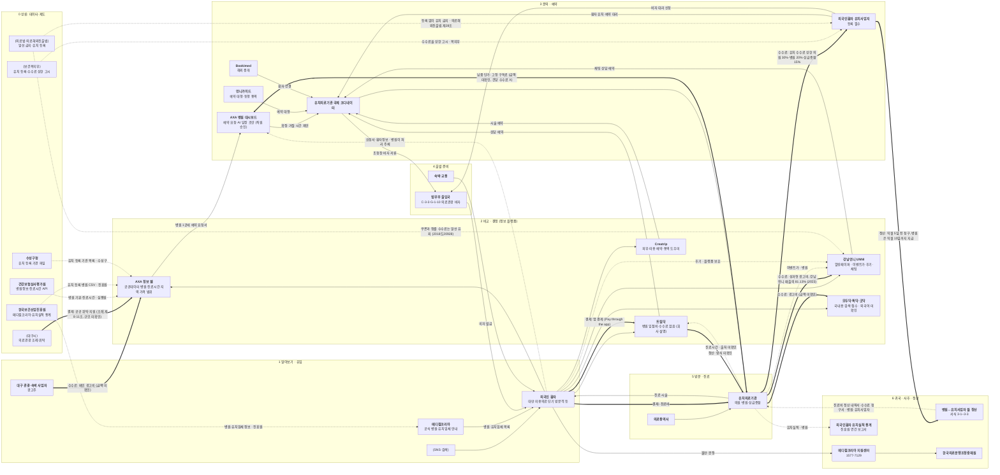
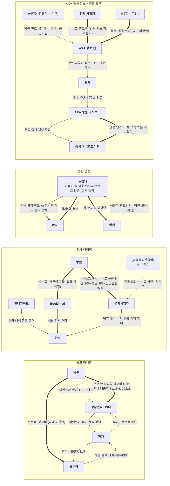

# valuechain_v0.md — 대구 외국인 의료관광 산업 밸류체인 (v0)

> 작성 2026-11-09 · 근거: `research-data` 브랜치 `research/` 노트 (onepager.md가 저장소에 없어 **research 노트로 대신**, 팀원 결정)
> 단계: [research/11.09/고객층-고객여정지도.md](../research/11.09/고객층-고객여정지도.md)의 이용자 여정 ①~⑥ + 상류(데이터·제도)
> 표기: **굵게** = 그 단계에서 일을 하는 사람 · (괄호) = 영향을 주는 사람(규제·지원·감독)
> 화살표: `-->` 상품·서비스 흐름 · `==>` 돈 흐름 · `-.->` 데이터 흐름 (라벨: 데이터 이름 · 보유자)
> 숫자: research 노트에 출처가 붙은 것만 썼어요. 출처가 없거나 확인이 안 된 금액·비율은 넣지 않았어요(라벨에 "미확인").

## 1. 전체 밸류체인

## 2. 플랫폼별 수익 구조 비교 (강남언니·모두닥 등)

누가 돈을 내느냐에 따라 플랫폼 성격이 달라져요 ([비즈니스모델-선택지.md](../research/의료관광/비즈니스모델-선택지.md) 결론).

## 3. 단계별 근거

onepager.md가 없어서 "어느 칸" 대신 **research 노트의 어느 절·표**인지 적었어요.

| 단계 | 이해관계자 | 근거 (노트 · 위치) | 쓴 숫자 · 원 출처 |
|---|---|---|---|
| ⓪ 상류: 데이터·제도 | **심평원**, **진흥원**, **수성구청**, (복지부), (대구시), (법) | [subject.md](../subject/subject.md) 필요한 데이터 표 · [정책-국가목표.md](../research/의료관광/정책-국가목표.md) §5 표(⑩·⑮·⑯), 역할 표 · [정책-대구.md](../research/의료관광/정책-대구.md) 조례 표(제8조) · [규제-병원연결-유인알선.md](../research/의료관광/규제-병원연결-유인알선.md) §1 | 숫자 없음 |
| ① 알아보기·유입 | **외국인 환자**, **관광 사업자**, **메디컬코리아**, (SNS) | [고객층-고객여정지도.md](../research/11.09/고객층-고객여정지도.md) §1-1 고객층 표(A·F), §3 ① 알아보기 칸 · [메디컬코리아-대구-비교.md](../research/의료관광/메디컬코리아-대구-비교.md) §1 | 숫자 없음 |
| ② 비교·결정 | **강남언니 UNNI**, **모두닥·똑닥·굿닥**, **트립닥**, **Creatrip**, **AXA 정보 웹** | [외국인-의료-플랫폼-조사.md](../research/의료관광/외국인-의료-플랫폼-조사.md) §2 기본 정보 표, "트립닥 직접 확인" · [규제-가격노출-의료광고.md](../research/의료관광/규제-가격노출-의료광고.md) §3-1 비교 표 | 강남언니 성과형 광고비 = 매출의 81.13% (2023) · 딜사이트 2024-07-08 (언론) |
| ③ 문의·예약 | **언니가이드**, **유치사업자**, **Bookimed**, **코디네이터**, **AXA 병원 대시보드** | [외국인-의료-플랫폼-조사.md](../research/의료관광/외국인-의료-플랫폼-조사.md) §2 표(언니가이드·Bookimed) · [규제-병원연결-유인알선.md](../research/의료관광/규제-병원연결-유인알선.md) §1 등록 요건, §3 기능별 판단 · [규제-예약에이전트-B2B.md](../research/의료관광/규제-예약에이전트-B2B.md) §2 구조 A · [고객층-고객여정지도.md](../research/11.09/고객층-고객여정지도.md) §4 구매자 D 여정 | 유치 수수료 상한 의원 30%·병원 20%·상급종합 15% · 보건복지부 2026년 시행계획 37쪽 (공식, 고시 원문은 미확인) |
| ④ 출발 준비 | **법무부 출입국**, **숙박·교통**, (병원·유치업체가 비자 대리) | [서비스-흐름-법률검토.md](../research/의료관광/서비스-흐름-법률검토.md) 단계 표 1·6단계 · [정책-국가목표.md](../research/의료관광/정책-국가목표.md) 역할 표(법무부 심사) | 숫자 없음 (비자 종류 C-3-3·G-1-10만) |
| ⑤ 방문·진료 | **유치의료기관**, **의료통역사** | [서식집-병원업무-AI자동화.md](../research/의료관광/서식집-병원업무-AI자동화.md) 업무 흐름 · [고객층-고객여정지도.md](../research/11.09/고객층-고객여정지도.md) §3 ⑤ 방문·진료 칸 | 숫자 없음 |
| ⑥ 귀국·사후·정산 | **월 정산**, **메디컬코리아 지원센터**, **의료분쟁조정중재원** | [서식집-병원업무-AI자동화.md](../research/의료관광/서식집-병원업무-AI자동화.md) ⑪ 정산·⑫ 분쟁 행 · [서비스-흐름-법률검토.md](../research/의료관광/서비스-흐름-법률검토.md) 8단계 | 정산 기한 익월 5일·15일 · KHIDI 「2025 외국인환자 다국어 서식집」 p.45·48–49 (공식) / 1577-7129 · 같은 서식집 p.55 |
| 돈 흐름 (AXA) | 관광 광고, 병원 구독, 공공 위탁 | [비즈니스모델-선택지.md](../research/의료관광/비즈니스모델-선택지.md) 선택지 표(A·C·F) · [고객층-고객여정지도.md](../research/11.09/고객층-고객여정지도.md) 한 줄 요약 | 금액 모두 미확인 |

## 4. 넣지 않은 것 · 확인할 것

- **웹 검색에서 본 숫자는 넣지 않았어요.** 모두닥 제휴 병원 수, 똑닥 유료 멤버십 요금 등은 research 노트에 없고, 원 출처(공식 자료)를 확인하지 못했어요.
  - 모두닥은 채용 공고 기준 **병원 광고가 수익원**이라 "광고비 (금액 미확인)"로만 표시했어요.
- 성과형 광고비가 알선 수수료와 법적으로 어떻게 다른지: **미확인** ([비즈니스모델-선택지.md](../research/의료관광/비즈니스모델-선택지.md) 남은 의문)
- 트립닥 결제가 병원에 어떻게 정산되는지, 진료시간 데이터 출처: **미확인**
- 모두닥·똑닥·굿닥의 외국어 지원: **미확인** (앱 직접 확인 필요)
- 메디컬코리아 대구 등록 병원 수는 노트마다 145곳(CSV, 2026-10-28)과 161곳(사이트 화면, 2026-10-30)으로 달라서 그림에 넣지 않았어요.
- **교차검증:** 81.13%는 언론 1곳(딜사이트)만 있어 독립 출처 2개 기준을 못 채웠어요. 수수료 상한은 시행계획(공식)과 서식집 인용(공식) 2곳이지만, 고시 원문은 아직 확인하지 않았어요.

## 출처

| 출처 | URL | 등급 | 기준 시점 | 확인일 |
|---|---|---|---|---|
| research 노트 (위 표에 링크한 파일, 원 출처는 각 노트 출처표) | `research-data` 브랜치 `research/` | 팀 내부 | 2026-10-28 ~ 2026-11-09 | 2026-11-09 |
| 딜사이트, 강남언니(힐링페이퍼) 수익 구조 (81.13%) | https://dealsite.co.kr/articles/124873 | 언론 | 2024-07-08 (2023년 실적) | 2026-10-29 (노트) |
| 보건복지부 2026년 외국인환자 유치 시행계획 37쪽 (수수료 상한) | https://www.mohw.go.kr/board.es?mid=a10401000000&bid=0008&act=view&list_no=1490739 | 공식 | 2026 | 2026-10-29 (노트) |
| KHIDI 「2025 외국인환자 다국어 서식집」 (정산 기한, 1577-7129) | research/의료관광/서식집-병원업무-AI자동화.md 출처표 | 공식 | 2025 | 2026-11-04 (노트) |
| 대법원 2019. 4. 25. 선고 2018도20928 | https://www.law.go.kr/LSW/precInfoP.do?precSeq=207141 | 공식 | 2019-04-25 | 2026-10-29 (노트) |
| 모두닥 채용 공고 (병원 광고 영업 = 수익원, 정성 정보만 사용) | https://www.wanted.co.kr/wd/389547 | 개인(채용 플랫폼) | 미확인 | 2026-11-09 |
| 트립닥 공식 소개 (입점비·수수료 없음) | https://tripdoc.kr/ko/about | 공식 | 조회 시점 | 2026-10-28 (노트) |
